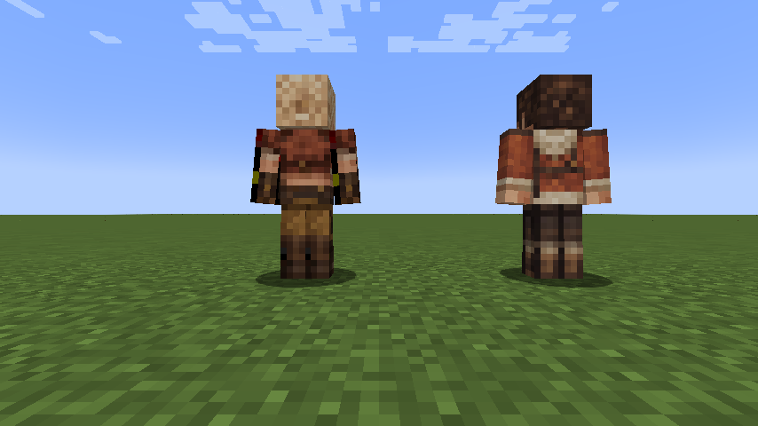

# Gemma

[Main Page](https://github.com/Bithio999/MC/wiki/Home) · [Skills](https://github.com/Bithio999/MC/wiki/Skills) · [Evolution](https://github.com/Bithio999/MC/wiki/Evolution) · [Mechanics](https://github.com/Bithio999/MC/wiki/Mechanics) · [Commands](https://github.com/Bithio999/MC/wiki/Commands)

| NPC data | Gemma |
| --- | --- |
| Origin | Monster Hunter Wilds |
| Race | [Awakened Hunter](https://github.com/Bithio999/MC/wiki/Awakened-Hunter) |
| Entity | `wildhunt:gemma` |
| System | Native Tensura Otherworlder |
| Skin | Bundled original 64×64 classic Minecraft skin |

## Character

Gemma is the expedition smith. Her skin follows the blonde hair, goggles, cropped brown jacket, cream top, utility belt and ochre work trousers of her base appearance.

## Tensura abilities

| Ability | Registry ID | Character fit |
| --- | --- | --- |
| Godly Craftsman | `tensura:godly_craftsman` | Forge and improve equipment |
| Analytical Appraisal | `tensura:analytical_appraisal` | Judge materials and weapon quality |
| All Seeing Eye | `tensura:all_seeing_eye` | Spot fine defects |
| Strengthen Body | `tensura:strengthen_body` | Handle heavy tools |
| Steel Strength | `tensura:steel_strength` | Support physical smithing work |
| Flame Manipulation | `tensura:flame_manipulation` | Control forge heat |
| Ultraspeed Regeneration | `tensura:ultraspeed_regeneration` | Recover from workshop and field injuries |

These are real Tensura abilities learned and toggled through native entity-existence data. They use Tensura's effects, passive logic and available NPC behavior. A native humanoid AI handles movement, hostility, melee and subordinate commands; a player-only UI or manual mode of a skill does not gain an invented autonomous AI here. The race also grants Hunter's Recovery as a separate racial Extra Skill.

## Spawning and otherworlder behavior

Gemma participates in Tensura's **otherworlder spawn distribution**, including its natural otherworlder replacement and summon selection. The eight regular native entries and these two hunters have equal 0.10 weights; the total remains 1. Special Shizu/Hinata rolls and the native overall spawn chance are unchanged. A datapack can override these distributions and loadouts.

Use `/summon wildhunt:gemma` or `/give @s wildhunt:gemma_spawn_egg` for a direct check. Native otherworlder ownership, inventory, home handling, interaction menus and configured Unique-skill drops are inherited. Races, skills and equipment persist through native saving; loading never reinitializes them. Their native entity data supplies 160,000 aura / 80,000 magicules before any applicable modifiers.

## Skin correction in 0.7.1

The top, side and rear head textures now use a separate opaque atlas. This removes Gemma's black patch and gives Alma a coherent swept-back hairstyle. The existing front faces, clothing and equipment pixels are preserved.

## Visual reference and skin provenance

Appearance reference: [Monster Hunter Wilds Gemma page](https://monsterhunterwilds.wiki.fextralife.com/Gemma). Common skin libraries blocked automated downloads during development, so this is an **original generated and UV-packed interpretation**, not a downloaded community skin or a ripped game texture. The character reference images are not redistributed in this repository. Source art and reproducible nearest-neighbor UV packing are in `art/` and `scripts/prepare-skins.py`.

---

**Categories:** Tensura: Wild Hunt · Otherworlders · Version 0.7.1
