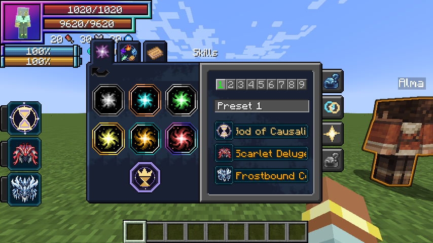
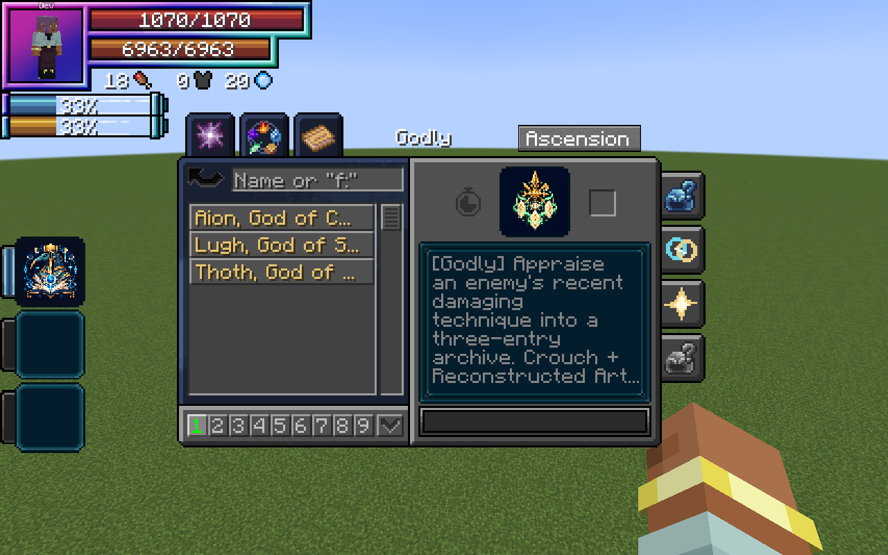
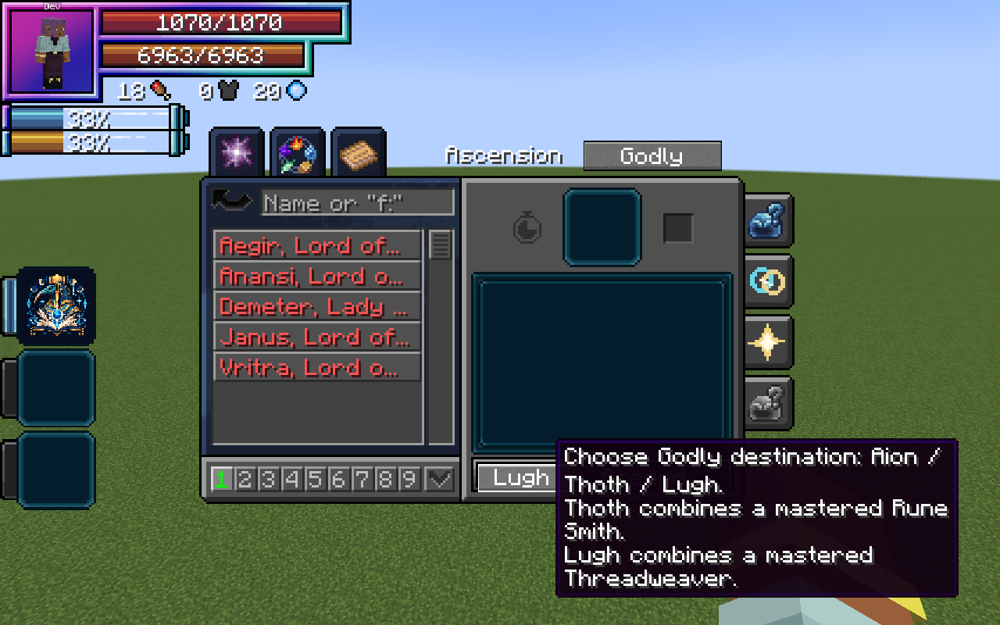

# Godly Skills

[Main Page](https://github.com/Bithio999/MC/wiki/Home) · [Skills](https://github.com/Bithio999/MC/wiki/Skills) · [Ability index](https://github.com/Bithio999/MC/wiki/Abilities) · [Damage types](https://github.com/Bithio999/MC/wiki/Damage-Types)

**Godly** is Tensura Myths’ skill tier above Ultimate. It appears as **Godly** in Tensura’s skill menu, alongside the six original categories. Its native classification remains **Ultimate** so native skill storage, combat authority, presets, toggles and commands continue to recognize it.

## Classification

| Classification | Value |
| --- | --- |
| Displayed addon tier | Godly |
| Native skill type | Ultimate |
| Native tag | `tensura:ultimate_skills` |
| Additional tag | `wildhunt:godly_skills` |
| Current skills | [Aion, God of Causality](https://github.com/Bithio999/MC/wiki/Aion); [Thoth, God of Magic](https://github.com/Bithio999/MC/wiki/Thoth); [Lugh, God of Skills](https://github.com/Bithio999/MC/wiki/Lugh) |

Godly skills appear in their own category instead of being duplicated in the ordinary Ultimate list. Other mods that only inspect the native type see an Ultimate. They do not automatically recognize the addon’s extra tier or grant it additional authority. The addon does not give Godly skills blanket immunity to other skills.

## Classification passives

Owning **any Godly skill** grants all three passives automatically. They require **no toggle, upkeep, equipped mode or mastery threshold**. Aion, Thoth, Lugh and skills classified through the `wildhunt:godly_skills` tag qualify. Owning multiple Godly skills grants each trait only once. Forgetting the last Godly skill removes the traits.

### Divine Authority

[Passive - Classification] — **Divine Authority**

| Ability information | Value |
| --- | --- |
| Damage type | Modifier — preserves the original attack's damage type |
| Damage ID | Original attack's ID |
| Damage bonus | +35% against non-Godly owners |
| Resource cost | None |

Your damage to eligible mobs and players that **do not own a Godly skill** is multiplied by **1.35**. Melee, owned projectiles, skill damage and other damage attributed to you qualify. A defender with any Godly skill is exempt, even with its skill toggle off. Multiple Godly skills never multiply the bonus again.

### Absolute Penetration

[Passive - Classification] — **Absolute Penetration**

| Ability information | Value |
| --- | --- |
| Damage type | Modifier — preserves the original attack's damage type |
| Damage ID | Original attack's ID |
| Resource cost | None |

**Your damage only** bypasses native Resistance and Nullification skill protection and native elemental/magic resistance attributes. It applies to melee, owned projectiles, skills, spells and other damage whose source identifies you as the attacker, regardless of range. It also works against Godly owners.

The target retains its learned skills, mastery, toggle settings and status immunities. Other attackers and environmental damage receive no benefit from your ownership or proximity. Armor, barriers, dodging, other skill defenses, authority and server PvP rules retain their normal behavior. Damage without an identifiable owner does not gain your traits.

### Interference Immunity

[Passive - Classification] — **Interference Immunity**

| Ability information | Value |
| --- | --- |
| Damage type | None — status immunity |
| Damage ID | — |
| Resource cost | None |

Reject Tensura's **Magic Interference** effect when its originating skill is **not Godly**. The source skill's classification decides this: an ordinary skill cast by a Godly owner remains ordinary. An effect explicitly attributed to a Godly skill can still apply through native status rules. Unattributed interference has no Godly authority and is rejected.

Learning a Godly skill also clears existing non-Godly interference on the next server tick. Godly-origin interference is preserved, including after save/load. This trait does not grant general immunity to Silence, sleep, world restrictions or resource drain; individual skills can have their own additional protections.

## Obtaining

Master one of the addon’s [five combination Ultimates](https://github.com/Bithio999/MC/wiki/Ultimate-Skills), become a True Hero or True Demon Lord and reach **12,000,000 base EP**. Open **Skills → Godly → Ascension**, select your mastered Ultimate and choose **Aion**, **Thoth** or **Lugh** with the destination button. Thoth additionally requires a mastered [Rune Smith](https://github.com/Bithio999/MC/wiki/Rune-Smith), which is combined into the result. Lugh instead combines a mastered [Threadweaver](https://github.com/Bithio999/MC/wiki/Threadweaver).

The chosen Ultimate is replaced; Thoth also replaces Rune Smith, while Lugh also replaces Threadweaver. All nine presets retain references to the evolved skill; its longest remaining cooldown carries to the new modes, except Thoth’s cooldown-free Mana Crucible. Godly ascension is separate from Duo Races and does not require a fusion. It is not a reincarnation roll, does not consume EP and grants no free magicule or aura pool.

## Controls

Open Tensura’s **Skills** categories and select **Godly**. Equip modes and toggle each skill’s own passive using the native Ability Selection interface. The three classification passives require no menu activation. The four active modes cycle with the normal Tensura controls.

The server’s `godlyEP` setting controls the default EP gate. Registry IDs are `wildhunt:aion`, `wildhunt:thoth` and `wildhunt:lugh`. Owning one does not prevent earning the others with separate valid sources.

## Gallery

---

**Categories:** Tensura Myths · Skills
