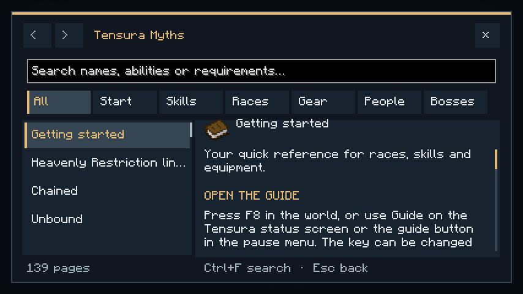

# In-game guide

> **Discontinued archive:** Tensura Myths ended at 0.36.1. No further updates are planned.

[All wikis](https://github.com/Bithio999/MC/wiki/Home) · [Tensura Myths](https://github.com/Bithio999/MC/wiki/Tensura-Myths)

Press **F8**, use the pause-menu **Myths Guide** button, or choose **Guide** below Tensura’s status panel.

- Search names, abilities, damage types or requirements; categories narrow results.
- Scroll the page list and article separately. Use arrows for history and related links for the next topic.
- **Ctrl+F:** search. **Page Up/Down:** scroll. **Esc:** back.

The guide covers this addon only and works offline. Single-player pauses while reading; multiplayer continues. Change its key in Controls.

## Pictures and video

