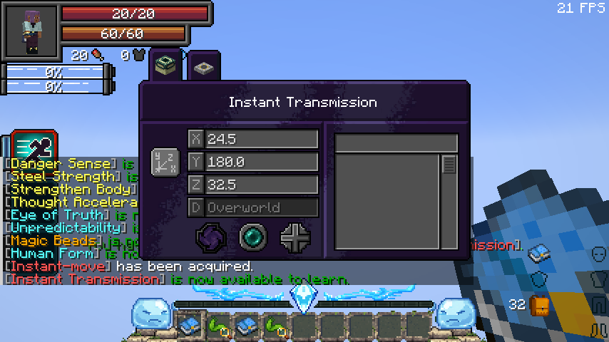

# Instant Transmission

[Main Page](https://github.com/Bithio999/MC/wiki/Home) · [Battlewills](https://github.com/Bithio999/MC/wiki/Battlewills) · [Chained](https://github.com/Bithio999/MC/wiki/Chained)

**Instant Transmission** is the Battlewill evolution of **Instant Move**. Enter **X, Y and Z** in Tensura’s native Spatial Movement screen to transmit yourself to those coordinates. Aura replaces Spatial Motion’s magicule payment; the art grants self-teleportation within your current dimension.

| Skill data | Instant Transmission |
| --- | --- |
| **Information** | |
| Classification | Battlewill |
| Registry ID | `wildhunt:instant_transmission` |
| Standalone ID | `heavenlyrestriction:instant_transmission` |
| Predecessor | Instant Move (`tensura:instant_move`) |
| Acquisition | Master the permanent predecessor; complete native learning |
| Maximum mastery | 400 |
| Active mode | Instant Transmission |
| Resource | Aura only |
| Damage type | None |
| Damage ID | None |

## Obtaining

Master a permanent, independent **Instant Move** to unlock a **learning entry** in Tensura’s normal Battlewill menu. Complete the entry’s learning to use it. Instant Move remains available; discovering the evolution does not replace your existing presets.

Players who already mastered Instant Move receive the entry on login or the next progression check. Existing progress is preserved. Temporary, detached and sub-instance copies do not unlock permanent progression. Any eligible race can learn the art, including [Chained](https://github.com/Bithio999/MC/wiki/Chained)/[Unbound](https://github.com/Bithio999/MC/wiki/Unbound) users, who receive their normal Battlewill training bonuses.

## Usage

### Instant Transmission

[Active - Press] — **Instant Transmission**

| Ability information | Value |
| --- | --- |
| Damage type | None |
| Damage ID | None |
| Normal charge | **100 ticks / 5 seconds** after coordinate confirmation |
| Mastered charge | **Instant** |
| Normal cost | **10 aura × distance in blocks** |
| Mastered cost | **5 aura × distance in blocks** |
| Distance | Straight-line three-dimensional distance from the caster at confirmation |
| Magicule cost | **0** |
| Menu-opening cost | **0** |
| Cooldown | None; one pending charge per caster |
| Targets | Caster only |
| Dimensions | Current dimension only; native spatial restrictions apply |
| Portal creation | Unavailable |

Press the art, enter the coordinates and use the native **Warp** button. The aura payment occurs once when the server accepts your confirmation. A normal cast then charges for 100 ticks with spatial particles and a countdown; mastery removes that wait and halves the price. You may move during the windup, as with Spatial Motion; the confirmed destination and quoted distance stay fixed.

For example, travelling **100 blocks** costs **1,000 aura**, or **500 aura** when mastered. A displacement of **3 blocks in X and 4 in Z** is **5 blocks**, costing **50 aura** or **25 aura** when mastered.

The native screen retains its existing coordinate/warp-point controls. The portal action is disabled and rejected by the server. No portal entity or other transported target is created.

## Restrictions

The server validates ownership, completed learning, available aura, finite coordinates, the world border and the destination dimension. Magicules cannot pay an aura shortfall. Repeating the request during a charge does not pay again or replace its destination; requesting the current position does not generate free mastery.

Spatial Blockade, native interaction/interference rules and applicable area restrictions can prevent or interrupt transmission. Death, logout, dimension changes, forgetting the art or losing valid ownership end a pending charge. The startup payment is already spent when interrupted, as with native Spatial Motion. Native spatial events can also cancel or redirect the final teleport.

## Related

[Battlewills](https://github.com/Bithio999/MC/wiki/Battlewills) · [Air Walk](https://github.com/Bithio999/MC/wiki/Air-Walk) · [Chained](https://github.com/Bithio999/MC/wiki/Chained) · [Unbound](https://github.com/Bithio999/MC/wiki/Unbound) · [Damage types](https://github.com/Bithio999/MC/wiki/Damage-Types)
