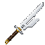

# Inverted Spear of Heaven

[Main Page](https://github.com/Bithio999/MC/wiki/Home) · [Weapons](https://github.com/Bithio999/MC/wiki/Weapons) · [Nullification](https://github.com/Bithio999/MC/wiki/Nullification)

The **Inverted Spear of Heaven** is a rare, forked blade bearing the unique **[Nullification](https://github.com/Bithio999/MC/wiki/Nullification)** engraving. It can attack spiritual entities, breaks native barriers, strips skill status effects and briefly prevents its target from activating abilities.



| Weapon data | Inverted Spear of Heaven |
| --- | --- |
| **Information** | |
| Registry ID | `wildhunt:inverted_spear_of_heaven` |
| Standalone ID | `heavenlyrestriction:inverted_spear_of_heaven` |
| Item rarity | Rare |
| Damage type | Physical |
| Melee damage ID | `minecraft:player_attack`; mobs use `minecraft:mob_attack` |
| Attack damage | **80** total with ordinary player base damage |
| Attack speed | **1.6 attacks/second** |
| Durability | **3,600** |
| Material | Hihiirokane |
| Fire resistant | Yes |
| Built-in engraving | Nullification I |
| Obtaining | **2%** independent additional reward from an ominous vault |
| Crafting recipe | None |

## Obtaining

Unlock an **ominous vault** in a trial chamber with an **ominous trial key**. Each reward generation has a **2% chance** to add one engraved spear. The roll preserves the vault's normal rewards. Ordinary vaults, ordinary trial rewards and unrelated chests do not receive it.

The item also appears in the **Combat** creative tab. The engraving initializes on native gear creation/inventory update, including stacks obtained with `/give`; vault rewards already contain it.

```mcfunction
/give @s wildhunt:inverted_spear_of_heaven
```

For the standalone addon, use `heavenlyrestriction:inverted_spear_of_heaven`.

## Combat

The default attack damage and attack speed exactly match Tensura's **Hihiirokane Sword**. Nullification does not add another damage multiplier or bypass ordinary armor and resistance by itself.

A qualifying hit:

1. Shatters the target's native **physical, magical and multilayer barriers** before barrier damage calculation. It can also destroy native barrier entities, including ranged and boss barriers.
2. Removes effects classified by Tensura as **skill effects**, plus status effects carrying a source-ability record. This removes effects rather than the target's learned skills. Ordinary unrelated potion effects remain.
3. Can attack **Spiritual Entities**, bypassing native spiritual-body physical reduction and physical-hit immunity in spiritual form.
4. Applies **Nullification** for **40 ticks / 2 seconds**, preventing skill activation. Another hit refreshes the duration. Existing cooldowns and learned mastery remain.

Nullification respects the native damage pipeline and ally/PvP targeting checks. Holding the spear does not make unrelated spells acquire its engraving.

## Spiritual entities

**Can attack Spiritual Entities.** Qualifying weapon hits bypass native spiritual-body physical reduction and physical-hit immunity in spiritual form while retaining Physical damage. Armor, resistance/nullification skills, blocking, dodge and ally/PvP checks still apply.


## Chained and Unbound

[Severance Rush](https://github.com/Bithio999/MC/wiki/Chained#severance-rush) and [Counter](https://github.com/Bithio999/MC/wiki/Unbound#counter) carry the main-hand weapon's damage, enchantment damage and native engraving hit callbacks. Wielding this spear lets their qualifying hits apply Nullification too. Their damage remains **Physical**.

Each path/arrival hit adds the weapon contribution separately. Counter uses the weapon held **when it releases**, so changing weapons during its stance changes the weapon contribution. Vanilla post-hit enchantments such as Fire Aspect and Tensura's engraving callbacks run on successful hits; native durability and enchantment conditions still apply.

Additional damage triggered by an engraving retains that engraving’s native damage type.

## Related

[Nullification engraving](https://github.com/Bithio999/MC/wiki/Nullification) · [Chained](https://github.com/Bithio999/MC/wiki/Chained) · [Unbound](https://github.com/Bithio999/MC/wiki/Unbound) · [Damage types](https://github.com/Bithio999/MC/wiki/Damage-Types)
