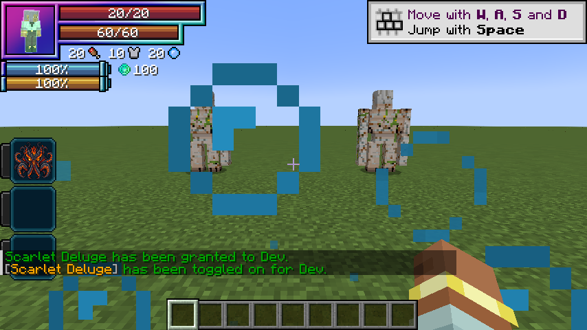
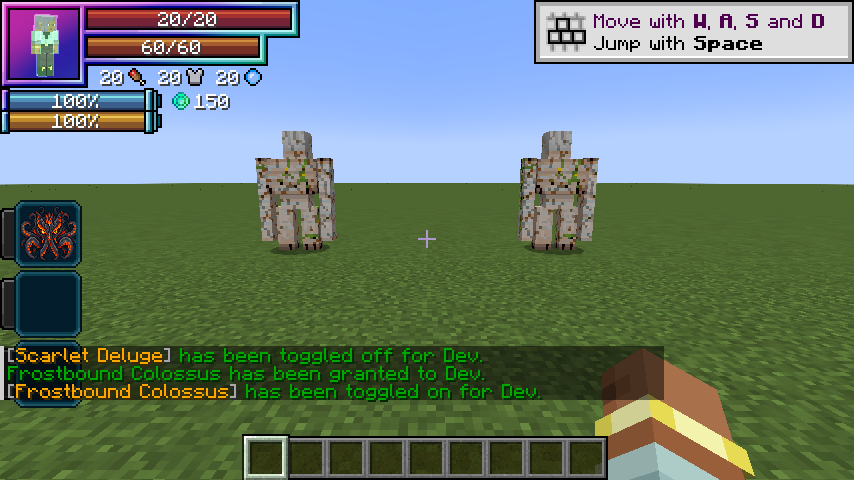
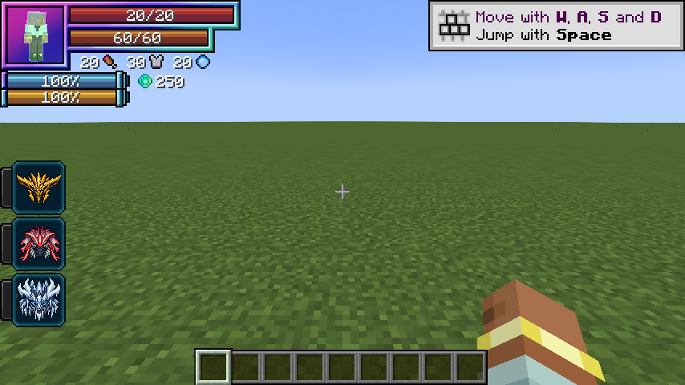

# Combat mechanics

[Main Page](https://github.com/Bithio999/MC/wiki/Home) · [Reference](https://github.com/Bithio999/MC/wiki/Mechanics) · [Ability index](https://github.com/Bithio999/MC/wiki/Abilities) · [Damage types](https://github.com/Bithio999/MC/wiki/Damage-Types)

This page explains **Tensura Myths combat mechanics**, including native barriers, skill toggles, damage modifiers, and aura consumption.

## Damage types

| Skill line | Unique / Ultimate | Native damage type |
| --- | --- | --- |
| Rey Dau | Storm Crown / Raijin | Lightning — `tensura:lightning_elemental` |
| Uth Duna | Scarlet Deluge / Varuna | Water — `tensura:water_elemental` |
| Nu Udra | Black Flame / Agni | Fire — `tensura:fire_elemental` |
| Jin Dahaad | Frostbound Colossus / Ymir | Ice — `tensura:ice_elemental` |
| Causality | Aion | Space — `tensura:space_elemental` |

Every damaging active, area pulse, signature, and Water Veil retaliation uses its line's listed element. The [ability index](https://github.com/Bithio999/MC/wiki/Abilities) records each art separately. Oil Lash deals fire elemental damage; Avalanche Crash and Glacial Prison deal ice elemental damage despite their physical-looking animations. Unique and Ultimate versions retain the same element.

Aura and magicules are skill resources, not separate damage types. These attacks use Tensura's native skill damage source, elemental boosts, resistance rules, and barriers. In Tensura 2.0.1.3's bundled damage tags, all five listed types bypass ordinary armor; that does not imply bypassing native barriers or elemental resistances. Nu Udra's ignition hits also apply the native Black Burn status, whose ticking source is `tensura:black_flame`, separate from the direct `tensura:fire_elemental` hit. See [Damage types](https://github.com/Bithio999/MC/wiki/Damage-Types#black-burn).

## Damage and mastery

The four apex lines’ damage multiplier is:

```text
0.90 × (1 + 0.5 × clamp(masteryFraction, 0, 1)) × (Ultimate ? 3 : 1)
```

**EP does not multiply damage.** A mastered Unique uses 1.35× its raw base value; a mastered Ultimate uses 4.05× the corresponding Unique raw base. The reduction also covers every area pulse, counter and signature impact. Skill-page tables already include the Ultimate’s 3× multiplier. Native Tensura elemental boosts, global combat rules, rank interactions, barriers and resistances still apply; raw values do not promise the same health damage against every enemy.

EP remains a requirement for race evolution and Ultimate ascension. Those progression gates do not increase these attacks’ raw damage.

## Aion’s damage

Aion uses space elemental damage and a **1 + 0.5 × mastery fraction** multiplier, capped at 1.5×, without the apex lines’ 0.90 reduction or Ultimate 3× base multiplier. While Unbroken Continuum is active, eligible attacks against non-Godly owners gain another 35%; the passive preserves the attack’s original damage type. Causal Reversal and the slowing aura do not deal damage. [Aion](https://github.com/Bithio999/MC/wiki/Aion) lists the individual arts and passive defense rules.

## World effects

Oil pools occupy finite world locations. Drenched is a timed water mark that supports the water/lightning interactions described on the skill pages.

## Toggleable passives

Each skill has two active modes (three for an Ultimate) plus a separate native skill toggle in Tensura’s Ability Selection.

| Line | Passive | Unique aura / second | Ultimate aura / second |
| --- | --- | ---: | ---: |
| Rey Dau | Storm Mantle | 10 | 40 |
| Uth Duna | Water Veil | 10 | 40 |
| Nu Udra | Furnace Mantle | 15 | 60 |
| Jin Dahaad | Colossus Carapace | 20 | 80 |

The first second is paid when enabling; upkeep is charged once every twenty game ticks while active. Passives stay on until disabled, unfunded or blocked by activation requirements. They do not expire after fifteen or thirty seconds. Attribute contributions use stable IDs, so refreshes cannot accumulate duplicate bonuses. Turning off or forgetting the skill removes its modifiers. Saved native toggle state is restored on login.

## Native barriers

Water Veil and Colossus Carapace contribute to Tensura’s `PHYSICAL_BARRIER` and `MAGIC_BARRIER` attributes and arm `MULTILAYER_BARRIER`, which is the attribute read by its shield HUD counter. Tensura handles their interaction with damage and renders its native barrier layer around the character. Wild Hunt adds no separate absorption-heart pool. Other skills’ barrier contributions remain separate.

| Passive | Unique capacity | Ultimate capacity |
| --- | ---: | ---: |
| Water Veil | 100 | 250 |
| Colossus Carapace | 150 | 350 |

The displayed value is native per-hit blocking capacity. Tensura charges magicules for blocked damage. Overflow, inadequate magicules and native power interactions can break the shield. A broken multilayer barrier automatically rearms at the first paid upkeep after ten seconds without a hit (normally 10–11 seconds). Hits, including fully blocked hits, restart recovery. Retoggling cannot skip this delay. The shield modifier is saved across relogs; turning off removes only this art’s contribution. Ensure Tensura’s **Barrier** HUD decoration is enabled if you have customized its HUD.

Water Veil retains water breathing and an attacker-targeted retaliation after actual health damage. Furnace Mantle retains fire protection while enabled; both utility effects stop immediately on toggle-off without leftover timed potions.

## Aiming and movement

Railbolt begins with a block-clipped aimed hit, then ricochets from the latest victim. Thunder Step follows the full aim vector, including vertical pitch, and sweeps the whole caster bounding box. Collisions, build-height limits and the world border stop it. Railbolt bounces reach twelve blocks through walls from the most recent victim. Thunder Step reaches 16/24 blocks with a 5/4 second cooldown and preserves all three components of player momentum. Undertow is placed on the crosshair ray within 24/36 blocks, using the hit surface or bounded endpoint. Water waves sweep continuous segments so targets cannot hide between movement updates. Oil Lash selects a limited forward fan and creates synced tentacle geometry. Avalanche Crash is an aimed area impact; Glacial Prison targets one enemy. Heavenfall Glacier warns fixed positions for half a second before impact.

Attacks respect teams, owned pets, creative/spectator immunity and PvP settings. They check line of sight except for Railbolt ricochets after the initial hit. Movement respects knockback resistance. Dimension changes invalidate anchored effects. Native status resistance and skill ranks can prevent Frost or Chill. No art destroys terrain or places permanent ice.

## Aura regeneration

See [Aura regeneration](https://github.com/Bithio999/MC/wiki/Aura-Regeneration) for the three race-granted Extra Skills, healing speed, aura costs, suppression and death-prevention limits. They never charge magicules. Default native EP gain stays split two thirds aura and one third magicules.

## Visual effects

Water waves render a broad curled mesh with a foam crest; Undertow renders rotating teal and coral spiral ribbons. Water and ice toggles emit no constant custom particles. Oil Lash uses a synced procedural mesh with a dark tapered body, glowing orange bands, extension and recoil, including on a miss. Ice spires, prison bars and falling ice use rendered faceted crystals. Those visual entities deal no damage by themselves, have no collision and expire automatically; server skill logic owns targeting and damage.

Tensura supplies elemental particles, shockwaves, native barrier rendering and animated magic circles. Its assets are used at runtime and are not copied into the addon.

## Barrier HUD examples





The examples show the Unique passives enabled.



The native HUD shows 250 combined capacity with both Unique barrier passives enabled (100 Water Veil + 150 Colossus Carapace); no custom bubble/frost orbit is emitted.

## Hunter vitality

Race HP bonuses are +100 / +500 / +1,000; native SHP bonuses are +400 / +3,200 / +6,600. These replace earlier hunter-stage bonuses. See [Human evolution](https://github.com/Bithio999/MC/wiki/Evolution#hp-and-shp-growth).

---

**Categories:** Tensura Myths · Reference
