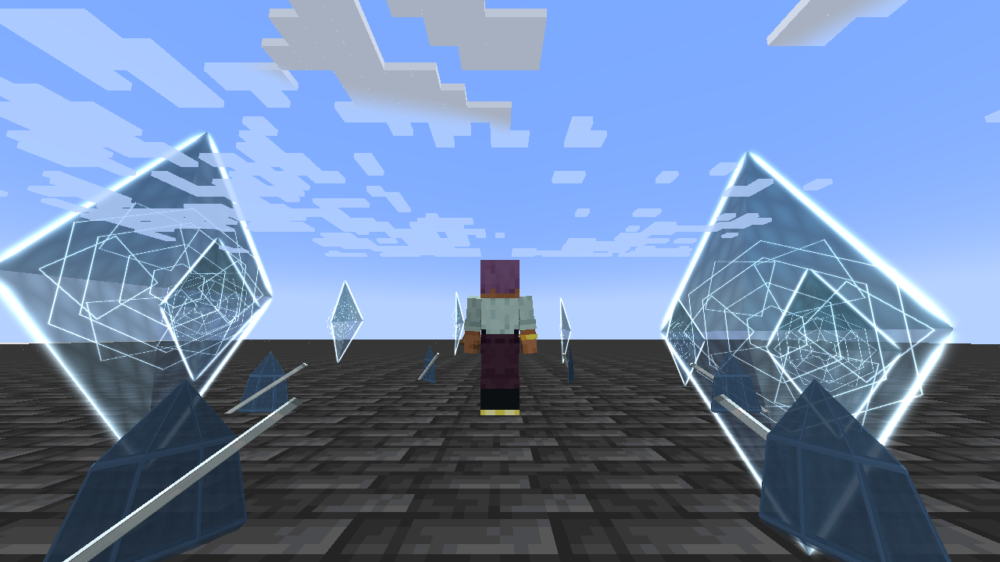

# Mirrorbound

[Main Page](https://github.com/Bithio999/MC/wiki/Home) · [Skills](https://github.com/Bithio999/MC/wiki/Skills) · [Ability index](https://github.com/Bithio999/MC/wiki/Abilities) · [Damage types](https://github.com/Bithio999/MC/wiki/Damage-Types)

**Mirrorbound** is a Unique Skill focused on **splitting light attacks and timed projectile reflection**.

| Skill data | Mirrorbound |
| --- | --- |
| **Information** | |
| Type | Unique Skill |
| Combat role | Splitting light attacks and timed projectile reflection |
| Active modes | 2 |
| Resource | Aura |
| Toggleable passive | Silvered Soul |
| Passive upkeep | 15 aura / second |
| Registry ID | `wildhunt:mirrorbound` |
| **Obtaining** | |
| Method | Reincarnation starting-skill roll |
| **Evolution** | |
| Evolution | [Synthesis](https://github.com/Bithio999/MC/wiki/Skill-Synthesis) |

## Usage

### Passive

[Passive - Toggle] — **Silvered Soul**

| Ability information | Value |
| --- | --- |
| Damage type | None — support / defense |
| Damage ID | — |
| Upkeep | 15 aura / second |

Gain 50% Light boost, 25% attack speed and 15% movement speed. Silvered Soul is an offensive mobility passive; defense comes from timing Mirror Aegis.

Elemental boosts use the [strongest ordinary source](https://github.com/Bithio999/MC/wiki/Mechanics#elemental-bonus-sources); Godly bonuses apply separately.

Enable the native skill toggle in Ability Selection. The first second is paid on enabling; upkeep is paid every twenty game ticks. It turns off when unfunded or blocked by native activation rules. Turning it off removes only its own modifiers. It is separate from active mode cycling.

### Active

| Mode | Aura | Cooldown | Raw damage |
| --- | ---: | ---: | --- |
| 1. Prismatic Lance | 280 | 3 s | 220 first hit; 130 each secondary hit |
| 2. Mirror Aegis | 600 | 10 s | — |

Damage listed here is before native combat handling and uses **1 + 0.5 × mastery fraction**, capped at **1.5×**. These new kits do not use the apex skills’ 0.90 multiplier or the former 3× Ultimate multiplier. EP never multiplies their damage. Native elemental boosts, authority, resistances, barriers and hit immunity apply.

#### Prismatic Lance

[Active - Press] — **Prismatic Lance**

| Ability information | Value |
| --- | --- |
| Damage type | Light elemental |
| Damage ID | `tensura:light_elemental` |
| Resource cost | 280 aura |
| Cooldown | 3 seconds |
| Raw damage | 220 first hit; 130 each secondary hit |

Aim a light lance up to 32 blocks. On an initial hit, split toward up to two additional enemies within eight blocks of that victim. You and the first victim must have line of sight to each secondary target. This is at most three distinct enemies; a missed initial lance has no secondary hits.

#### Mirror Aegis

[Active - Press] — **Mirror Aegis**

| Ability information | Value |
| --- | --- |
| Damage type | None — reflected projectiles retain their own attack type |
| Damage ID | — |
| Resource cost | 600 aura |
| Cooldown | 10 seconds |
| Raw damage | — |

For six seconds, orbit mirror shards around yourself. Hostile or ownerless projectiles within 3.5 blocks that are moving toward you are redirected toward their previous owner, or backward if ownerless. Ownership changes to you, so damage attribution and team checks use the defender. Own, allied and outgoing shots are left alone. This does not reflect beams, melee attacks or explosions.

## Obtaining

Roll through Tensura’s normal reincarnation pool alongside the other seven Myths Uniques and configured native candidates. The roll is random; no particular skill is guaranteed. There is no race, trial or boss-kill requirement to roll.

## Evolution

Combine with mastered Threadweaver for [Janus](https://github.com/Bithio999/MC/wiki/Janus), or with mastered Scarlet Deluge for [Aegir](https://github.com/Bithio999/MC/wiki/Aegir), through synthesis at 2M base EP.

## Suggested combo

Use Prismatic Lance to pressure a formation → activate Mirror Aegis during incoming missile fire.

## Strengths and limitations

Reflection has a six-second window and a ten-second cooldown. The original projectile determines its resulting damage type and power.

Attacks respect teams, owned pets, creative/spectator immunity and server PvP settings. Native status resistances apply. World effects are bounded, expire automatically and do not damage terrain. Anchored effects do not persist across death, relog or dimension changes.

## Related pages

[Skills](https://github.com/Bithio999/MC/wiki/Skills) · [Skill synthesis](https://github.com/Bithio999/MC/wiki/Skill-Synthesis) · [Damage types](https://github.com/Bithio999/MC/wiki/Damage-Types) · [Mechanics](https://github.com/Bithio999/MC/wiki/Mechanics)

## Visual effects

Prismatic Lance has a white core, three refracted color strands and etched optical collars. Mirror Aegis uses independently orbiting faceted glass panels, luminous edges and inset mirror inscriptions. The formation follows the caster smoothly between server updates.

[Visual effects gallery and display settings](https://github.com/Bithio999/MC/wiki/Visual-Effects).

---

**Categories:** Tensura Myths · Skills
