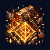
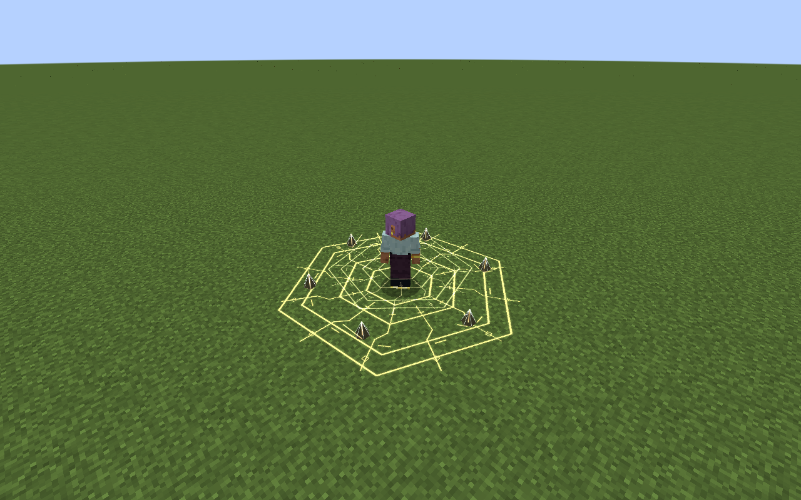

# Rune Smith

[Main Page](https://github.com/Bithio999/MC/wiki/Home) · [Skills](https://github.com/Bithio999/MC/wiki/Skills) · [Ability index](https://github.com/Bithio999/MC/wiki/Abilities) · [Damage types](https://github.com/Bithio999/MC/wiki/Damage-Types)

**Rune Smith** is a Unique Skill focused on **armed proximity trap and remote demolition**.

| Skill data | Rune Smith |
| --- | --- |
| **Information** | |
| Type | Unique Skill |
| Combat role | Armed proximity trap and remote demolition |
| Active modes | 2 |
| Resource | Aura |
| Toggleable passive | Runic Circuit |
| Passive upkeep | 20 aura / second |
| Registry ID | `wildhunt:rune_smith` |
| **Obtaining** | |
| Method | Reincarnation starting-skill roll |
| **Evolution** | |
| Evolution | [Synthesis](https://github.com/Bithio999/MC/wiki/Skill-Synthesis) |

## Usage

### Passive

[Passive - Toggle] — **Runic Circuit**

| Ability information | Value |
| --- | --- |
| Damage type | None — support / defense |
| Damage ID | — |
| Upkeep | 20 aura / second |

Gain 30% Earth, Flame and Lightning boost through native attributes. No passive stacks are accumulated.

Elemental boosts use the [strongest ordinary source](https://github.com/Bithio999/MC/wiki/Mechanics#elemental-bonus-sources); Godly bonuses apply separately.

Enable the native skill toggle in Ability Selection. The first second is paid on enabling; upkeep is paid every twenty game ticks. It turns off when unfunded or blocked by native activation rules. Turning it off removes only its own modifiers. It is separate from active mode cycling.

### Active

| Mode | Aura | Cooldown | Raw damage |
| --- | ---: | ---: | --- |
| 1. Runic Mine | 350 | 6 s | 280 on trigger |
| 2. Command Detonation | 400 | 4 s | 420 |

Damage listed here is before native combat handling and uses **1 + 0.5 × mastery fraction**, capped at **1.5×**. These new kits do not use the apex skills’ 0.90 multiplier or the former 3× Ultimate multiplier. EP never multiplies their damage. Native elemental boosts, authority, resistances, barriers and hit immunity apply.

#### Runic Mine

[Active - Press] — **Runic Mine**

| Ability information | Value |
| --- | --- |
| Damage type | Earth elemental |
| Damage ID | `tensura:earth_elemental` |
| Resource cost | 350 aura |
| Cooldown | 6 seconds |
| Raw damage | 280 on trigger |

Place one rune at your crosshair within 28 blocks, using a visible target or bounded surface/endpoint. It arms after one second and lasts fifteen seconds. An eligible enemy entering its three-block radius triggers one Earth blast against up to eight enemies. Placing another rune replaces the previous one. The mine checks your line of sight to victims and does not edit terrain.

#### Command Detonation

[Active - Press] — **Command Detonation**

| Ability information | Value |
| --- | --- |
| Damage type | Earth elemental |
| Damage ID | `tensura:earth_elemental` |
| Resource cost | 400 aura |
| Cooldown | 4 seconds |
| Raw damage | 420 |

Detonate your existing rune within 48 blocks, expanding its blast radius to six blocks and raising its raw damage to 420. You can detonate before proximity arming completes. No live rune means no resource charge, mastery or cooldown.

## Obtaining

Roll through Tensura’s normal reincarnation pool alongside the other seven Myths Uniques and configured native candidates. The roll is random; no particular skill is guaranteed. There is no race, trial or boss-kill requirement to roll.

## Evolution

Combine with mastered Threadweaver for [Anansi](https://github.com/Bithio999/MC/wiki/Anansi) through synthesis at 2M base EP. A mastered Rune Smith is also the additional ingredient for [Thoth](https://github.com/Bithio999/MC/wiki/Thoth).

## Suggested combo

Place a rune at a choke point → wait for proximity activation or manually detonate early to cover a wider group.

## Strengths and limitations

Only one live rune is retained. A consumed rune cannot trigger again. Command Detonation costs its own aura in addition to the original inscription.

Attacks respect teams, owned pets, creative/spectator immunity and server PvP settings. Native status resistances apply. World effects are bounded, expire automatically and do not damage terrain. Anchored effects do not persist across death, relog or dimension changes.

## Related pages

[Skills](https://github.com/Bithio999/MC/wiki/Skills) · [Skill synthesis](https://github.com/Bithio999/MC/wiki/Skill-Synthesis) · [Damage types](https://github.com/Bithio999/MC/wiki/Damage-Types) · [Mechanics](https://github.com/Bithio999/MC/wiki/Mechanics)

## Visual effects

Runic Mine assembles two counter-rotating circuit inscriptions and six rising rune tablets. Command Detonation releases an expanding circuit front and luminous earth pillars. The armed mine has a stable footprint rather than a continuous shower of server particles.

[Visual effects gallery and display settings](https://github.com/Bithio999/MC/wiki/Visual-Effects).

---

**Categories:** Tensura Myths · Skills
