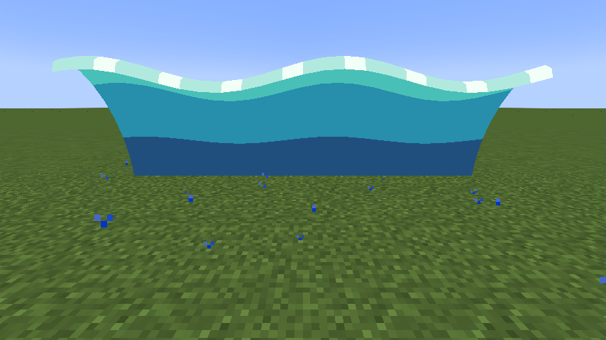
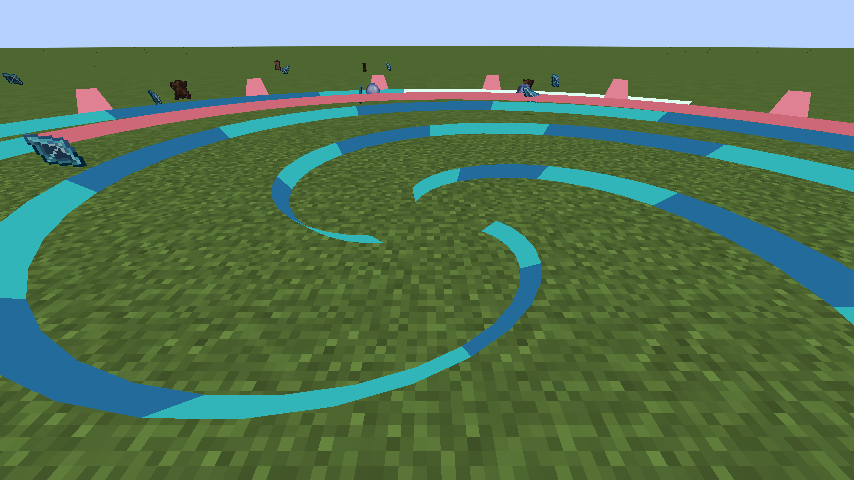

# Scarlet Deluge

> **Discontinued archive:** Tensura Myths ended at 0.36.1. No further updates are planned.

[All wikis](https://github.com/Bithio999/MC/wiki/Home) · [Tensura Myths](https://github.com/Bithio999/MC/wiki/Tensura-Myths)

Scarlet Deluge is a Unique Skill inspired by Uth Duna. It combines travelling currents, aimed whirlpools, and native barriers.

| Skill data | Value |
| --- | --- |
| Tier | Unique |
| Damage type | Water elemental |
| Passive upkeep | 30 aura / second |
| Obtaining | Reincarnation / starting skill roll |

## Active abilities

| Ability | Damage type / base damage | Cost | Cooldown |
| --- | --- | --- | --- |
| Crushing Current | Water elemental · 250 | 500 aura | 3 s |
| Scarlet Undertow | Water elemental · 100 | 1,200 aura | 6 s |

## Passive

- Damage type: Water elemental
- Effect: Retaliation deals water elemental damage; the barrier itself deals none.
- While toggled on, gain 10 armor, 18 physical barrier, 18 magic barrier and 50% water boost. These native attributes participate in Tensura’s damage handling and visible barrier layer.

## Crushing Current

Damage type: Water elemental

It carries and drenches each enemy it reaches, damaging a given entity at most once per wave. Its front is 4 blocks wide on either side.

## Scarlet Undertow

Damage type: Water elemental

Place a six-second whirlpool at the aim point, up to 24 blocks away along the crosshair ray. The radius is 9 blocks.

## Related

[Skill synthesis](https://github.com/Bithio999/MC/wiki/Skill-Synthesis) · [Godly Skills](https://github.com/Bithio999/MC/wiki/Godly)

## Pictures and video

