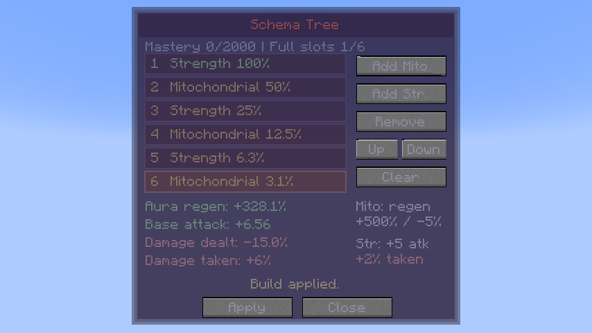
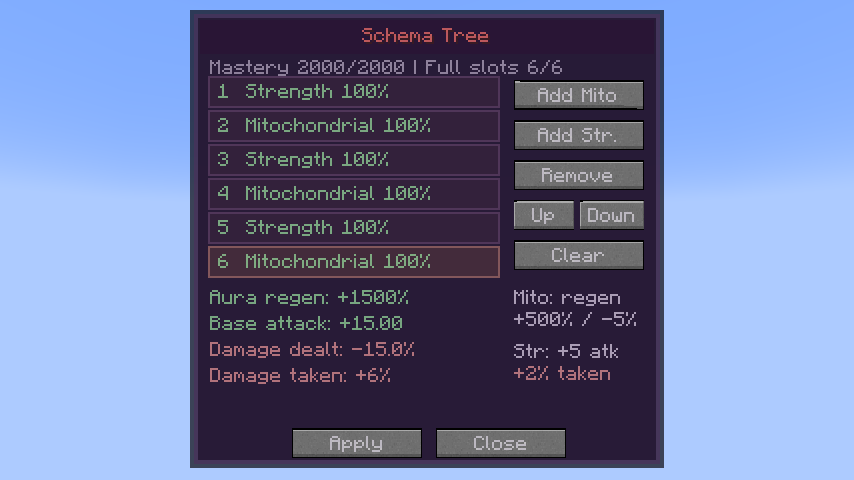

# Schema

[Main Page](https://github.com/Bithio999/MC/wiki/Home) · [Battlewills](https://github.com/Bithio999/MC/wiki/Battlewills) · [Chained](https://github.com/Bithio999/MC/wiki/Chained)

**Schema** is a Battlewill inspired by the Schema system from *Infinite Mage*. Organize biological effects into a six-slot **Schema Tree**, then toggle the art to activate the saved build. Choose **Mitochondrial Build** for aura regeneration or **Strength Build** for base attack damage. Mix them to balance their benefits and drawbacks.

| Skill data | Schema |
| --- | --- |
| **Information** | |
| Classification | Battlewill |
| Registry ID | `wildhunt:schema` |
| Standalone ID | `heavenlyrestriction:schema` |
| Learning points | **1,000** |
| Maximum mastery | **2,000** |
| Acquisition | Available for native learning; no predecessor or race prerequisite |
| Active mode | Build |
| Passive | Toggle — activate the saved tree |
| Maximum effects | Six, with repeated effects allowed |
| Activation / upkeep cost | None |
| Damage type | None directly |
| Damage ID | None |

## Obtaining

Schema appears as a learning entry in Tensura’s Battlewill menu on login or the next discovery tick. Complete **1,000 learning points** to use it. Existing Mitochondrial trees keep their saved order after updating and automatically use the reduced 5% drawback. Existing learning, mastery and builds are retained; there is no race or awakening gate. Chained/Unbound users may learn it as a Battlewill.

## Usage

### Schema Tree

[Passive - Toggle]

| Ability information | Value |
| --- | --- |
| Damage type | None |
| Damage ID | None |
| Effect | Activate every effect in the saved tree |
| Costs | None |

Toggle Schema with Tensura’s normal passive control. Both bonuses and drawbacks apply while it is enabled, including while resting. Turning it off removes both. The saved build remains available for the next activation. Forgetting Schema removes its own regeneration and attack modifiers.

### Build

[Active - Press] — **Build**

| Ability information | Value |
| --- | --- |
| Damage type | None |
| Damage ID | None |
| Capacity | Six ordered effects |
| Costs | None |
| Save | Apply |

Press **Build** to open the Schema Tree. Select a slot and use **Add Mito**, **Add Str.**, **Remove**, **Up**, **Down**, or **Clear** to organize the draft. **Apply** saves it on the server and updates an active passive immediately. **Close** discards unapplied edits. Builds persist with the learned skill.

The menu previews each effect’s positive effectiveness, aura regeneration, base attack damage, outgoing-damage reduction and incoming-damage increase. Empty slots do not bypass diminishing returns. Both effects share the same six-slot sequence: placing Strength first makes a following Mitochondrial effect receive the second slot’s weight.

## Stacking and mastery

At zero mastery, the six positive-effect weights are **100%, 50%, 25%, 12.5%, 6.25%, 3.125%**. Each additional full-strength slot moves the start of this diminishing sequence one position later. Drawbacks always apply at their full amount.

| Mastery | Full-strength slots |
| --- | --- |
| 0–399 | 1 |
| 400–799 | 2 |
| 800–1,199 | 3 |
| 1,200–1,599 | 4 |
| 1,600–1,999 | 5 |
| 2,000 | All 6 |

Mastery is gained while an enabled, populated build actually restores aura, or when you land a damaging hit with Strength Build active, at most once per second through the normal mastery-point system. Opening the menu, saving, toggling and sitting idle at full aura do not grant free mastery. Native aptitude and Chained/Unbound Battlewill training bonuses apply.

## Schema Tree effects

### Mitochondrial Build

**+500% aura regeneration; −5% all outgoing damage per stack.**

Positive weights apply to the regeneration bonus. The damage penalty adds **5 percentage points per stack**, with no mastery discount. It scales the complete ordinary outgoing hit, including flat effect bonuses, and native direct spiritual damage. Attack damage attributes are not multiplied separately, avoiding a second penalty on weapon-derived attacks.

| Build | Aura regeneration bonus | Total regeneration rate | Outgoing damage |
| --- | --- | --- | --- |
| One stack | +500% | 6× baseline | 95% |
| Six stacks, zero mastery | +984.375% | 10.84375× baseline | 70% |
| Six stacks, full mastery | +3,000% | 31× baseline | 70% |

These are baseline values before other Battlewill bonuses. Chained/Unbound’s enabled buff-effectiveness bonus boosts the **positive bonus once** and leaves the damage penalty alone. The preview includes that bonus. Native aura recovery, sleep recovery and Chained’s converted magicule regeneration benefit; Chained still retains only its normal flat magicule recovery. Aura remains capped at maximum, and effects that pause native regeneration still prevent recovery.

### Strength Build

**+5 base attack damage; +2% damage taken per stack.**

Positive slot weights apply to the flat attack bonus. It adds to the native attack-damage attribute, including while holding a weapon, so weapon-derived attacks use the improved stat. It does not add a separate flat bonus to unrelated fixed-damage spells. Other attack modifiers still apply normally.

The incoming-damage drawback adds **2 percentage points per stack**, unaffected by mastery or Chained/Unbound’s buff multiplier. It applies to ordinary melee, projectiles, magic, environmental damage and native direct spiritual damage. It does not remove armor, resistances or other defenses. Turning Schema off, removing Strength from the saved build or forgetting the art removes its bonus and drawback.

| Build | Base attack damage bonus | Damage taken |
| --- | --- | --- |
| One stack | +5 | 102% |
| Six stacks, zero mastery | +9.84375 | 112% |
| Six stacks, full mastery | +30 | 112% |

These are baseline values before Chained/Unbound’s positive-buff bonus. Each Strength stack occupies one of the six shared slots. At zero mastery, alternating Strength/Mitochondrial in slots 1–6 gives **+6.5625 base attack**, **+328.125% aura regeneration**, **−15% damage dealt** and **+6% damage taken**. At full mastery the same build gives **+15 base attack** and **+1,500% regeneration**, with the same drawbacks.

## Related

[Battlewills](https://github.com/Bithio999/MC/wiki/Battlewills) · [Air Walk](https://github.com/Bithio999/MC/wiki/Air-Walk) · [Instant Transmission](https://github.com/Bithio999/MC/wiki/Instant-Transmission) · [Chained](https://github.com/Bithio999/MC/wiki/Chained) · [Unbound](https://github.com/Bithio999/MC/wiki/Unbound)
