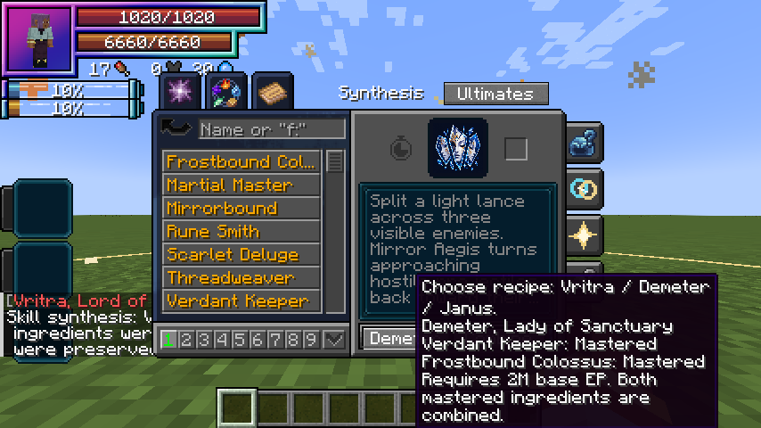

# Skill synthesis

[Main Page](https://github.com/Bithio999/MC/wiki/Home) · [Skills](https://github.com/Bithio999/MC/wiki/Skills) · [Ability index](https://github.com/Bithio999/MC/wiki/Abilities) · [Damage types](https://github.com/Bithio999/MC/wiki/Damage-Types)

**Skill synthesis** combines two mastered Unique Skills into one new Ultimate. It is available to any race at **2,000,000 base EP**.

## Recipes

| Ultimate | Mastered ingredient 1 | Mastered ingredient 2 | Role |
| --- | --- | --- | --- |
| [Vritra](https://github.com/Bithio999/MC/wiki/Vritra) | [Storm Crown](https://github.com/Bithio999/MC/wiki/Storm-Crown) | [Black Flame](https://github.com/Bithio999/MC/wiki/Black-Flame) | Plasma / delayed demolition |
| [Demeter](https://github.com/Bithio999/MC/wiki/Demeter) | [Verdant Keeper](https://github.com/Bithio999/MC/wiki/Verdant-Keeper) | [Frostbound Colossus](https://github.com/Bithio999/MC/wiki/Frostbound-Colossus) | Allied support / crystal control |
| [Janus](https://github.com/Bithio999/MC/wiki/Janus) | [Threadweaver](https://github.com/Bithio999/MC/wiki/Threadweaver) | [Mirrorbound](https://github.com/Bithio999/MC/wiki/Mirrorbound) | Gates / spatial displacement |

## Using the menu

Open **Skills → Ultimate**, then choose **Synthesis** at the top of the native skill page. The native list still shows your learned Uniques and their details. The footer’s recipe button cycles **Vritra → Demeter → Janus**; hover it or **Combine** to see both ingredients and their mastery states. Combine becomes available when all requirements are met. Use **Ultimates** to return to the ordinary native Ultimate list.

The server checks the complete recipe and EP requirement. An invalid request consumes nothing. A successful synthesis combines both ingredients, preserves all nine equipped presets and carries the longest remaining ingredient cooldown to every new mode. The new Ultimate starts with its own mastery. EP is a threshold and is not spent. A different mastered skill is not a substitute for a required ingredient. Unrelated skills stay learned.

## Further evolution

Master the resulting Ultimate, become a True Hero or True Demon Lord and reach 12M base EP. **Skills → Godly → Ascension** offers [Aion](https://github.com/Bithio999/MC/wiki/Aion), or [Thoth](https://github.com/Bithio999/MC/wiki/Thoth) when a mastered [Rune Smith](https://github.com/Bithio999/MC/wiki/Rune-Smith) is also available. The Godly destination button cycles between the two.

## Standalone Uniques

[Scarlet Deluge](https://github.com/Bithio999/MC/wiki/Scarlet-Deluge) remains an independent water and barrier kit. [Rune Smith](https://github.com/Bithio999/MC/wiki/Rune-Smith) is the additional ingredient for Thoth. Not every Unique needs an Ultimate recipe.

## Gallery

---

**Categories:** Tensura Myths · Skills
