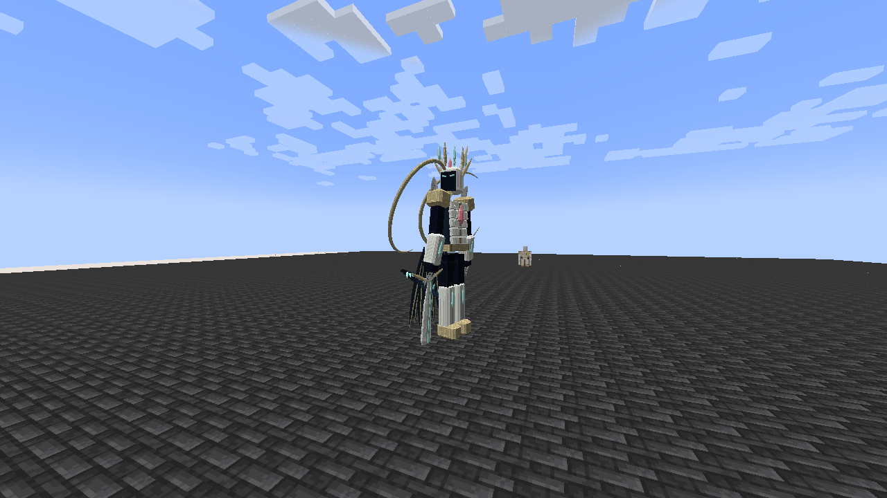

# Tensura Myths

> **Discontinued archive:** Tensura Myths ended at 0.36.1. No further updates are planned.

[All wikis](https://github.com/Bithio999/MC/wiki/Home) · [Tensura Myths](https://github.com/Bithio999/MC/wiki/Tensura-Myths)

Progression, skill combinations and Myth bosses for **Tensura: Reincarnated**. Final archived release: **0.36.1** · Minecraft **1.21.1** · NeoForge.

| Explore | Pages |
| --- | --- |
| Start | [Install](https://github.com/Bithio999/MC/wiki/Getting-Started) · [In-game guide](https://github.com/Bithio999/MC/wiki/In-Game-Guide) |
| Skills | [Unique](https://github.com/Bithio999/MC/wiki/Unique-Skills) · [Ultimate](https://github.com/Bithio999/MC/wiki/Ultimate-Skills) · [Godly](https://github.com/Bithio999/MC/wiki/Godly) · [All abilities](https://github.com/Bithio999/MC/wiki/Abilities) |
| Battlewills | [Schema](https://github.com/Bithio999/MC/wiki/Schema) · [Air Walk](https://github.com/Bithio999/MC/wiki/Air-Walk) · [Instant Transmission](https://github.com/Bithio999/MC/wiki/Instant-Transmission) |
| Races | [Hunters](https://github.com/Bithio999/MC/wiki/Evolution) · [Heavenly Restriction](https://github.com/Bithio999/MC/wiki/Fettered-Human) · [Secondary races](https://github.com/Bithio999/MC/wiki/Duo-Races) · [Awakening](https://github.com/Bithio999/MC/wiki/Convergent-Awakening) |
| Encounters | [Ananke](https://github.com/Bithio999/MC/wiki/Ananke) · [Eschaton](https://github.com/Bithio999/MC/wiki/Eschaton) · [Alma and Gemma](https://github.com/Bithio999/MC/wiki/Otherworlders) |
| Gear | [Inverted Spear of Heaven](https://github.com/Bithio999/MC/wiki/Inverted-Spear-of-Heaven) · [Nullification](https://github.com/Bithio999/MC/wiki/Nullification) |

[Download Myths 0.36.1](https://github.com/Bithio999/MC/raw/refs/heads/main/releases/tensura-myths-0.36.1.jar). Install this addon or TensuraAdditionalAdditions; do not install both in the same instance.

