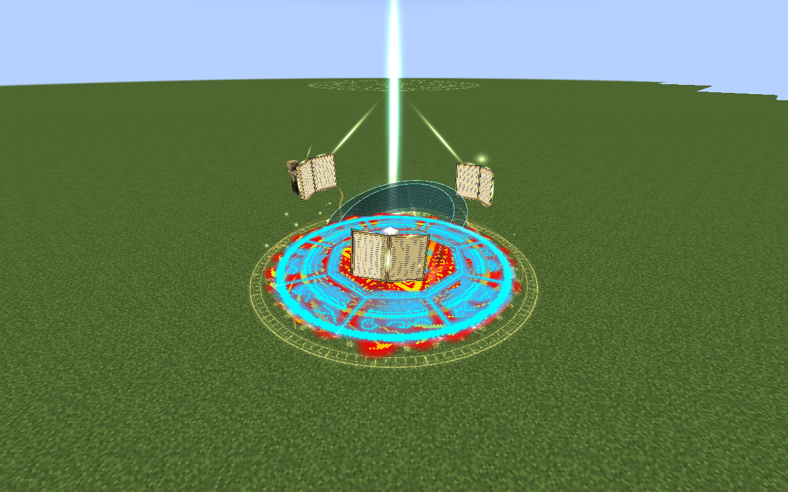
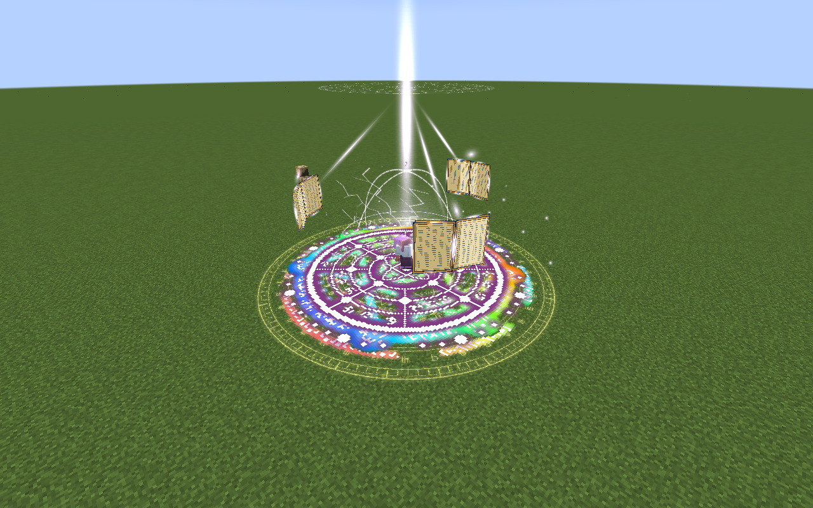
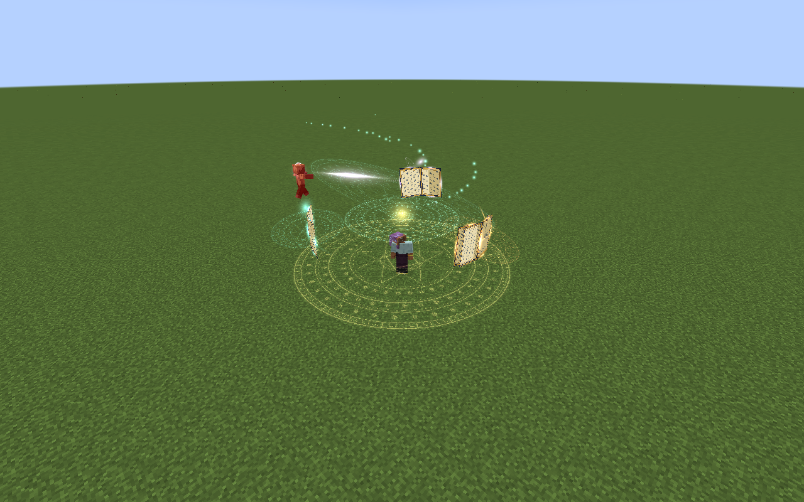
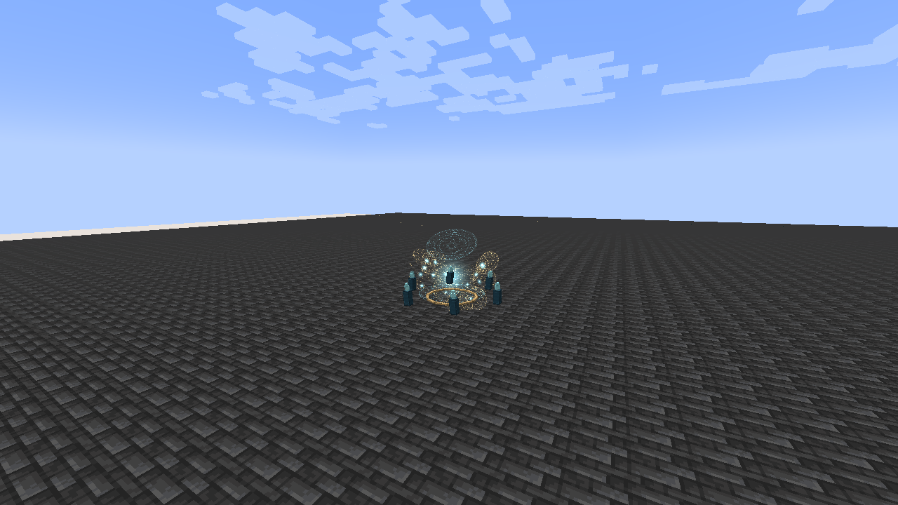
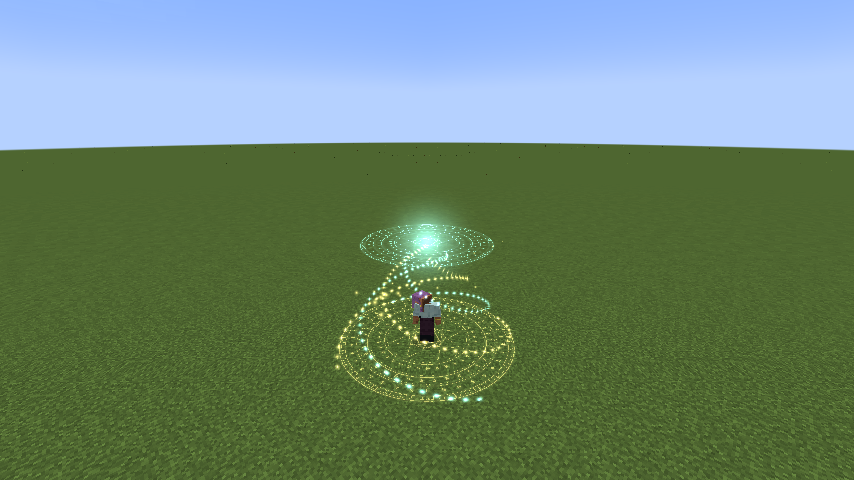
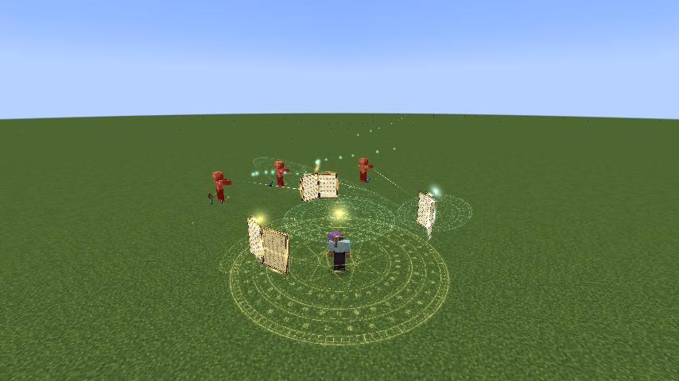
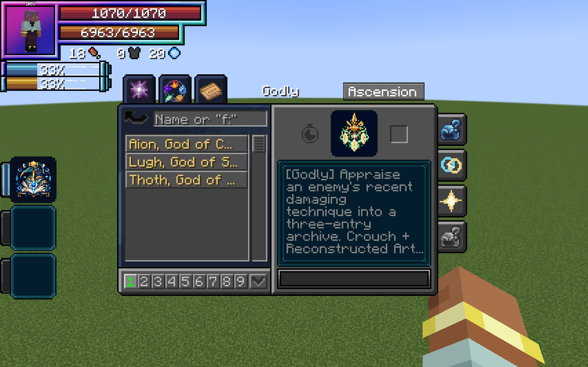

# Thoth, God of Magic

[Main Page](https://github.com/Bithio999/MC/wiki/Home) · [Skills](https://github.com/Bithio999/MC/wiki/Skills) · [Ability index](https://github.com/Bithio999/MC/wiki/Abilities) · [Damage types](https://github.com/Bithio999/MC/wiki/Damage-Types)

**Thoth, God of Magic** is a Godly Skill focused on **elemental sequences, disruption, conversion and autonomous spell fire**.

| Skill data | Thoth, God of Magic |
| --- | --- |
| **Information** | |
| Type | Godly Skill / native Ultimate |
| Combat role | Elemental sequences, disruption, conversion and autonomous spell fire |
| Active modes | 4 |
| Resource | Magicules; Mana Crucible converts aura |
| Toggleable passive | Arcane Sovereignty |
| Passive upkeep | 180 magicules / second |
| Registry ID | `wildhunt:thoth` |
| **Obtaining** | |
| Method | Mastered combination Ultimate + mastered Rune Smith; true awakening; 12M base EP |
| **Evolution** | |
| Evolution | — |

## Usage

### Classification passives

Owning Thoth automatically grants [Divine Authority, Absolute Penetration and Interference Immunity](https://github.com/Bithio999/MC/wiki/Godly#classification-passives): +35% damage against non-Godly owners, resistance/nullification bypass for your own damage, and protection against non-Godly Magic Interference. They have no toggle or upkeep and do not stack with Aion's shared traits. Arcane Sovereignty below retains its separate toggle and cost.

### Passive

[Passive - Toggle] — **Arcane Sovereignty**

| Ability information | Value |
| --- | --- |
| Damage type | None — support / defense |
| Damage ID | — |
| Upkeep | 180 magicules / second |

Gain 75% Earth, Flame, Water/Ice, Wind, Light, Lightning and Space boost; 75% increased native Chant Speed; and 25% reduced native Magic Cost Multiplier. Thoth’s Godly boosts apply in addition to the strongest ordinary elemental source. Native spell-cost efficiency applies where Tensura reads that attribute; the art costs on this page remain fixed.

Enable the native skill toggle in Ability Selection. The first second is paid on enabling; upkeep is paid every twenty game ticks. It turns off when unfunded or blocked by native activation rules. Turning it off removes only its own modifiers. It is separate from active mode cycling.

### Active

| Mode | Magicules | Cooldown | Raw damage |
| --- | ---: | ---: | --- |
| 1. Lexicon of Ruin | 5,000 | 12 s | 375 per chapter |
| 2. Spellbreak | 4,000 | 15 s | 180 |
| 3. Mana Crucible | 0; converts aura while held | None | — |
| 4. Astral Library | 9,000 | 35 s | 160 per bolt |

Damage listed here is before native combat handling and uses **1 + 0.5 × mastery fraction**, capped at **1.5×**. These new kits do not use the apex skills’ 0.90 multiplier or the former 3× Ultimate multiplier. EP never multiplies their damage. Native elemental boosts, authority, barriers and hit immunity apply; shared Godly penetration bypasses native resistance/nullification protection.

#### Lexicon of Ruin

[Active - Press] — **Lexicon of Ruin**

| Ability information | Value |
| --- | --- |
| Damage type | Fire, Water, Lightning, Earth, Wind, Light and Space elemental |
| Damage ID | `tensura:fire_elemental`; `tensura:water_elemental`; `tensura:lightning_elemental`; `tensura:earth_elemental`; `tensura:wind_elemental`; `tensura:light_elemental`; `tensura:space_elemental` |
| Resource cost | 5,000 magicules |
| Cooldown | 12 seconds |
| Raw damage | 375 per chapter |

Mark a six-block-radius spell diagram within 64 blocks. Seven chapters strike the fixed location at **0.60, 0.90, 1.25, 1.60, 1.90, 2.25 and 2.60 seconds**, cycling **Fire → Water → Lightning → Earth → Wind → Light → Space**. The warning begins immediately and the formation lasts **3.5 seconds**. Each chapter attempts to hit up to eight visible enemies using its own native elemental source and animated magic circle. Native hit immunity still applies to closely spaced chapters; it is never reset to force extra hits. Water represents the passive’s shared Water/Ice boost, so there is no separate Ice chapter. The sequence can be dodged by leaving its area.

#### Spellbreak

[Active - Press] — **Spellbreak**

| Ability information | Value |
| --- | --- |
| Damage type | Generic magic |
| Damage ID | `tensura:magic` |
| Resource cost | 4,000 magicules |
| Cooldown | 15 seconds |
| Raw damage | 180 |

Place a twelve-block-radius disruption field within 36 blocks, affecting up to six visible enemies. Each takes generic magic damage. Non-Godly owners additionally face native Silence and Magic Interference II for three seconds, and lose up to 1,500 current magicules. Half the drained magicules returns to you, capped at 2,000 total and your current maximum. Godly owners take the attack damage but are exempt from the drain and disruption.

#### Mana Crucible

[Active - Hold] — **Mana Crucible**

| Ability information | Value |
| --- | --- |
| Damage type | None |
| Damage ID | — |
| Resource cost | 2 aura per 1 magicule restored; no activation cost |
| Cooldown | None |
| Conversion speed | 5% of maximum magicules per second |
| Duration / total conversion limit | None; hold to continue |
| Raw damage | — |

Hold the assigned skill key to continuously convert **2 current aura into 1 magicule**. Restore **5% of maximum magicules per second**, transferred smoothly each server tick. An empty magicule pool takes twenty seconds to fill if you have enough aura. There is **no activation cost, cooldown, duration limit or total conversion cap**. It has no upfront magicule requirement; native activation restrictions, including exhaustion sleep, still apply.

Release to stop immediately. The channel also ends when aura runs out, magicules reach their normal maximum, native suppression interrupts it, or you die, change dimension, log out or forget Thoth. It follows you while held and can restart immediately after ending. Only the aura actually converted is spent, including a fractional final transfer; maximum resources never change. Arcane Sovereignty’s separate upkeep still applies when that passive is enabled.

Repeated taps do not grant mastery. Sustained conversion earns mastery once per second of successful channel ticks.

#### Astral Library

[Active - Press] — **Astral Library**

| Ability information | Value |
| --- | --- |
| Damage type | Rotating Fire, Water, Lightning, Earth, Wind, Light and Space elemental |
| Damage ID | `tensura:fire_elemental`; `tensura:water_elemental`; `tensura:lightning_elemental`; `tensura:earth_elemental`; `tensura:wind_elemental`; `tensura:light_elemental`; `tensura:space_elemental` |
| Resource cost | 9,000 magicules |
| Cooldown | 35 seconds |
| Raw damage | 160 per bolt |

For ten seconds, three open grimoires orbit above you. Starting after half a second and then every **0.25 seconds**, fire at up to three visible enemies within 28 blocks. The chapter cycles **Fire → Water → Lightning → Earth → Wind → Light → Space**, repeating every **1.75 seconds**. There are 38 volleys within the same ten-second window. Each bolt uses 160 raw damage before mastery and native combat handling; normal hit immunity can suppress closely spaced hits. The three books take turns firing and recolour for their upcoming element; there is no separate Ice volley. The formation moves with you; only one library per owner. Forgetting the skill, dying or changing dimension cancels it.

## Spellcraft visuals

Lexicon raises a three-volume casting formation above counter-rotating inscription seals. The seven chapters have synchronized elemental eruptions: flame crowns, caustic water ribbons, branched lightning, rising stone tablets, wind helices, radiant spokes and spatial fractures. Water has no ice-spire phase. Spellbreak spreads rings of fractured sigils; Mana Crucible draws golden and cyan helical currents into a raised focus. Astral Library carries animated open books, celestial seals, continuous trails and softly fading motes. Its chapter-colored bolts and miniature elemental impacts originate at the actual firing book. Damage sources, bolt styles and the faster chapter timing share one spectrum definition. All effects use standard Minecraft rendering, without a shader pack.

## Obtaining

Open **Skills → Godly → Ascension**, select one mastered [combination Ultimate](https://github.com/Bithio999/MC/wiki/Ultimate-Skills), choose **Thoth**, then Ascend. Also master [Rune Smith](https://github.com/Bithio999/MC/wiki/Rune-Smith), become a True Hero or True Demon Lord and reach **12,000,000 base EP**. Both the selected Ultimate and Rune Smith are combined into Thoth. Other skills remain learned. Presets and the longest remaining cooldown carry over. Owning Aion does not prevent earning Thoth using another valid source Ultimate.

## Suggested combo

Cast Astral Library before sustained combat → trap an approach in Lexicon of Ruin → Spellbreak a caster formation → convert spare aura with Mana Crucible when magicules are low.

## Strengths and limitations

Thoth has native Ultimate classification plus the Godly tag. It does not copy other skills or erase their ownership. Silence and interference still pass through Tensura’s native status rules. Conversion is a resource trade, not free regeneration.

Attacks respect teams, owned pets, creative/spectator immunity and server PvP settings. Native status resistances apply. World effects are bounded, expire automatically and do not damage terrain. Anchored effects do not persist across death, relog or dimension changes.

## Related pages

[Skills](https://github.com/Bithio999/MC/wiki/Skills) · [Skill synthesis](https://github.com/Bithio999/MC/wiki/Skill-Synthesis) · [Damage types](https://github.com/Bithio999/MC/wiki/Damage-Types) · [Mechanics](https://github.com/Bithio999/MC/wiki/Mechanics)

## Gallery

[Watch Astral Library in motion](https://github.com/Bithio999/MC/blob/main/wiki/media/astral-library.mp4).

---

**Categories:** Tensura Myths · Skills
