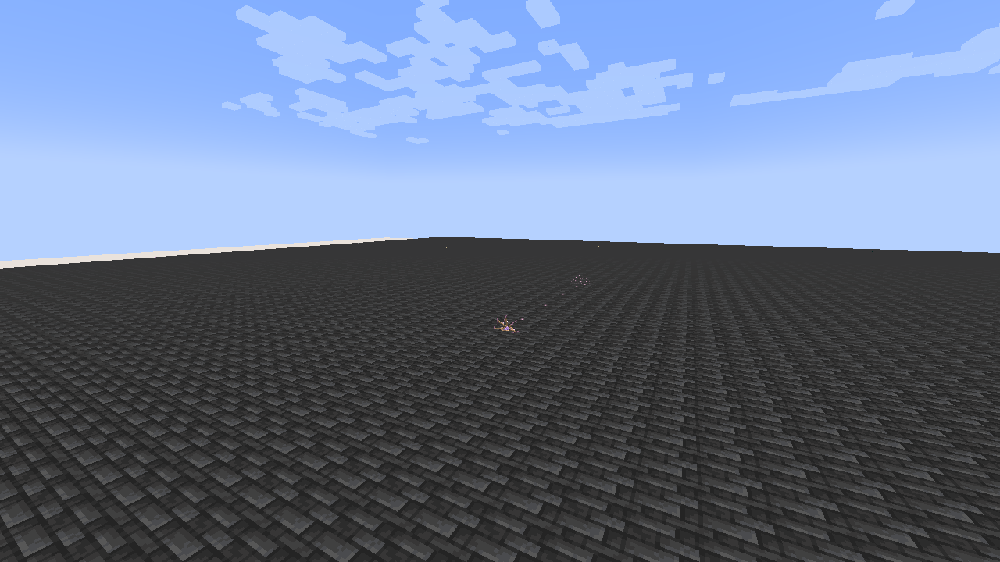

# Threadweaver

> **Discontinued archive:** Tensura Myths ended at 0.36.1. No further updates are planned.

[All wikis](https://github.com/Bithio999/MC/wiki/Home) · [Tensura Myths](https://github.com/Bithio999/MC/wiki/Tensura-Myths)

Threadweaver is a Unique Skill focused on single-target leash and spatial severance.

| Skill data | Value |
| --- | --- |
| Tier | Unique |
| Resource | Aura |
| Passive upkeep | 25 aura / second |
| Obtaining | Reincarnation starting-skill roll |

## Active abilities

| Ability | Damage type / base damage | Cost | Cooldown |
| --- | --- | --- | --- |
| Loom Needle | Space elemental · 320 | 500 aura | 4 s |
| Sever Thread | Space elemental · 550 | 850 aura | 6 s |

## Passive

- Damage type: None — support / defense
- Upkeep: 25 aura / second
- Gain 30% movement speed and 25% attack speed. This creates no charges or passive stacks.

## Loom Needle

- Damage type: Space elemental
- Resource cost: 500 aura
- Cooldown: 4 seconds
- Raw damage: 320
- Aim at one visible enemy within 28 blocks. The hit pins a silk anchor at its current position for six seconds.

## Sever Thread

- Damage type: Space elemental
- Resource cost: 850 aura
- Cooldown: 6 seconds
- Raw damage: 550
- Consume your live tether and burst around its current victim, hitting up to six eligible enemies in a four-block radius. The victim must remain within 40 blocks and visible.

## Related

[Skill synthesis](https://github.com/Bithio999/MC/wiki/Skill-Synthesis) · [Godly Skills](https://github.com/Bithio999/MC/wiki/Godly)

## Pictures and video

