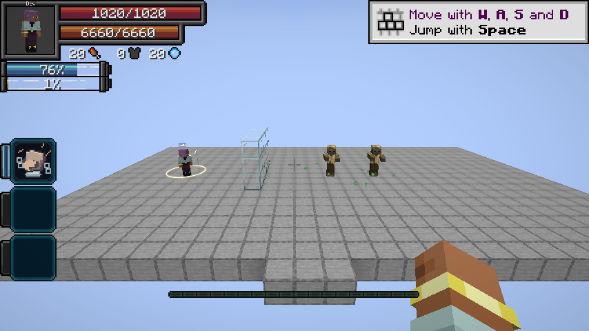

# Unbound

> **Discontinued archive:** Tensura Myths ended at 0.36.1. No further updates are planned.

[All wikis](https://github.com/Bithio999/MC/wiki/Home) · [Tensura Myths](https://github.com/Bithio999/MC/wiki/Tensura-Myths)

Chained automatically evolves into this Ultimate when you are Heavenbreaker, fully master Chained, and become a True Hero or True Demon Lord.

| Skill data | Value |
| --- | --- |
| Tier | Ultimate |

## Retained pact

Retains Chained’s restrictions, aura growth and regeneration conversion. Presets and progress carry over.

## Improved combat

- Toggle: 8× Battlewill damage or 5× other Physical damage; 4× numeric Battlewill buffs except Aura Sword. The damage branches remain separate.
- In slot: 30% damage reduction, 100% projectile dodge and 50% other dodge. Retains Fear, Slowness, Burden and Haki immunity.
- Mastered Broken Limit retains resistance degradation and dodge bypass, and makes your attacks critical hits.

## Severance Rush

**Damage type: Physical.**

The same 16-block aim teleport and Physical path/arrival formulas as Chained. Cost: 2% current aura. Cooldown: 1 second. Held weapon effects apply.

## Counter

**Damage type: Physical.**

- Press to hold a defensive stance for 3 seconds with movement speed 0. The first eligible enemy hit is negated and releases a terrain-piercing slash toward the attacker, hitting other enemies along its path.
- Cost: 10% current aura on entry. Cooldown: 10 seconds. Press again to cancel early for free.
- Physical base damage: 10 × negated damage + 6 × √A + W. The released weapon’s damage, enchantments and engravings apply; toggle bonuses and critical hits then apply.

## Related

[Chained](https://github.com/Bithio999/MC/wiki/Chained) · [Inverted Spear of Heaven](https://github.com/Bithio999/MC/wiki/Inverted-Spear-of-Heaven)

## Pictures and video

[Counter against Eschaton (Myths recording; the Counter ability is also in Additions)](https://github.com/Bithio999/MC/raw/refs/heads/main/wiki/media/counter-eschaton-8m.mp4)
