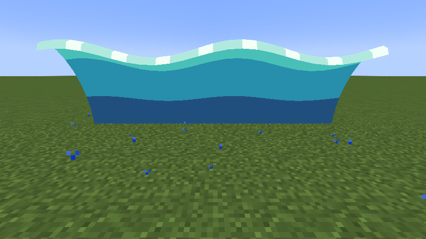
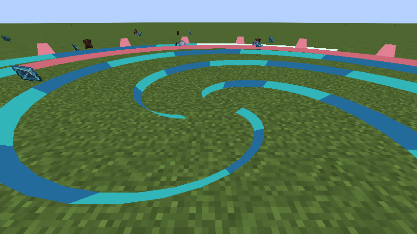
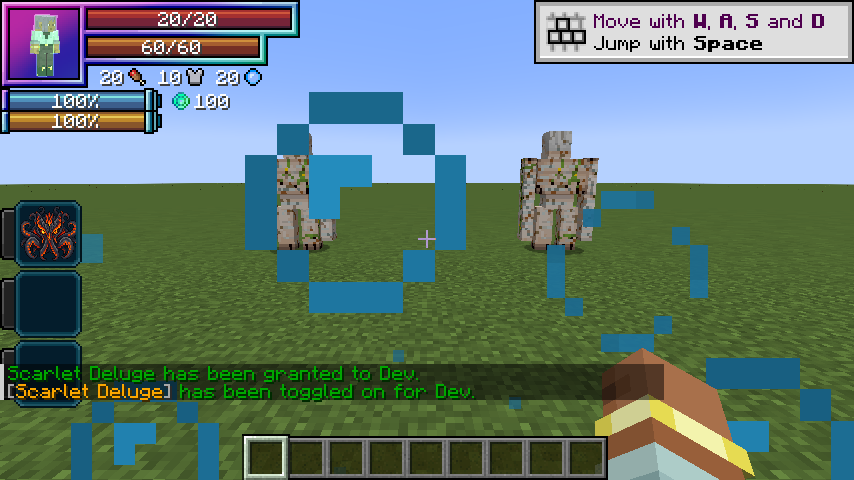

# Varuna, Lord of Tides

[Main Page](https://github.com/Bithio999/MC/wiki/Home) · [Skills](https://github.com/Bithio999/MC/wiki/Skills) · [Evolution](https://github.com/Bithio999/MC/wiki/Evolution) · [Mechanics](https://github.com/Bithio999/MC/wiki/Mechanics) · [Commands](https://github.com/Bithio999/MC/wiki/Commands)

**Varuna, Lord of Tides** is a Ultimate Skill inspired by **Uth Duna**. It combines travelling currents, aimed whirlpools, and native barriers.

| Skill data | Varuna, Lord of Tides |
| --- | --- |
| **Information** | |
| Type | Ultimate Skill |
| Inspiration | Uth Duna |
| Damage type | Water elemental |
| Damage ID | `tensura:water_elemental` |
| Combat role | Moving tides / native barriers |
| Active modes | 3 |
| Toggleable passive | Water Veil |
| Passive upkeep | 40 aura / second |
| Registry ID | `wildhunt:varuna` |
| **Evolution** | |
| Previous | [Scarlet Deluge](https://github.com/Bithio999/MC/wiki/Scarlet-Deluge) |
| Evolution | [Aion, God of Causality](https://github.com/Bithio999/MC/wiki/Aion) |
| **Obtaining** | |
| Method | Ascend the matching mastered Unique |

All damaging arts in this skill use **water elemental damage**, including its area hits and pulses.

## Usage

### Passive

[Passive - Toggle] — **Water Veil**

While toggled on, gain 25 armor, 36 physical barrier, 36 magic barrier and 100% water boost. These native attributes participate in Tensura’s damage handling and visible barrier layer. Water breathing remains active while toggled on. No absorption hearts are added. A hostile hit that removes health triggers a 25-raw water counter (75 as Varuna) against a visible attacker within twelve blocks, with a 1-second cooldown.

The passive also arms a **250-capacity native Multilayer Barrier**, which appears in Tensura’s shield HUD counter when its Barrier decoration is enabled. The counter is a per-hit blocking capacity, not absorption hearts or a custom health bar. Native rules spend magicules on blocked damage and can break the barrier on overflow, insufficient magicules or stronger attacks. While still toggled on, a broken barrier automatically rearms on the first paid upkeep after **ten seconds without an incoming hit**. Any new hit restarts the delay, including hits completely blocked by a surviving shield. Retoggling does not bypass the delay. Surviving shields persist across relogs.

Enable or disable this through Tensura’s native **Ability Selection** skill toggle. It is separate from active mode cycling and has no fifteen/thirty-second duration. Upkeep is **40 aura per second**, with the first second paid on enabling. It turns off when aura is insufficient or activation requirements fail. Turning it off removes its own attribute modifiers immediately.

No constant bubble orbit is emitted while the passive is enabled. Native barrier rendering and the shield HUD remain. Active waves use a curled teal water mesh with foam, and Undertow uses rotating teal/coral spiral ribbons.

### Active

| Mode | Aura | Cooldown | Raw opening damage |
| --- | ---: | ---: | ---: |
| 1. Crushing Current | 640 | 2 s | 195 |
| 2. Scarlet Undertow | 2,000 | 6 s | 135 |
| 3. Crimson Ocean | 6,000 | 60 s | See signature below |

**Damage calculation:** multiply the listed base values by **0.90**, then by the mastery multiplier (up to **1.50**). Ultimate table values already include their 3× base multiplier. Elemental boosts, defenses, barriers, and situational modifiers also apply. EP does not multiply damage.

#### Crushing Current

[Active - Press] — **Crushing Current**

Send a broad wave up to 26 blocks over about sixteen game ticks. It carries and drenches each enemy it reaches, damaging a given entity at most once per wave. Its front is 5 blocks wide on either side. Previously drenched enemies take 50% extra primary damage. Drenched is a single twelve-second mark, never a stack counter.

#### Scarlet Undertow

[Active - Press] — **Scarlet Undertow**

Place a six-second whirlpool at the aim point, up to 36 blocks away along the crosshair ray. The radius is 13 blocks. A block or water surface under the crosshair sets the position; a miss places it at the bounded ray endpoint. It hits immediately and once per second, with a gentle inward current between pulses. Raw pulse damage is 54; the table lists opening damage.

#### Crimson Ocean

[Active - Press] — **Crimson Ocean**

For ten seconds, alternate inward and outward tides within fourteen blocks around the caster. Incoming tides gather; outgoing tides push away and slightly upward. Raw damage is 135 on the opening pulse and 81 on later pulses, before mastery and native modifiers.

## Obtaining

Evolve [Scarlet Deluge](https://github.com/Bithio999/MC/wiki/Scarlet-Deluge) as Sovereign Hunter with 2,000,000 base EP and mastery of that Unique. Use `/wildhunt ascend uth_duna`. It replaces only the matching Unique; the Ultimate starts with its own mastery.

## Evolution

| Unique Skill | Ultimate Skill | Requirements |
| --- | --- | --- |
| [Scarlet Deluge](https://github.com/Bithio999/MC/wiki/Scarlet-Deluge) | Varuna, Lord of Tides | Sovereign Hunter; 2,000,000 base EP; matching Unique mastered |

Ascension replaces only the matching Unique. The Ultimate starts with its own mastery.

## Suggested combo

Place Scarlet Undertow to gather enemies → send Crushing Current through the drenched group. Toggle Water Veil when you need sustained defense.

## Strengths and limitations

The veil must remain funded. Native barriers follow Tensura’s rules and do not guarantee immunity to stronger attacks. Its retaliation requires health damage, a hostile living attacker and line of sight. Knockback resistance reduces tides and wave carrying.

## Active visuals

These visuals appear during active arts.

## Native barrier HUD

The Unique passive’s native shield counter. Its Ultimate uses a higher capacity.

## Related pages

[Skills](https://github.com/Bithio999/MC/wiki/Skills) · [Mechanics](https://github.com/Bithio999/MC/wiki/Mechanics) · [Evolution](https://github.com/Bithio999/MC/wiki/Evolution) · [Commands](https://github.com/Bithio999/MC/wiki/Commands)

---

**Categories:** Tensura Myths

## Godly evolution

At mastery, True Hero or True Demon Lord awakening, and 12M base EP, use `/myths` to evolve this Ultimate into [Aion, God of Causality](https://github.com/Bithio999/MC/wiki/Aion). It replaces the selected Ultimate while preserving presets and remaining cooldowns.
