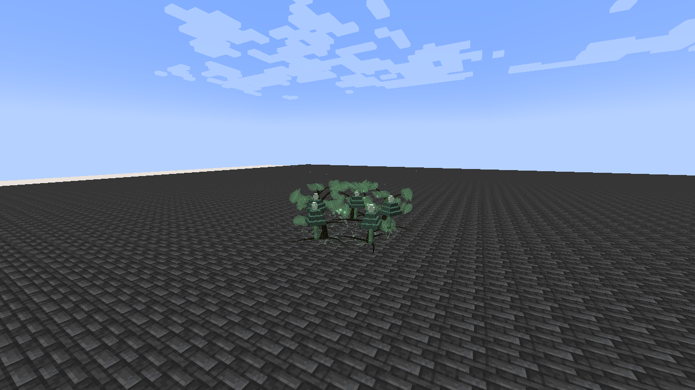

# Verdant Keeper

[Main Page](https://github.com/Bithio999/MC/wiki/Home) · [Skills](https://github.com/Bithio999/MC/wiki/Skills) · [Ability index](https://github.com/Bithio999/MC/wiki/Abilities) · [Damage types](https://github.com/Bithio999/MC/wiki/Damage-Types)

**Verdant Keeper** is a Unique Skill focused on **allied hp/shp support and forward root control**.

| Skill data | Verdant Keeper |
| --- | --- |
| **Information** | |
| Type | Unique Skill |
| Combat role | Allied HP/SHP support and forward root control |
| Active modes | 2 |
| Resource | Aura |
| Toggleable passive | Verdant Heart |
| Passive upkeep | 35 aura / second |
| Registry ID | `wildhunt:verdant_keeper` |
| **Obtaining** | |
| Method | Reincarnation starting-skill roll |
| **Evolution** | |
| Evolution | [Synthesis](https://github.com/Bithio999/MC/wiki/Skill-Synthesis) |

## Usage

### Passive

[Passive - Toggle] — **Verdant Heart**

| Ability information | Value |
| --- | --- |
| Damage type | None — support / defense |
| Damage ID | — |
| Upkeep | 35 aura / second |

Increase native spiritual-health regeneration by 100%. This modifies natural recovery; it does not create an additional periodic HP-heal loop.

Enable the native skill toggle in Ability Selection. The first second is paid on enabling; upkeep is paid every twenty game ticks. It turns off when unfunded or blocked by native activation rules. Turning it off removes only its own modifiers. It is separate from active mode cycling.

### Active

| Mode | Aura | Cooldown | Raw damage |
| --- | ---: | ---: | --- |
| 1. Living Grove | 600 + healing expenditure | 14 s | — |
| 2. Briar Grasp | 550 | 5 s | 300 |

Damage listed here is before native combat handling and uses **1 + 0.5 × mastery fraction**, capped at **1.5×**. EP never multiplies their damage. Native elemental boosts, authority, resistances, barriers and hit immunity apply.

#### Living Grove

[Active - Press] — **Living Grove**

| Ability information | Value |
| --- | --- |
| Damage type | None |
| Damage ID | — |
| Resource cost | 600 aura to place; each pulse pays for HP/SHP restored |
| Cooldown | 14 seconds |
| Raw damage | — |

Grow a stationary grove within 24 blocks. For eight seconds it restores 7% maximum HP and 6% maximum SHP each second to up to eight beneficiaries within seven blocks. Beneficiaries are yourself, teammates/allies and your owned pets; neutral strangers are excluded. Healing caps at each pool’s current maximum. Only one grove per owner; other allies need your line of sight.

After the placement payment, each pulse spends the caster’s aura for the HP and SHP it restores to **each** recipient. At zero mastery the rates are **40 aura per HP** and **60 aura per SHP**; they improve smoothly to **30 aura per HP** and **40 aura per SHP** at full mastery. Full pools cost nothing. Canceled or reduced HP healing refunds the unused payment.

If there is not enough aura for a full pulse, every eligible recipient receives the same proportion of their planned healing. At zero aura the field pauses healing and can resume on a later pulse when funded. The pulse cannot exceed its funded quota, including native HP-healing amplification. Native healing suppression and its regeneration-based exceptions still apply. Placement range, duration, ally rules and current pool caps remain in effect.

#### Briar Grasp

[Active - Press] — **Briar Grasp**

| Ability information | Value |
| --- | --- |
| Damage type | Earth elemental |
| Damage ID | `tensura:earth_elemental` |
| Resource cost | 550 aura |
| Cooldown | 5 seconds |
| Raw damage | 300 |

Lash up to six visible enemies in a forward fan within twelve blocks. Successful hits attempt to apply native Webbed for 3.5 seconds. Animated briars erupt around the selected victims. Native resistance and rank rules still govern the status.

## Obtaining

Roll through Tensura’s normal reincarnation pool alongside the other seven Myths Uniques and configured native candidates. The roll is random; no particular skill is guaranteed. There is no race, trial or boss-kill requirement to roll.

## Suggested combo

Place Living Grove where your allies can fight → use Briar Grasp to hold approaching enemies outside their formation.

## Strengths and limitations

The grove stays where it was cast. It heals allies instead of damaging enemies. Webbed is a native effect and is not guaranteed against every target.

Attacks respect teams, owned pets, creative/spectator immunity and server PvP settings. Native status resistances apply. World effects are bounded, expire automatically and do not damage terrain. Anchored effects do not persist across death, relog or dimension changes.

## Related pages

[Skills](https://github.com/Bithio999/MC/wiki/Skills) · [Skill synthesis](https://github.com/Bithio999/MC/wiki/Skill-Synthesis) · [Damage types](https://github.com/Bithio999/MC/wiki/Damage-Types) · [Mechanics](https://github.com/Bithio999/MC/wiki/Mechanics)

## Visual effects

Living Grove grows curved trunks, branching stems, roots and leaf clusters around a botanical ground diagram. Soft rising motes and an outward ripple accompany its healing field. Briar Grasp uses tapering, thorned vines around each caught enemy rather than a recolored grove.

[Visual effects gallery and display settings](https://github.com/Bithio999/MC/wiki/Visual-Effects).

---

**Categories:** Tensura Myths · Skills
