# Skill visual effects

[Main Page](https://github.com/Bithio999/MC/wiki/Home) · [Skills](https://github.com/Bithio999/MC/wiki/Skills) · [Combat mechanics](https://github.com/Bithio999/MC/wiki/Mechanics)

Tensura Myths gives each skill family an individual visual language, using original inscription and surface textures, animated geometry and Tensura’s native magic circles. Effects are full-bright where appropriate and require no shader pack.

## Display settings

Minecraft’s **Particles** setting reduces decorative motes, foam and cloud sprites. Primary attack paths, warning footprints, crystal geometry and gate frames remain visible even on **Minimal**. Distant effects use fewer curve segments. These settings do not change damage or server targeting.

Water Veil and Colossus Carapace have no constant custom particle cloud. Healing Extras pulse only when they actually restore HP or SHP. Native barrier rendering and the barrier HUD still belong to Tensura.

## Gallery

These in-game views show the geometry in an isolated development world. Some use a single staged visual to keep the shape unobstructed; they are not representations of damage, range or effect duration. The individual ability articles remain the gameplay reference.

### Storm Crown

[Storm Crown](https://github.com/Bithio999/MC/wiki/Storm-Crown) — A coherent white-hot Railbolt core carries branching gold lightning and moving ion collars between its victims. Thunder Step leaves a tunnel of conductors and speed streaks along the travelled path; the lightning impact expands from the landing point.

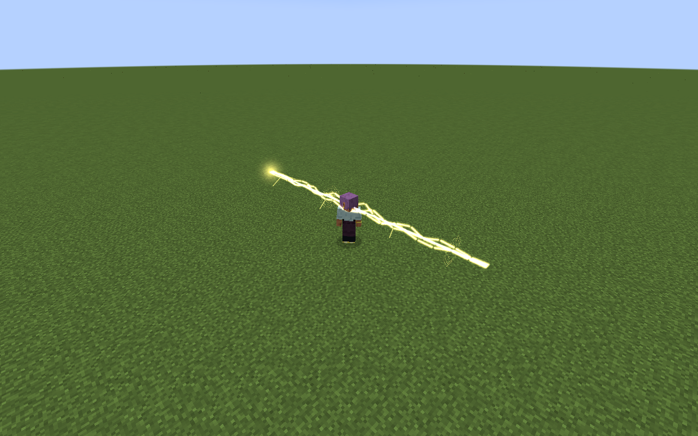

### Scarlet Deluge

[Scarlet Deluge](https://github.com/Bithio999/MC/wiki/Scarlet-Deluge) — Crushing Current is a curled, scrolling caustic water sheet with a bright foam crest. Scarlet Undertow forms a shallow raised vortex with four inward-flowing spiral ribbons, coral-colored fins and drifting foam. These surfaces mark the actual travelling wave and placed field; Water Veil adds no constant custom particle cloud.

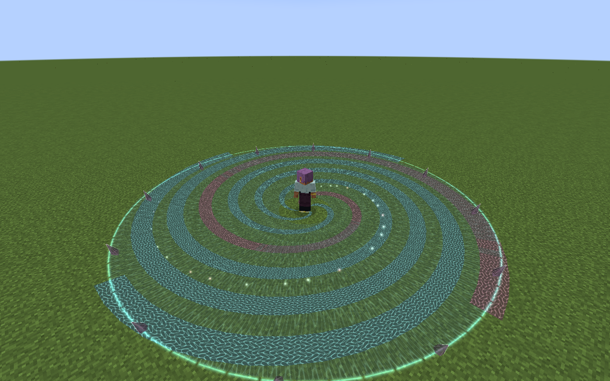

### Black Flame

[Black Flame](https://github.com/Bithio999/MC/wiki/Black-Flame) — Oil Lash extends and recoils as a curved, tapered tentacle with suckers and molten seams. Each owned pool has an irregular dark oil surface. Ignition transforms that same surface into black flame silhouettes, violet inner fire, orange hot cores and rising soot; the surface fades when its pool ends.

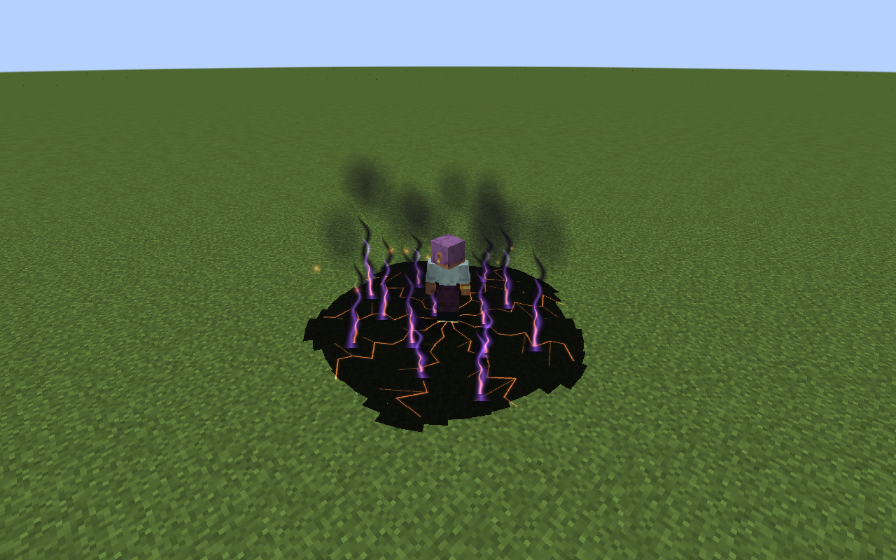

### Frostbound Colossus

[Frostbound Colossus](https://github.com/Bithio999/MC/wiki/Frostbound-Colossus) — Avalanche Crash erupts in faceted, veined ice spires with luminous edges and snowflake imprints. Glacial Prison arranges the crystals around its captured victim. The crystals remain visual geometry rather than placed blocks, and Colossus Carapace adds no constant custom particle cloud.

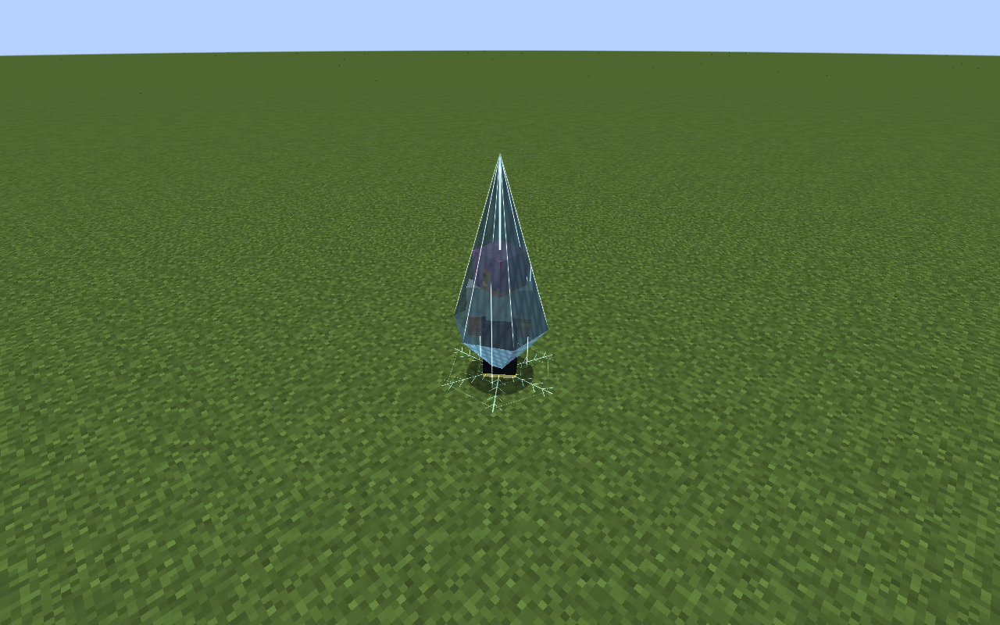

### Threadweaver

[Threadweaver](https://github.com/Bithio999/MC/wiki/Threadweaver) — Loom Needle uses four braided strands, travelling pulses and an oriented silk-web anchor at its target. Sever Thread closes that web inward into a pink spatial snap. Its fine filaments remain distinct from Janus’s large architectural cuts.

### Rune Smith

[Rune Smith](https://github.com/Bithio999/MC/wiki/Rune-Smith) — Runic Mine assembles two counter-rotating circuit inscriptions and six rising rune tablets. Command Detonation releases an expanding circuit front and luminous earth pillars. The armed mine has a stable footprint rather than a continuous shower of server particles.

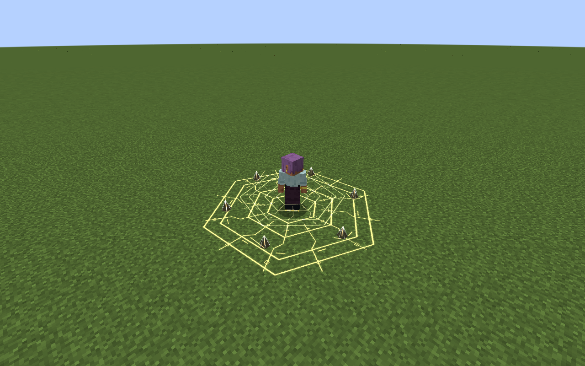

### Verdant Keeper

[Verdant Keeper](https://github.com/Bithio999/MC/wiki/Verdant-Keeper) — Living Grove grows curved trunks, branching stems, roots and leaf clusters around a botanical ground diagram. Soft rising motes and an outward ripple accompany its healing field. Briar Grasp uses tapering, thorned vines around each caught enemy rather than a recolored grove.

### Mirrorbound

[Mirrorbound](https://github.com/Bithio999/MC/wiki/Mirrorbound) — Prismatic Lance has a white core, three refracted color strands and etched optical collars. Mirror Aegis uses independently orbiting faceted glass panels, luminous edges and inset mirror inscriptions. The formation follows the caster smoothly between server updates.

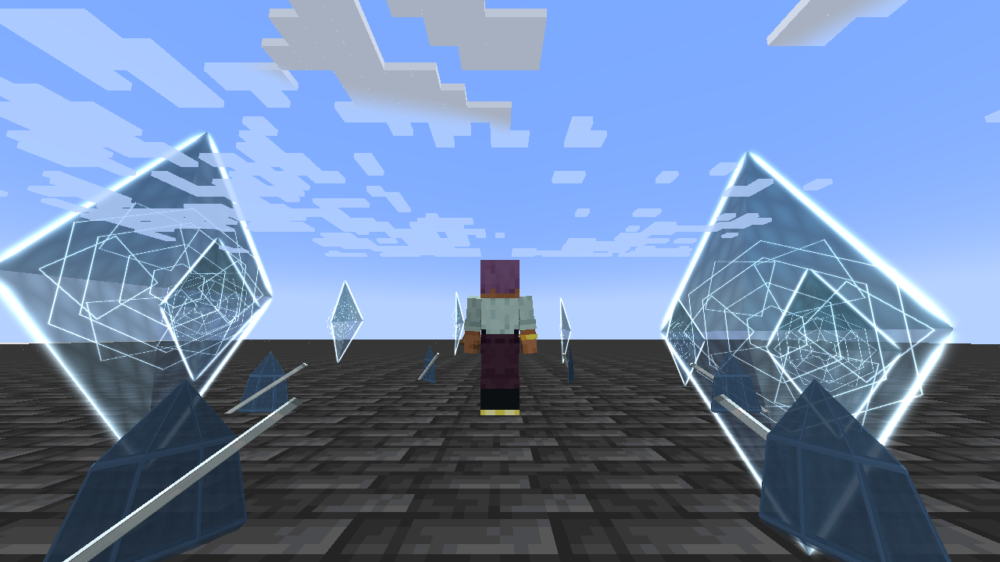

### Vritra

[Vritra](https://github.com/Bithio999/MC/wiki/Vritra) — Plasma Lance combines a continuous hot core, orange/violet helices and conductor collars; its delayed fuses converge into fire impacts. Thunderhead Furnace carries soft storm-cloud layers, periodic branching lightning and a suspended hot ring. Cataclysm Front warns with a fractured ground inscription before volcanic spires and flame jets erupt at the strike.

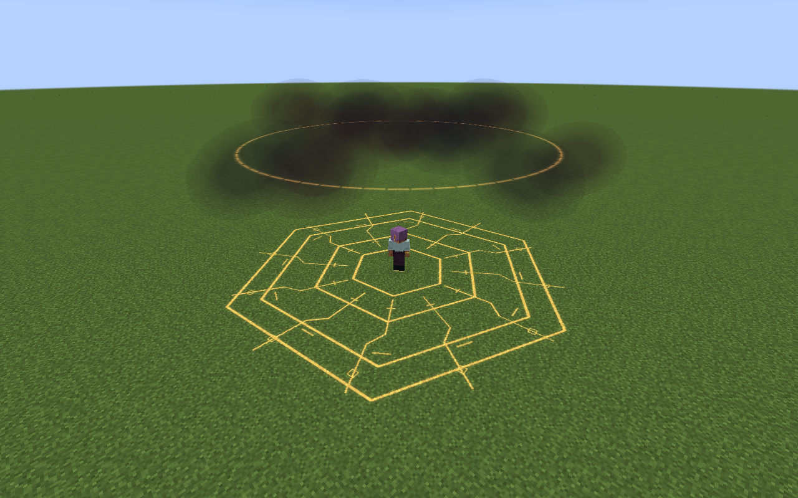

### Demeter

[Demeter](https://github.com/Bithio999/MC/wiki/Demeter) — Winter Orchard grows an ice-veined grove with curved crystal branches, snowflake tips, roots and flowing restorative ripples. Perennial Seed marks its actual recipient with a quiet crystal flower and opens a crystalline recovery bloom when triggered. Winter Harvest first shows its frost warning, then opens into a large eight-petalled crystalline bloom at the strike.

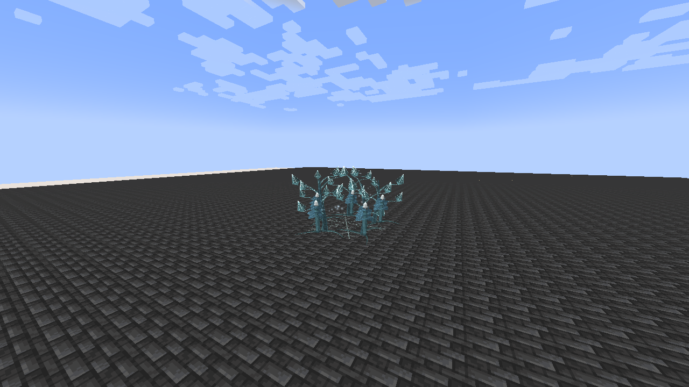

### Janus

[Janus](https://github.com/Bithio999/MC/wiki/Janus) — Twin Gate builds two freestanding frames with recessed, counter-rotating spiral apertures; entry and exit have distinct violet and gold accents. Passage leaves a short spatial transit streak. Parallax Snare closes opposing luminous cuts toward its warned center, while Crossroads Edict lays out a wide cartographic grid and cardinal anchors.

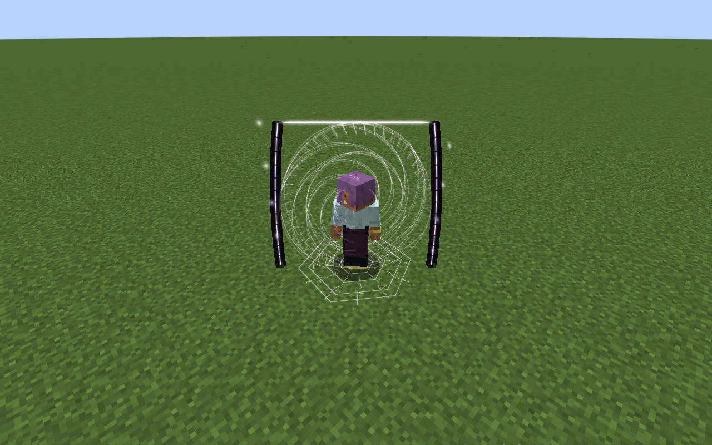

### Aion

[Aion](https://github.com/Bithio999/MC/wiki/Aion) — Worldline Sever carries fine gold/violet helical strands and clock collars around its readable aim core. Event Horizon has a dark spherical core, tilted accretion optics, counter-rotating dials and a faint separate pull perimeter. Causal Reversal places a three-dimensional hourglass with flowing sand over its checkpoint clock. Genesis Verdict suspends twenty miniature black holes, bends each through a unique accelerating curve, and resolves them in five explosive salvos. Opaque dark cores, tilted accretion bands, projected photon rings, volume-preserving speed deformation and tapered wakes distinguish the phases.

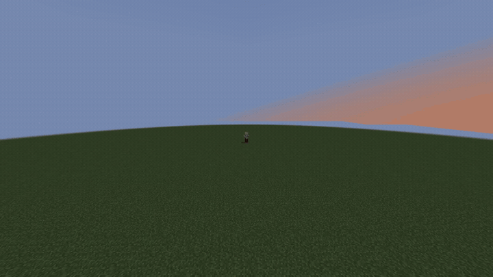

[720p native animation clip](https://github.com/Bithio999/MC/blob/main/wiki/media/aion-singularity-barrage.mp4).

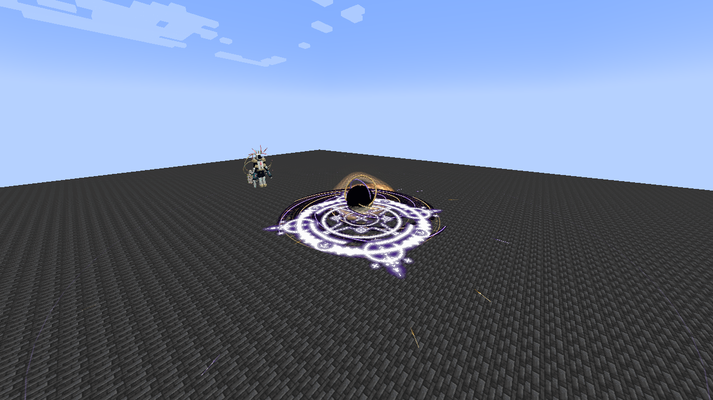

### Thoth

[Thoth](https://github.com/Bithio999/MC/wiki/Thoth) cycles Fire, Water, Lightning, Earth, Wind, Light and Space through flame crowns, caustic ribbons, branching bolts, stone tablets, wind helices, radiant spokes and spatial fractures. Its animated books, counter-rotating seals and held Mana Crucible formation remain. Water represents the shared Water/Ice slot.

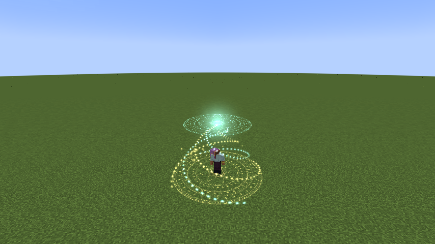

## Combat readability

Bright cores mark beam paths, floor inscriptions preserve placed areas, and warned strikes build before their existing damage timings. Visual geometry has no collision and does not place terrain blocks. Server logic determines all hits, costs and cooldowns independently.

### Anansi

[Anansi](https://github.com/Bithio999/MC/wiki/Anansi) uses articulated runic spider anchors and fine braided threads that match its placed network. Puppet Passage sends a woven transit along the route; Checkmate raises its fixed closing lattice and erupts along the consumed shape.

### Aegir

[Aegir](https://github.com/Bithio999/MC/wiki/Aegir) builds a circular caustic Mirrorsea and six floating glass lenses. Refracted Harpoon shows each converging water spear; Sovereign Breaker's narrow crest expands with its actual damage rim.

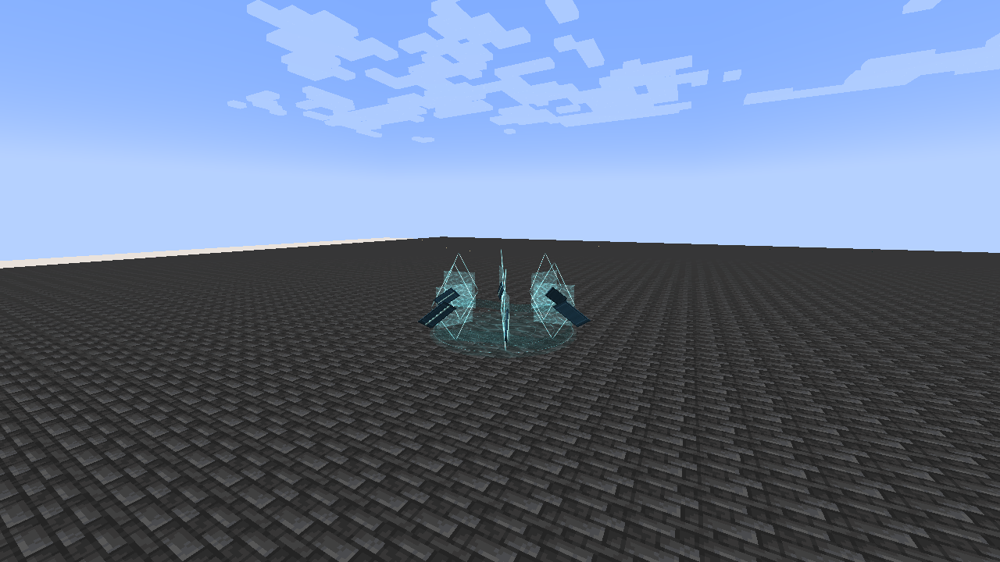

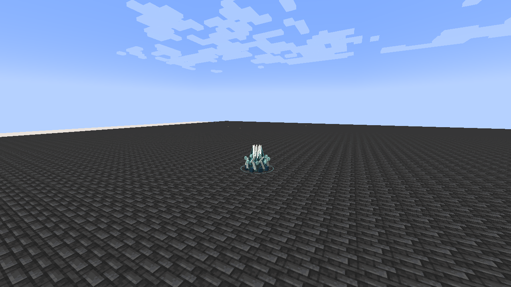

### Lugh

[Lugh](https://github.com/Bithio999/MC/wiki/Lugh) assembles ivory/gold armaments from solid, recessed rune tablets. Blade arcs, travelling lances and a descending crown identify its three forms. Grand Synthesis visibly assembles its archived forms in sequence. Appraisal scans the target, while Countermand locks a single rune tablet rather than surrounding the victim with a barrier.

---

**Categories:** Tensura Myths · Reference
