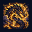
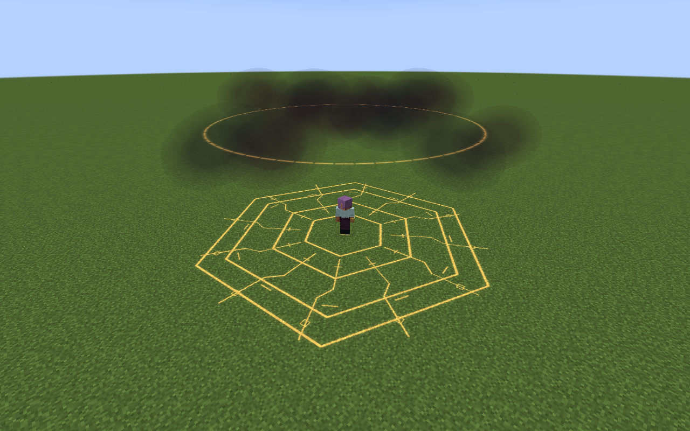

# Vritra, Lord of Cataclysm

[Main Page](https://github.com/Bithio999/MC/wiki/Home) · [Skills](https://github.com/Bithio999/MC/wiki/Skills) · [Ability index](https://github.com/Bithio999/MC/wiki/Abilities) · [Damage types](https://github.com/Bithio999/MC/wiki/Damage-Types)

**Vritra, Lord of Cataclysm** is an Ultimate Skill focused on **piercing plasma, delayed fire and travelling demolition**.

| Skill data | Vritra, Lord of Cataclysm |
| --- | --- |
| **Information** | |
| Type | Ultimate Skill |
| Combat role | Piercing plasma, delayed fire and travelling demolition |
| Active modes | 3 |
| Resource | Aura |
| Toggleable passive | Catastrophe Engine |
| Passive upkeep | 120 aura / second |
| Registry ID | `wildhunt:vritra` |
| **Obtaining** | |
| Method | Synthesis: master both ingredients; 2M base EP |
| **Evolution** | |
| Evolution | [Aion](https://github.com/Bithio999/MC/wiki/Aion), [Thoth](https://github.com/Bithio999/MC/wiki/Thoth) or [Lugh](https://github.com/Bithio999/MC/wiki/Lugh) |

## Usage

### Passive

[Passive - Toggle] — **Catastrophe Engine**

| Ability information | Value |
| --- | --- |
| Damage type | None — support / defense |
| Damage ID | — |
| Upkeep | 120 aura / second |

Gain 100% Flame boost, 100% Lightning boost and 50% attack damage.

Elemental boosts use the [strongest ordinary source](https://github.com/Bithio999/MC/wiki/Mechanics#elemental-bonus-sources); Godly bonuses apply separately.

Enable the native skill toggle in Ability Selection. The first second is paid on enabling; upkeep is paid every twenty game ticks. It turns off when unfunded or blocked by native activation rules. Turning it off removes only its own modifiers. It is separate from active mode cycling.

### Active

| Mode | Aura | Cooldown | Raw damage |
| --- | ---: | ---: | --- |
| 1. Plasma Bore | 6,000 | 5 s | 1,500 lightning; 850 per fire fuse |
| 2. Thunderhead Crucible | 15,000 | 16 s | 900 lightning + 500 fire per pulse |
| 3. Cataclysm Front | 25,000 | 26 s | 1,800 per eruption; 2,400 when empowered |

Damage listed here is before native combat handling and uses **1 + 0.5 × mastery fraction**, capped at **1.5×**. EP never multiplies their damage. Ultimate art hits carry native **level-1 resistance penetration**. Native elemental boosts, authority, resistance attributes, nullification fallback rules, barriers and hit immunity remain relevant.

#### Plasma Bore

[Active - Press] — **Plasma Bore**

| Ability information | Value |
| --- | --- |
| Damage type | Lightning elemental + delayed Fire elemental |
| Damage ID | `tensura:lightning_elemental`; `tensura:fire_elemental` |
| Resource cost | 6,000 aura |
| Cooldown | 5 seconds |
| Raw damage | 1,500 lightning; 850 per fire fuse |

Fire a solid-block-clipped plasma lance for **64 blocks**, piercing up to eight visible enemies. While your thunderhead exists within 64 blocks, a **second lance** fires from its elevated center toward the same endpoint, clipped along its own route. Both rays share an eight-target set, so crossing both does not double-hit an enemy. Each struck location receives a fixed fire fuse: after 0.8 seconds it erupts in a 3.5-block radius. The fuse remains at the marked position; a moving enemy can leave it. Native hit immunity may limit overlapping detonations.

#### Thunderhead Crucible

[Active - Press] — **Thunderhead Crucible**

| Ability information | Value |
| --- | --- |
| Damage type | Lightning elemental + delayed Fire elemental |
| Damage ID | `tensura:lightning_elemental`; `tensura:fire_elemental` |
| Resource cost | 15,000 aura |
| Cooldown | 16 seconds |
| Raw damage | 900 lightning + 500 fire per pulse |

Place an **eleven-block-radius** storm furnace within **48 blocks** for eight seconds. Once per second it strikes up to six visible enemies with lightning; each strike leaves a fire burst at that position after 0.6 seconds, in a three-block radius. One thunderhead per owner.

#### Cataclysm Front

[Active - Press] — **Cataclysm Front**

| Ability information | Value |
| --- | --- |
| Damage type | Fire elemental |
| Damage ID | `tensura:fire_elemental` |
| Resource cost | 25,000 aura |
| Cooldown | 26 seconds |
| Raw damage | 1,800 per eruption; 2,400 when empowered |

Send seven warned eruptions forward at four-block spacing, reaching 28 blocks. Each covers a 4.5-block radius. If Thunderhead Crucible is active, **consume it**, begin the advancing line from the storm’s center, increase each radius to **six blocks** and raise raw damage to **2,400**. The first erupts after 0.8 seconds and later eruptions follow every 0.2 seconds. A solid obstruction ends the advancing line. Targets can leave the warned circles; no terrain is destroyed.

## Obtaining

Open **Skills → Ultimate → Synthesis**. Choose Vritra and combine **[Storm Crown](https://github.com/Bithio999/MC/wiki/Storm-Crown) + [Black Flame](https://github.com/Bithio999/MC/wiki/Black-Flame)**, with both mastered and at least **2,000,000 base EP**. Any race can synthesize. Both ingredients are replaced only after native storage accepts the result. Other skills remain learned. All nine presets and the longest remaining ingredient cooldown carry over; the new Ultimate starts with its own mastery.

## Suggested combo

Cast Thunderhead Crucible to pressure a group → Plasma Bore through their escape line → send Cataclysm Front across the remaining formation.

## Strengths and limitations

This is a new combined kit, not an upgraded Railbolt or Oil Lash. Fixed warnings can be dodged. Damage scales with mastery, never EP.

Attacks respect teams, owned pets, creative/spectator immunity and server PvP settings. Native status resistances apply. World effects are bounded, expire automatically and do not damage terrain. Anchored effects do not persist across death, relog or dimension changes.

## Related pages

[Skills](https://github.com/Bithio999/MC/wiki/Skills) · [Skill synthesis](https://github.com/Bithio999/MC/wiki/Skill-Synthesis) · [Damage types](https://github.com/Bithio999/MC/wiki/Damage-Types) · [Mechanics](https://github.com/Bithio999/MC/wiki/Mechanics)

## Visual effects

Plasma Lance combines a continuous hot core, orange/violet helices and conductor collars; its delayed fuses converge into fire impacts. Thunderhead Furnace carries soft storm-cloud layers, periodic branching lightning and a suspended hot ring. Cataclysm Front warns with a fractured ground inscription before volcanic spires and flame jets erupt at the strike.

[Visual effects gallery and display settings](https://github.com/Bithio999/MC/wiki/Visual-Effects).

---

**Categories:** Tensura Myths · Skills
