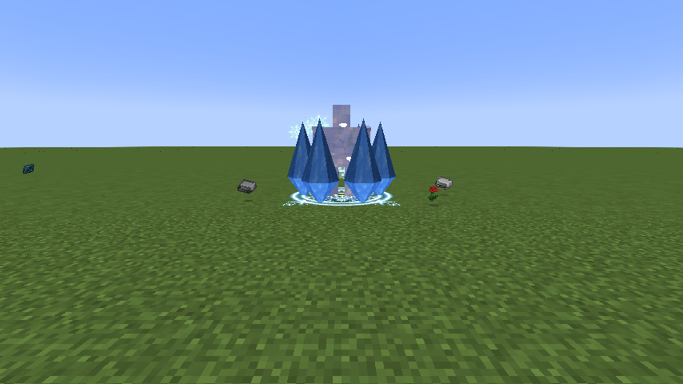
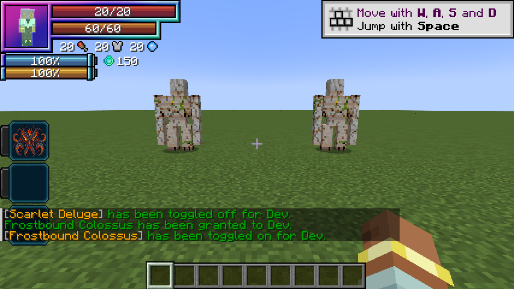

# Ymir, Lord of Winter

[Main Page](https://github.com/Bithio999/MC/wiki/Home) · [Skills](https://github.com/Bithio999/MC/wiki/Skills) · [Evolution](https://github.com/Bithio999/MC/wiki/Evolution) · [Mechanics](https://github.com/Bithio999/MC/wiki/Mechanics) · [Commands](https://github.com/Bithio999/MC/wiki/Commands)

| Skill data | Ymir, Lord of Winter |
| --- | --- |
| Category | Ultimate Skill |
| Inspiration | Jin Dahaad |
| Combat role | Avalanche impact / capture / ice siege |
| Active modes | 3 |
| Toggleable passive | Colossus Carapace |
| Passive upkeep | 80 aura / second |
| Registry ID | `wildhunt:ymir` |
| Previous | [Frostbound Colossus](https://github.com/Bithio999/MC/wiki/Frostbound-Colossus) |
| Evolution | — |

## Overview

A complete replacement for the former rime/fissure/ward kit. Aim a heavy avalanche impact, capture a single foe in an ice prison, and sustain a native barrier carapace. Ymir’s signature rains telegraphed ice onto fixed positions.

## Acquisition

Evolve [Frostbound Colossus](https://github.com/Bithio999/MC/wiki/Frostbound-Colossus) as Sovereign Hunter with 2,000,000 base EP and mastery of that Unique. Use `/wildhunt ascend jin_dahaad`. It replaces only the matching Unique; the Ultimate starts with its own mastery.

## Active modes

| Mode | Aura | Cooldown | Raw opening damage |
| --- | ---: | ---: | ---: |
| 1. Avalanche Crash | 800 | 3 s | 300 |
| 2. Glacial Prison | 2,600 | 7 s | 165 |
| 3. Heavenfall Glacier | 6,000 | 60 s | See signature below |

**0.7.0 damage adjustment:** multiply every raw damage value below by **0.90**. This applies to direct hits, ricochets, fields, counters and signature pulses. Raw values already include the Ultimate’s 3× multiplier where applicable. Mastery adds up to 50%. **Wild Hunt applies no EP damage scaling.** Native elemental boosts, defenses, rank interactions and the listed situational modifiers still apply. EP requirements for race evolution and Ultimate ascension are unchanged.

### Avalanche Crash

Aim at a visible enemy up to 24 blocks away, or at the endpoint if no enemy is selected. Erupt eight rendered ice spires around the impact. Damage enemies in a 6-block radius and launch them upward and outward, respecting knockback resistance. This is an immediate aimed impact, not the old travelling fissure. It neither builds nor consumes rime.

### Glacial Prison

Aim at one visible hostile within 28 blocks. Deal the listed hit damage, then apply Tensura’s native Frost effect for up to 6 seconds, subject to its rank and resistance checks. Six rendered spires and an Ice magic circle mark the prison. The visual cage places no blocks and adds no separate collision wall. There is no projectile-interception budget.

### Heavenfall Glacier

Anchor an ice siege at the selected enemy’s position within twenty-four blocks, or at the aim endpoint. For ten seconds, select up to three enemies within ten blocks of that anchor each second. Mark their current positions with circles and falling ice. Each mark explodes after ten ticks (half a second), striking a 2.5-block radius. Opening raw damage is 300 per impact; later impacts use 135, before mastery and native modifiers. Overlapping marks cannot strike one victim twice in the same resolution tick. Enemies can leave the marked locations before impact.

## Toggleable passive: Colossus Carapace

While toggled on, gain 40 armor, 72 physical barrier, 36 magic barrier, one knockback resistance and 100% water-element boost. Tensura classifies ice under water for this boost. This uses the native barrier layer and damage rules, not absorption or the former projectile-deletion ward.

The passive also arms a **350-capacity native Multilayer Barrier**, which appears in Tensura’s shield HUD counter when its Barrier decoration is enabled. The counter is a per-hit blocking capacity, not absorption hearts or a custom health bar. Native rules spend magicules on blocked damage and can break the barrier on overflow, insufficient magicules or stronger attacks. While still toggled on, a broken barrier automatically rearms on the first paid upkeep after **ten seconds without an incoming hit**. Any new hit restarts the delay, including hits completely blocked by a surviving shield. Retoggling does not bypass the delay. Surviving shields persist across relogs.

Enable or disable this through Tensura’s native **Ability Selection** skill toggle. It is separate from active mode cycling and has no fifteen/thirty-second duration. Upkeep is **80 aura per second**, with the first second paid on enabling. It turns off when aura is insufficient or activation requirements fail. Turning it off removes its own attribute modifiers immediately.

The toggle no longer emits constant frost crystals. Native barrier rendering and the HUD remain.

## Suggested combo

Capture an enemy with Glacial Prison → aim Avalanche Crash at the captive and nearby foes. As Ymir, use the prison to hold a target within Heavenfall Glacier’s warning circles.

## Strengths and limitations

Prison uses native Frost, so immunity, skill rank and stronger defensive effects can affect it. The cage mesh is visual. Icefall marks stay where they were placed and can be dodged. Neither spires nor falling ice change terrain. There are no rime stacks, shatter preparation, finite projectile wards or expanding frostfronts.

## In-game preview

Captured in the Minecraft 1.21.1 development client with Wild Hunt 0.5.0.

## Native barrier HUD

The Unique passive’s native shield counter in Wild Hunt 0.6.0. Its Ultimate uses a higher capacity.

## Related pages

[Skills](https://github.com/Bithio999/MC/wiki/Skills) · [Mechanics](https://github.com/Bithio999/MC/wiki/Mechanics) · [Evolution](https://github.com/Bithio999/MC/wiki/Evolution) · [Commands](https://github.com/Bithio999/MC/wiki/Commands)

---

**Categories:** Tensura: Wild Hunt · Version 0.7.0
