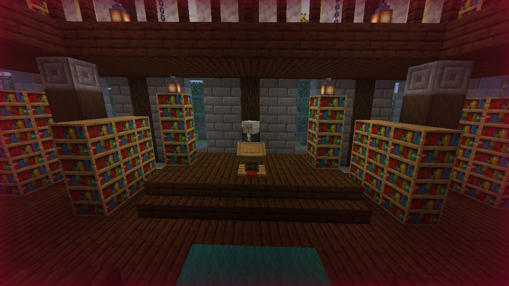
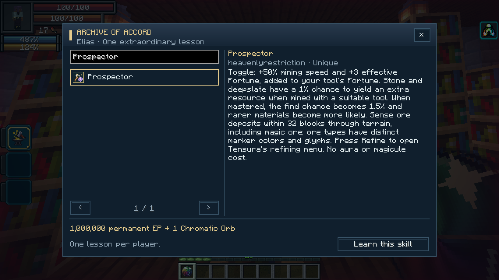
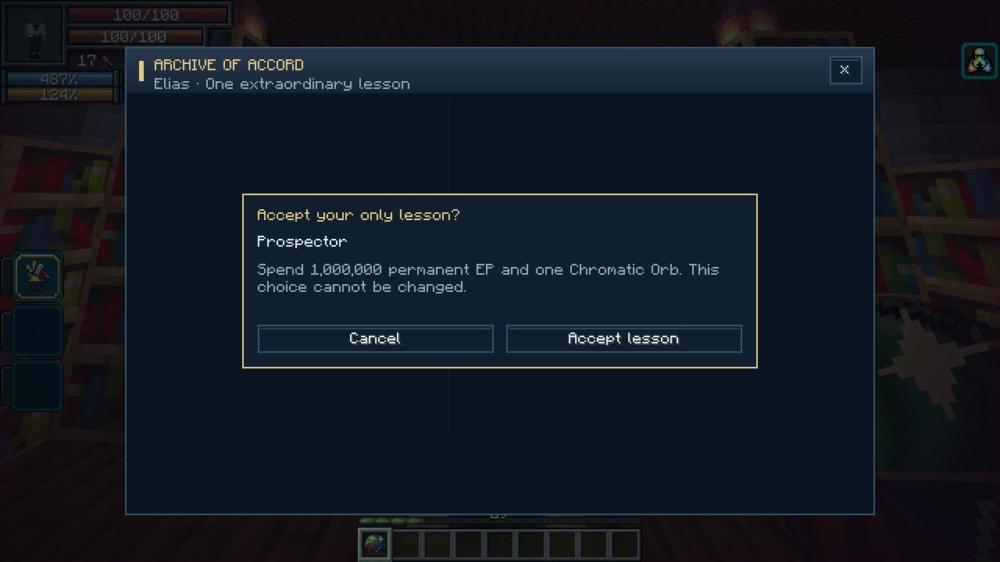
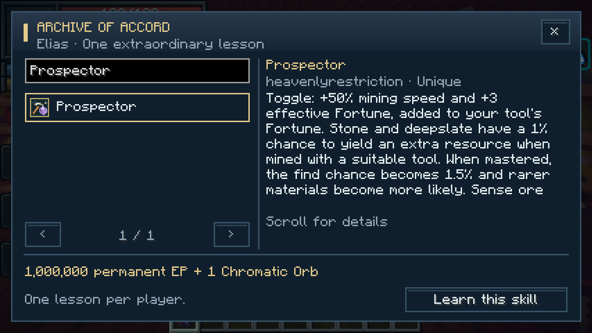
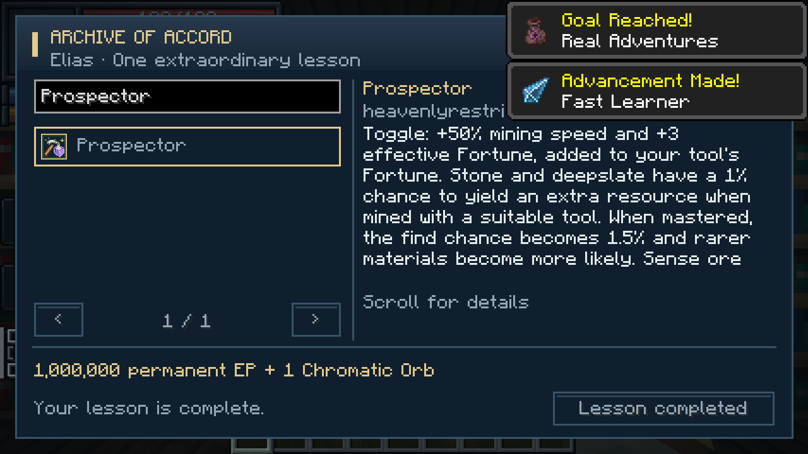

# Archive of Accord

[All wikis](../README.md) · [TensuraAdditionalAdditions](TensuraAdditionalAdditions.md) · [Skills](Additions-Skills.md)

| NPC data | Value |
| --- | --- |
| Mentor | Elias, the Archivist |
| Location | Rare Archive of Accord structures in the Overworld |
| Service | Choose and permanently learn one eligible Unique Skill |
| Default cost | 1,000,000 permanent EP + 1 Chromatic Orb |
| Limit | One successful lesson per player |



## Finding the archive

Look for a slate-roofed, two-storey library in forests, plains, meadows and savannas. Inside are reading alcoves, upper galleries and Elias's teaching dais. Archives use a sparse 128-chunk placement grid; unsuitable biomes can make them farther apart. They generate in **new chunks**, including newly explored regions of existing worlds.

Marauder's Map can search for **`heavenlyrestriction:mentor_archive`**. With commands enabled, use:

```mcfunction
/locate structure heavenlyrestriction:mentor_archive
```

Elias stays inside and is protected from ordinary damage. Each archive contains a mentor, but visiting another archive does not grant another lesson.

## Taking a lesson

Interact with Elias, search by skill name or mod, select a Unique and read its description. Choose **Learn this skill**, review the price and confirm. The skill is permanent and starts **unmastered**.





The default payment is **one Chromatic Orb and 1,000,000 permanent EP**. Permanent aura and magicule capacities pay proportionally to your current permanent reserves. Equipment and temporary bonuses cannot pay the bill; some permanent EP must remain afterward. There is **no additional magicule acquisition charge**. The EP price is configurable in `tensura-additions-mentor.toml`.

Canceled, unaffordable or blocked attempts consume nothing. Successful purchases cannot be exchanged or refunded. Death, reincarnation, losing the skill and Parallel World Jumper do not restore the lesson.

## Available skills

The catalogue includes normal Unique skills from Tensura and installed addons, including synthesis partners such as **Great Sage**, **Godly Craftsman**, **Split Mind** and **Prospector**. Already learned skills cannot be purchased. Existing acquisition restrictions and native unlock protections still apply.

**Chained** is excluded because it belongs to its reincarnation lineage. **Parallel World Jumper** is offered only in supported private single-player worlds. Ultimate skills and skills in the Godly tier are not taught. Servers can extend the `heavenlyrestriction:mentor_excluded` skill tag with a datapack.

After learning the missing component, master it and meet the usual [Hephaestus](Additions-Hephaestus.md) or [Metis](Additions-Metis.md) synthesis requirements. Taking a lesson does not complete an Ultimate synthesis.

<details><summary>Compact menu and completed lesson</summary>





</details>
