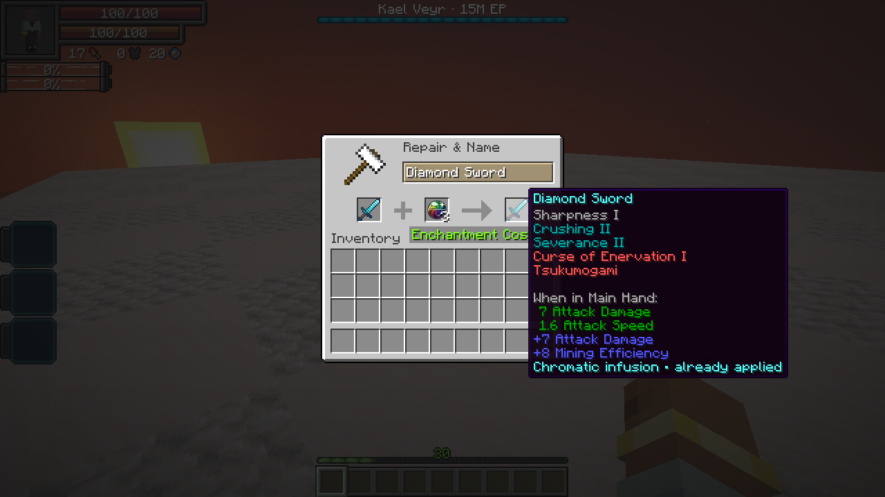

# Chromatic Orb

[All wikis](../README.md) · [TensuraAdditionalAdditions](TensuraAdditionalAdditions.md) · [Equipment](Additions-Weapons.md)

A one-time equipment enhancement. In an **anvil**, combine equipment in the left slot with a Chromatic Orb in the right slot. Taking the result costs **one orb and one XP level**.

Every eligible engraving gains **one level**, including beyond its normal maximum. **Curses, blessings and ordinary enchantments are unchanged.** Equipment needs at least one eligible engraving.

An infused piece cannot use another orb. Its tooltip shows **Chromatic infusion · already applied**. Renaming, repairs, smithing and normal gear evolution preserve that history. A grindstone removes engravings normally and does not make the equipment eligible for another orb.

[Crafting](#crafting) · [Upgraded effects](#upgraded-engraving-effects)

## Crafting

Combine **one of each** ingredient below in any arrangement in a crafting grid to make one orb.

| Ingredient | Source |
| --- | --- |
| **Bulwark Shard** | High Orcs, Armorsauruses and Horned Bears |
| **Sentinel Shard** | Dragonewts, Basilisks, Greater Daemons and Arch Daemons |
| **Skirmisher Shard** | Tempest Star Wolves, Blade Tigers and Knight Spiders |
| **Starless Core** | [Kael Veyr](Additions-Kael-Veyr.md) · one guaranteed per defeat |

Shards have a **25% drop chance** from the matching unowned [High Realm](Additions-The-High-Realm.md) elite. The kill must be credited to a player or their subordinate. Ordinary mobs and owned subordinates do not drop shards.

## Upgraded engraving effects

The tables show an engraving at its **ordinary maximum → one level above maximum**. An orb used below that maximum still adds only one level. Values use the default enchantment data shared by Tensura **2.0.1.3 and 2.0.1.4**; server datapacks and configuration can change them.

Bonuses apply in each engraving’s normal equipment slots and attack conditions. Weapon and armor percentages below are native equipment-attribute bonus coefficients, before other skills and defenses. Attribute contributions combine with existing equipment and skill modifiers.

### Weapon and elemental effects

| Engraving | Upgrade | Effect |
| --- | --- | --- |
| **Crushing** | I → II | Weapon damage bonus **50% → 100%**; mining efficiency **5 → 8**; arrow damage **+0.5 → +1**. Extra durability damage per attack also rises **5 → 10**. <!-- engraving: tensura:crushing --> |
| **Sturdy** | I → II | Weapon damage bonus **30% → 60%**; armor bonus **10% → 20%**; mining efficiency **+3 → +6**; arrow damage **+0.3 → +0.6**. Its normal durability-loss prevention is already saturated at I. <!-- engraving: tensura:sturdy --> |
| **Swift** | I → II | Weapon damage bonus **10% → 20%**; attack speed **+0.2 → +0.4**; melee reach **+1 → +2 blocks**; mining efficiency **3 → 6**; crossbow charge-time reduction **0.5 → 1 second**; arrow damage **+0.1 → +0.2**. <!-- engraving: tensura:swift --> |
| **Barrier Piercing** | II → III | At full attack charge, multilayer/barrier-entity reduction **20% → 30%** per eligible hit. Armor mitigation subtraction **40 → 60 percentage points**, with mitigation floored at zero; projectile piercing amount **6 → 9**. <!-- engraving: tensura:barrier_piercing --> |
| **Severance** | I → II | Flat attack damage **+3 → +6**. The anti-healing wound fraction remains capped at **50% of the triggering damage**; II does **not** turn it into 100%. Native wound and protection checks still apply. <!-- engraving: tensura:severance --> |
| **Holy Weapon** | I → II | Additional **Holy** damage coefficient **1× → 2×** the native triggering-attack amount, before that extra hit’s defenses. <!-- engraving: tensura:holy_weapon --> |
| **Magic Weapon** | I → II | Additional **Magic** damage coefficient **1× → 2×** the native triggering-attack amount, before that extra hit’s defenses. <!-- engraving: tensura:magic_weapon --> |
| **Soul Eater** | I → II | Additional **Spiritual / Soul Scatter** damage coefficient **1× → 2×** the native triggering-attack amount. This targets SHP through Tensura’s spiritual-damage rules. <!-- engraving: tensura:soul_eater --> |
| **Energy Steal** | I → II | Transfers **1% → 2%** of the target’s **current aura and current magicules** per eligible trigger. The player weapon cooldown stays **1 second**. It does not steal permanent capacity. <!-- engraving: tensura:energy_steal --> |
| **Elemental Boost** | I → II | Each covered elemental damage-boost attribute receives **+0.10 → +0.20** per applicable equipped item: earth, darkness, flame, light, space, water and wind. <!-- engraving: tensura:elemental_boost --> |

### Defensive effects

| Engraving | Upgrade | Effect |
| --- | --- | --- |
| **Elemental Resistance** | II → III | Each of the seven covered elemental resistance attributes receives **+0.20 → +0.30** per applicable equipped item. <!-- engraving: tensura:elemental_resistance --> |
| **Magic Protection** | I → II | Magic-resistance attribute contribution **+0.10 → +0.20** per applicable equipped item. <!-- engraving: tensura:magic_protection --> |
| **Spiritual Protection** | I → II | Spiritual-damage reduction **10% → 20%**, using the highest applicable equipped level. <!-- engraving: tensura:spiritual_protection --> |
| **Severance Protection** | I → II | Reduction to newly applied Severance wounds **10% → 20%**, using the highest applicable equipped level. Existing wounds are not removed. <!-- engraving: tensura:severance_protection --> |
| **Energy Protection** | I → II | Reduction to energy-drain amounts **10% → 20%**, using the highest applicable equipped level. <!-- engraving: tensura:energy_protection --> |
| **Magic Interference** | I → II | Armor contribution to qualifying magic-damage reduction **20% → 40% per piece** at default settings. A blocking shield still contributes only **one level**; the weapon’s barrier-bypass check remains presence-based. <!-- engraving: tensura:magic_interference --> |
| **Holy Coat** | I → II | Damage multiplier against qualifying holy-affected targets **1.25× → 1.5×**; arrow damage **+0.25 → +0.5**; protection against qualifying holy-affected direct attackers **4 → 8 protection points**. <!-- engraving: tensura:holy_coat --> |

### Utility effects

| Engraving | Upgrade | Effect |
| --- | --- | --- |
| **Magic Capacity** | III → IV | Adds **3 → 4 magic-storage slots** to compatible native spell-storage equipment. It does not increase the player’s maximum magicules. <!-- engraving: tensura:magic_capacity --> |
| **Magicule Absorption** | II → III | Adds **+2.0 → +3.0** to the magicule-regeneration multiplier per applicable item. With a base multiplier of 1 and no other modifiers, that is **3× → 4× total regeneration**. <!-- engraving: tensura:magicule_absorption --> |
| **Slotting** | III → IV | Elemental-core storage capacity **3 → 4**. Core-combination damage and casting still require a matching native combination recipe; see the four-core limit below. <!-- engraving: tensura:slotting --> |
| **Breathing Support** | I → II | **No stronger effect.** Level I already removes the native need to breathe; II keeps that same benefit. <!-- engraving: tensura:breathing_support --> |

### Inheritance and special effects

| Engraving | Upgrade | Effect |
| --- | --- | --- |
| **Dead End Rainbow** | I → II | At full attack charge, direct SHP damage changes from **clamp(S/7 + 10% of S, 10, 500)** to **clamp(S/7 + 20% of S, 20, 1,000)**, where **S** is the target’s maximum SHP. The **1-second** player cooldown remains. Armor mitigation is already fully bypassed at I. <!-- engraving: tensura:dead_end_rainbow --> |
| **Intangibility** | I → II | Projectile piercing amount **5 → 10**. Armor mitigation is already fully bypassed at I, and the native melee shield-bypass condition does not become stronger. <!-- engraving: tensura:intangibility --> |
| **Nullification** | I → II | **No stronger effect.** Barrier shattering, skill-effect removal, spiritual targeting and the **2-second skill seal** remain unchanged. <!-- engraving: heavenlyrestriction:nullification --> |
| **Afterwind** | I → II | [Vesper](Additions-Vesper.md) delayed Wind cut: **30% → 75%** of raw attack damage. The **0.2-second delay**, **3-second cooldown** and **5-second mark** stay the same. <!-- engraving: heavenlyrestriction:afterwind --> |

### Mysticism addon engravings

These apply when Mysticism is installed, including the checked Neo Otherworld 1.1.3a build.

| Engraving | Upgrade | Effect |
| --- | --- | --- |
| **Holy Flames** | I → II | Armor mitigation subtraction **50 → 100 percentage points**, floored at zero. The applied **Brimstone Flames I** remains **5 seconds**. <!-- engraving: mysticism:holy_flames --> |
| **Boreal Frost** | I → II | **No stronger effect.** Both levels apply **Eternal Permafrost VI for 10 seconds**; its duration and amplifier are fixed in the enchantment definition. <!-- engraving: mysticism:boreal_frost --> |

### Limits and exclusions

- **Four-core combinations:** Slotting IV can store four cores, but the checked native data has **no four-core combination recipes**. A four-core loadout therefore has no matching native combination attack or cast. Use a supported mix unless your server adds a matching recipe. The native five-core special recipe requires five slots and is not unlocked by III → IV.
- **Magic Interference:** native resistance-degradation and current-magicule checks still gate its reduction. An attacker with at least **1.5× the wearer’s current magicules** bypasses that engraving-based mitigation. Higher armor levels do not change the separate weapon barrier-bypass condition.
- **Armor and protection limits:** armor mitigation cannot fall below zero. Native protection-point and resistance limits still apply; an extra level does not guarantee the same increase to final damage or defense in every build.
- **Protected blessings:** **Blessing of Vitality, Blessing of Vigor, Blessing of Transcendence, Blessing of Growth and Blessing of Restoration** receive **no level increase**.
- **Protected curses:** curse-tagged engravings, including **Tsukumogami**, and configured curse engravings stay unchanged. Ordinary enchantments such as Sharpness also stay unchanged.

## Engraving research

Godly Craftsman cannot store engravings above their ordinary maximum. Rejected overcap engravings stay on the donor; other eligible entries can still be learned. Existing overcap knowledge in that skill is normalized when read.

[Lord of the Forge](Additions-Hephaestus.md) can store overcap levels within its research limits. Applying an Orb-eligible overcap marks the receiving equipment’s Chromatic upgrade as used. This blocks repeatedly copying the engraving to a fresh item and raising it with another Orb. Applying only normal capped levels keeps the upgrade available. Editing already-infused equipment retains its level and spent upgrade.
