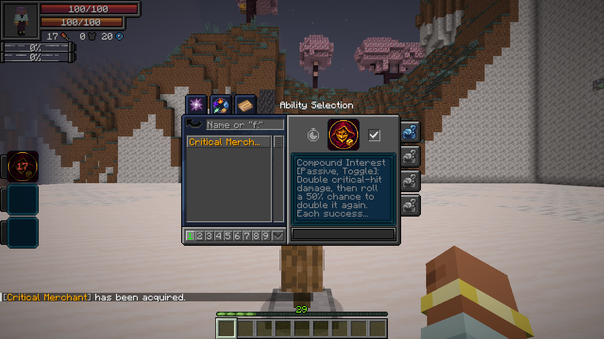
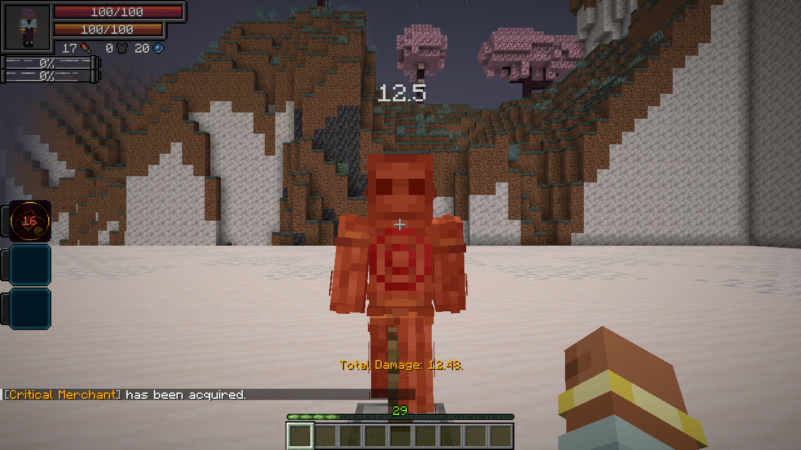

# Critical Merchant

[All wikis](../README.md) · [TensuraAdditionalAdditions](TensuraAdditionalAdditions.md) · [Skills](Additions-Skills.md)

| Skill data | Value |
| --- | --- |
| Tier | Unique |
| Obtaining | Normal reincarnation Unique pool, subject to server settings |
| Role | Critical-hit damage and guaranteed criticals |
| Resource cost | Passive: none · Active: 1,000 magicules |

## Compound Interest · Passive, Toggle

Every critical hit receives a guaranteed **×2 damage bonus**. It then has a **50% chance** to double again. Every success permits another 50% roll; the chain ends on its **first failure**, after at most **100 additional rolls**.

Each critical starts a fresh chain. Before defenses, a **100-damage critical** becomes **200**, then **400** after one successful roll, then **800** after two.

Enable the passive through Tensura’s **Skills → Unique** checkbox. **Damage type:** the original attack’s type. Normal armor, resistances, barriers and other defenses still apply.

## Guaranteed Profit · Active, Press

Spend **1,000 magicules** to make your **next ten landed hits** critical hits. **Cooldown: 20 seconds.** Recasting refreshes the count to ten; it does not stack. The native skill mode shows the remaining hits.

This works independently of the passive. Toggle **Compound Interest** on to amplify those criticals. Native melee, owned projectiles and abilities are supported, including direct spiritual damage. Each damaged target counts as a hit. Misses, fully blocked hits and immune targets do not spend a guarantee; Tensura training-dummy damage counts.

Unbound’s existing guaranteed criticals retain one base critical multiplier. Guarantees clear on death or forgetting the skill. **Damage type:** none directly; affected attacks retain their normal types.

**Fettered Human:** excluded from its reincarnation rolls because the active costs magicules.
