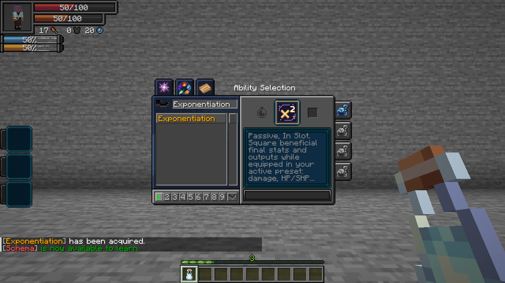

# Exponentiation

[All wikis](../README.md) · [TensuraAdditionalAdditions](TensuraAdditionalAdditions.md)

| Skill data | Value |
| --- | --- |
| Tier | Unique |
| Obtaining | Reincarnation Unique pool; eligible for Fettered Human |
| Activation | Passive, In Slot |
| Cost / cooldown | None |
| Damage type | None directly; enhanced attacks retain their original damage type |

## Exponentiation · Passive, In Slot

Learn the skill and equip it in your **current Tensura skill preset**. Supported beneficial final values become **x²**: 10 damage becomes 100, 5 healing becomes 25, and 4 attack speed becomes 16. Owning the skill without equipping it, an unfinished learning entry or an inactive preset gives no bonus.

**Movement is excluded. Attack speed, mining speed and chant speed are included.** Values of 1 or less stay unchanged so fractions do not become weaker. Chances keep their native maximum, item drops keep normal stack limits, and extremely large numbers remain finite.

## Outputs and gains

| Value | What changes |
| --- | --- |
| Outgoing HP damage | Squares the completed damage after normal modifiers and reductions; retains the original damage type and immunity rules |
| Direct SHP damage | Squares the completed spiritual damage after native resistance and protection |
| HP healing | Squares the final positive healing amount, including supported direct healing and Schema bonuses |
| SHP healing | Squares positive SHP recovery; respects the effective maximum |
| Aura / magicule recovery | Squares the completed positive resource gain, including native regeneration, biome input and sleep recovery |
| Permanent aura / magicule gains | Squares each native positive pool award after its normal split; includes native kill EP awards and EnergyHelper gains |
| Learning / mastery | Squares the awarded points after native point modifiers; requirements and mastery caps stay unchanged |
| Mining speed | Squares the completed block-breaking speed after tool, enchantment and skill modifiers |
| Experience | Squares positive player XP awards; does not generate extra XP orbs |
| Block / mob drops | Squares each final stack quantity, capped at that item’s normal maximum stack size; one item stays one |

Damage, healing, regeneration, mining and point formulas read their ordinary inputs before the completed output is squared. For example, a normal 10-damage melee hit becomes 100, rather than using a squared attack attribute and then squaring the hit again. The displayed attack attribute still shows its empowered value. Capacity and gain are distinct benefits: maximum aura and a new aura award can both be enhanced.

## Affected attributes

The following **63 native attributes** are covered when their value exceeds 1. Effects must already exist on your character: Exponentiation does not grant an absent barrier, element, sense or skill. Attributes used as inputs to the output calculations above are handled at that output instead of being applied twice.

| Attribute | Exact ID |
| --- | --- |
| Critical Attack Chance | `manascore_attribute:critical_attack_chance` |
| Critical Damage Multiplier | `manascore_attribute:critical_damage_multiplier` |
| Armor | `minecraft:generic.armor` |
| Armor Toughness | `minecraft:generic.armor_toughness` |
| Attack Damage | `minecraft:generic.attack_damage` |
| Attack Speed | `minecraft:generic.attack_speed` |
| Mob Follow Range | `minecraft:generic.follow_range` |
| Luck | `minecraft:generic.luck` |
| Max Absorption | `minecraft:generic.max_absorption` |
| Max Health | `minecraft:generic.max_health` |
| Oxygen Bonus | `minecraft:generic.oxygen_bonus` |
| Block Break Speed | `minecraft:player.block_break_speed` |
| Block Interaction Range | `minecraft:player.block_interaction_range` |
| Entity Interaction Range | `minecraft:player.entity_interaction_range` |
| Mining Efficiency | `minecraft:player.mining_efficiency` |
| Submerged Mining Speed | `minecraft:player.submerged_mining_speed` |
| Nametag Distance | `neoforge:nametag_distance` |
| Ability Learning Gain | `tensura:ability_learning_gain` |
| Ability Mastery Gain | `tensura:ability_mastery_gain` |
| Analysis Distance | `tensura:analysis_distance` |
| Analysis Level | `tensura:analysis_level` |
| Aura Gain Percentage | `tensura:aura_gain` |
| Aura Regeneration Multiplier | `tensura:aura_regeneration_multiplier` |
| Chant Speed | `tensura:chant_speed` |
| Darkness Attack Boost | `tensura:darkness_boost` |
| Darkness Attack Resistance | `tensura:darkness_resistance` |
| Dodge Invulnerability | `tensura:dodge_invulnerability` |
| Dodge Negate Chance | `tensura:dodge_negate_chance` |
| Earth Attack Boost | `tensura:earth_boost` |
| Earth Attack Resistance | `tensura:earth_resistance` |
| Fire Attack Boost | `tensura:flame_boost` |
| Fire Attack Resistance | `tensura:flame_resistance` |
| Gravity Attack Boost | `tensura:gravity_boost` |
| Heat Sense Radius | `tensura:heat_sense_radius` |
| Illusion Attack Boost | `tensura:illusion_boost` |
| Lava Capacity | `tensura:lava_capacity` |
| Light Attack Boost | `tensura:light_boost` |
| Light Attack Resistance | `tensura:light_resistance` |
| Lightning Attack Boost | `tensura:lightning_boost` |
| Magic Barrier | `tensura:magic_barrier` |
| Magic Interference | `tensura:magic_interference` |
| Magic Resistance | `tensura:magic_resistance` |
| Magicule Gain Percentage | `tensura:magicule_gain` |
| Magicule Regeneration Multiplier | `tensura:magicule_regeneration_multiplier` |
| Max Aura | `tensura:max_aura` |
| Max Magicule | `tensura:max_magicule` |
| Max Spiritual Health | `tensura:max_spiritual_health` |
| Auto Melee Dodge Chance | `tensura:melee_dodge_chance` |
| Multilayer Barrier | `tensura:multilayer_barrier` |
| Physical Barrier | `tensura:physical_barrier` |
| Presence Concealment | `tensura:presence_concealment` |
| Presence Sense | `tensura:presence_sense` |
| Presence Sense Radius | `tensura:presence_sense_radius` |
| Auto Projectile Dodge Chance | `tensura:projectile_dodge_chance` |
| Sound Attack Boost | `tensura:sound_boost` |
| Space Attack Boost | `tensura:space_boost` |
| Space Attack Resistance | `tensura:space_resistance` |
| Spiritual Health Regeneration | `tensura:spiritual_health_regeneration` |
| Water Attack Boost | `tensura:water_boost` |
| Water Capacity | `tensura:water_capacity` |
| Water Attack Resistance | `tensura:water_resistance` |
| Wind Attack Boost | `tensura:wind_boost` |
| Wind Attack Resistance | `tensura:wind_resistance` |

## Limits and exclusions

- **Movement:** walking, sprinting, flying, gliding, swimming, sneaking, lava movement, jumping, step height, fall handling, knockback, dodge displacement, dash/teleport travel and body size remain unchanged. Interaction reach and sensing distance are included.
- **Costs and timers:** costs, cooldowns, progression requirements and drawbacks are not squared. Percentage-based costs still follow the resource amount their original formula uses.
- **Fixed skill settings:** fixed durations, radii, target counts, Fortune/enchantment levels, recipe outputs and other hard-coded skill constants are not rewritten. Prospector still surveys 32 blocks and adds Fortune III; its completed mining speed and drop quantities can benefit.
- **Bounded fractions:** values in 0–1, such as fractional resistance degradation, are retained. A normal 1× gain remains 1×. Probabilities expressed in percentage points can increase, up to their native chance cap.
- **Preservation:** equipping does not repeatedly square saved base stats or refill reserves. Unequipping restores normal effective capacities and clamps current HP, SHP, aura and magicules to those capacities. Gains earned while equipped remain earned.
- **Chained:** the locked maximum-magicule capacity remains locked. Exponentiation does not bypass skill acquisition restrictions.
- **Fusion:** combining and restoring bodies transfers their existing reserves without treating the transfer as another healing/resource reward.

These tables describe the supported native attribute and output paths. An unrelated addon’s private variables, custom damage engine or separate inventory system are not automatically covered.
