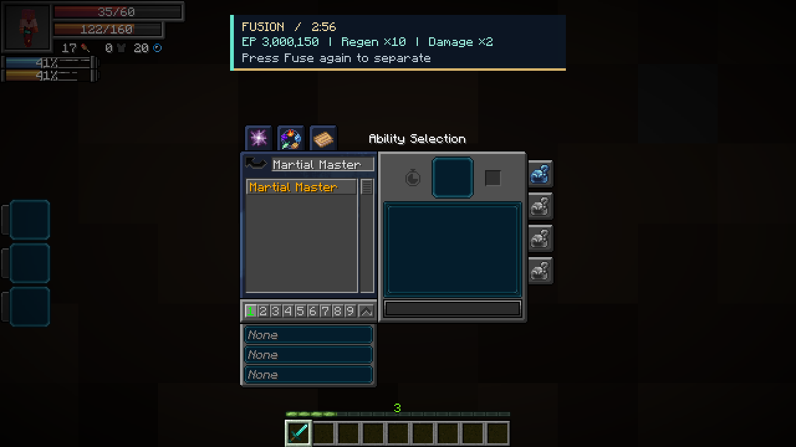
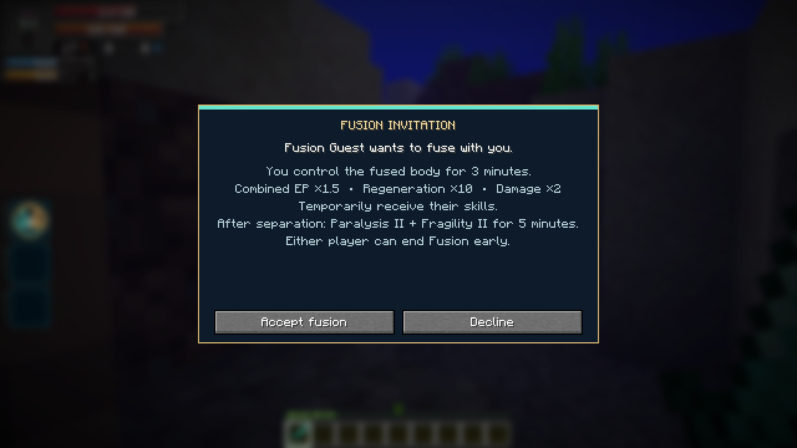
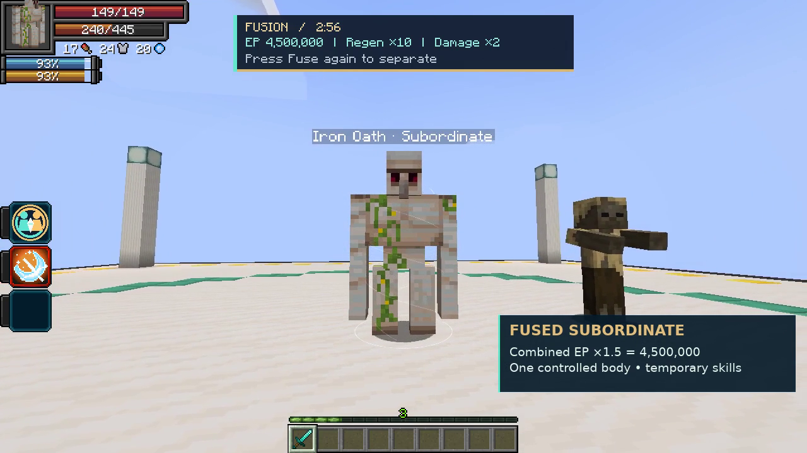

# Fusion

[All wikis](../README.md) · [TensuraAdditionalAdditions](TensuraAdditionalAdditions.md)

| Skill data | Value |
| --- | --- |
| Tier | Unique |
| Duration | 3 minutes; **4 minutes 30 seconds when mastered** |
| Range | 16 blocks |
| Cost | None |
| Additional cooldown | None |
| Damage type | None directly; boosted attacks retain their original type |

## Fuse · Active, Press

Aim at your subordinate or another player. Players must accept the invitation. You control a subordinate’s fused form; a receiving player controls their own body.

| Fused benefit | Effect |
| --- | --- |
| EP | **(Your actual max EP + target’s actual max EP) × 1.5**; **× 1.75 when mastered** |
| HP and SHP | **Add both participants’ maximum and remaining HP/SHP**; the EP multiplier does not multiply health |
| Resource split | Combined aura and magicule capacities, each multiplied by 1.5, or **1.75 when mastered** |
| Regeneration | **10×** aura and magicule regeneration, including normal biome bonuses |
| Damage | **2× final outgoing damage**, retaining Physical, magical or Spiritual type |
| Skills | Temporary skill sharing; existing learned skills are retained |

Mastery is checked on the player casting Fuse when the fusion begins.

Press **Fuse** again or choose **Pause → Separate Fusion** to end early. The absorbed caster can also sneak to separate. Fusion cannot be nested.

## Borrowed skills in Tensura’s menu

Open Tensura’s **Ability Selection** menu. Borrowed skills appear in their normal categories, such as **Skills → Unique**, **Magic**, or **Battlewills**. Search `f:temporary` to find temporary entries. Select and slot active abilities normally; passives follow their normal toggle/slot rules. Borrowed entries disappear after separation, and any previous learning entry is restored.

## Separation

Both participants receive **Paralysis II and Fragility II for 5 minutes**, including after early separation. Original forms, EP and permanent skills return. Remaining HP, SHP, aura and magicules are divided in proportion to the original maximum capacities; Fusion does not provide a free refill. Borrowed skill storage and cooldowns return to their owner.

Death, disconnect, dimension changes and server shutdown end Fusion. Normal skill restrictions still apply.

## Obtaining

Can roll as a normal reincarnation Unique. Excluded from Fettered Human’s starting pool because it borrows target skills.

## Player invitation

## In-game preview

[Fusion — recorded on 1.6.0, before combined HP/SHP](../media/fusion.mp4)
