# Hephaestus, Lord of the Forge

[All wikis](../README.md) · [TensuraAdditionalAdditions](TensuraAdditionalAdditions.md) · [Skills](Additions-Skills.md)

| Skill data | Value |
| --- | --- |
| Tier | Ultimate |
| Components | Fully mastered Prospector + Godly Craftsman |
| Awakening | True Demon Lord or True Hero |
| Achievement | Personally craft or smith Netherite or Hihiirokane equipment |
| Acquisition | 250,000 permanent magicules by default; configurable and affected by Tensura’s skill-cost gamerule |
| EP requirement | None |

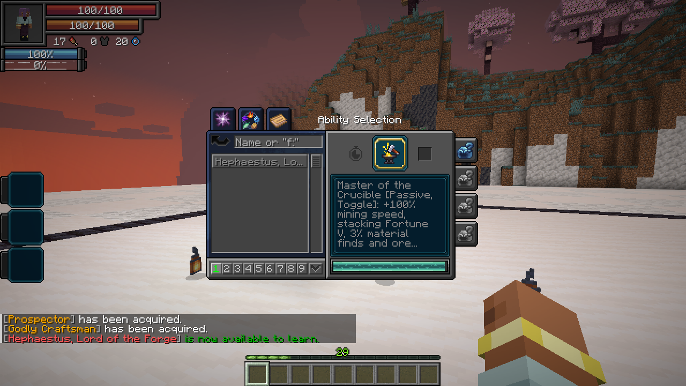

## Obtaining

Owning a component reveals an unfinished Hephaestus entry in Tensura’s **Skills → Ultimate** menu. Slot and activate that entry to open **Synthesis**. Complete the listed conditions, choose **Synthesize Hephaestus**, and confirm the dialog.

Awakening bonuses are applied **before** the acquisition cost. Synthesis waits until awakening is finished. Already-awakened players can qualify later. Hephaestus replaces both components and begins learned, unmastered. Engraving knowledge, stored materials and affected presets are retained.

The crafting achievement requires an actual craft or smithing result while you have Godly Craftsman. **Tensura’s Smithing Bench**, the vanilla smithing table and crafting tables are supported, including shift-click. Previewing a recipe does not count. The eligible equipment can be changed with the `heavenlyrestriction:hephaestus_synthesis_equipment` item tag. There is no EP threshold.

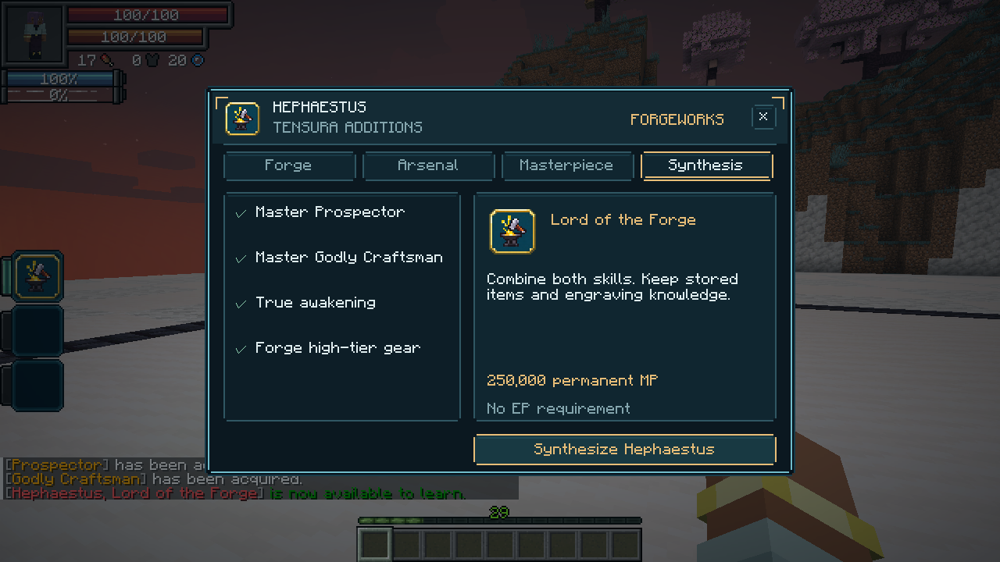

## Master of the Crucible · Passive, Toggle

- **+100% mining speed**, **Fortune V** added to the tool’s Fortune, and a **3%** material-find chance when properly mining stone or deepslate.
- Subtle ore markers within **32 blocks**, differentiated by material, including magic ore.
- Equipment you personally forge gains **+20% weapon attack damage, armor and armor toughness**, and **50% reduced durability damage**.

Forging bonuses apply once per item and remain on the equipment. They reduce ordinary wear and native EP durability loss; maximum durability is unchanged. **Damage type:** none directly; improved equipment retains its normal damage type.

## Divine Forge · Active, Press

Use the workshop’s **Forge** tab. Select equipment on the left, choose a forge action and material on the right, then press the gold action button. **Utilities** opens crafting, refining, engraving and storage. **Reforge** applies the bonus to equipment crafted before you acquired Hephaestus.

Open the forge to craft, use Tensura’s native refining and engraving menus, access inherited storage, temper equipment or repair it. **Recover** returns the previous Prospector refining ingredients to your inventory.

**Overcap engraving research:** Lord of the Forge can retain levels above an engraving’s ordinary maximum, within its research limits. Applying an Orb-eligible overcap automatically marks the receiving equipment as already Chromatic-infused, so it cannot take another Orb. Normal capped engravings leave the Orb upgrade available. Native engraving blacklists still apply. Godly Craftsman cannot research overcap engravings; previously stored overcap knowledge is normalized to the ordinary engraving maximum. Ordinary enchantment bonuses remain unchanged.

**Reforge / Temper:** 2,000 magicules and one selected material. Reforging signs unmarked equipment and applies the ordinary forging benefits. Signed equipment from another smith cannot be overwritten.

| Temper | Weapon effect | Worn armor effect |
| --- | --- | --- |
| Keen | Increased critical-hit damage | Increased critical-hit damage |
| Piercing | Ignores part of armor’s damage reduction | Ignores part of armor’s damage reduction |
| Conductor | Increased elemental damage | Reduced elemental damage taken, including native SHP damage |
| Enduring | Further reduces item wear | Further reduces that armor piece’s ordinary and EP wear |

Iron provides **10%**, Diamond **20%**, Netherite **30%**, and Hihiirokane **35%** temper strength. Only one temper applies; replacing it consumes the material again. Tempers are separate from enchantments, engravings and the [Chromatic Orb](Additions-Chromatic-Orb.md).

**Armor tempers activate only in their proper equipped slot.** Helmet and boots contribute **15%** each, chestplate **40%**, and leggings **30%** of their material’s strength. A matching full set contributes the listed material percentage once, up to **35%**; mixing tempers divides that total among their effects. For example, a Diamond chestplate contributes **8%** critical damage with Keen, **8%** armor penetration with Piercing, or **8%** elemental damage reduction with Conductor. Armor’s offensive bonuses add to the weapon’s bonus rather than multiplying it. Enduring’s full material strength applies to that piece’s wear instead of using the slot weight.

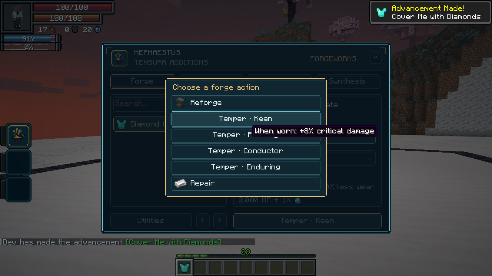

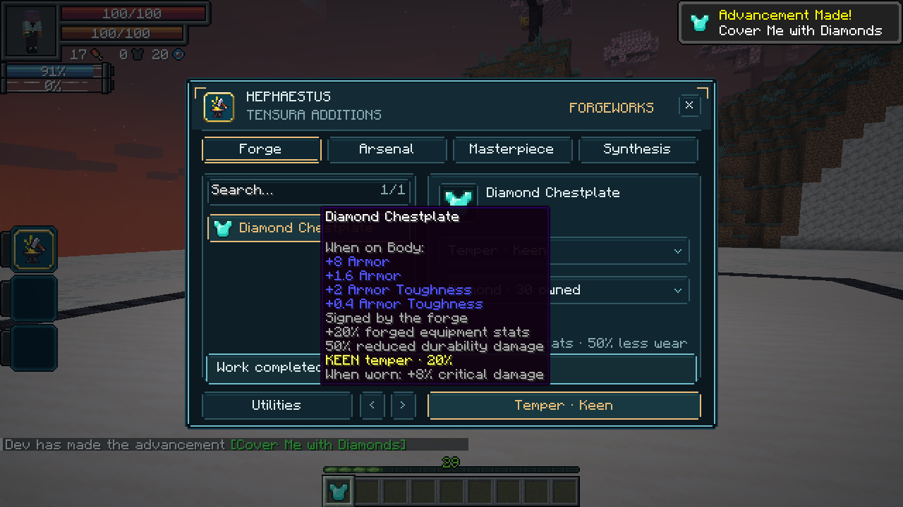

**Repair:** 500 magicules and one selected material. Restores 30% / 60% / 90% / 100% of ordinary durability and native EP durability, respectively, without changing engravings or the Orb’s one-use history. **Damage type:** none directly.

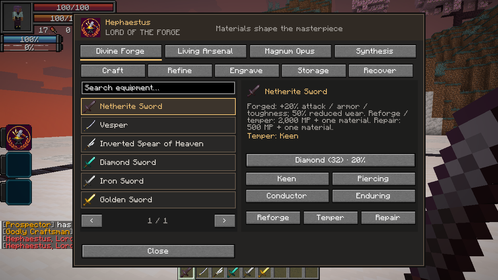

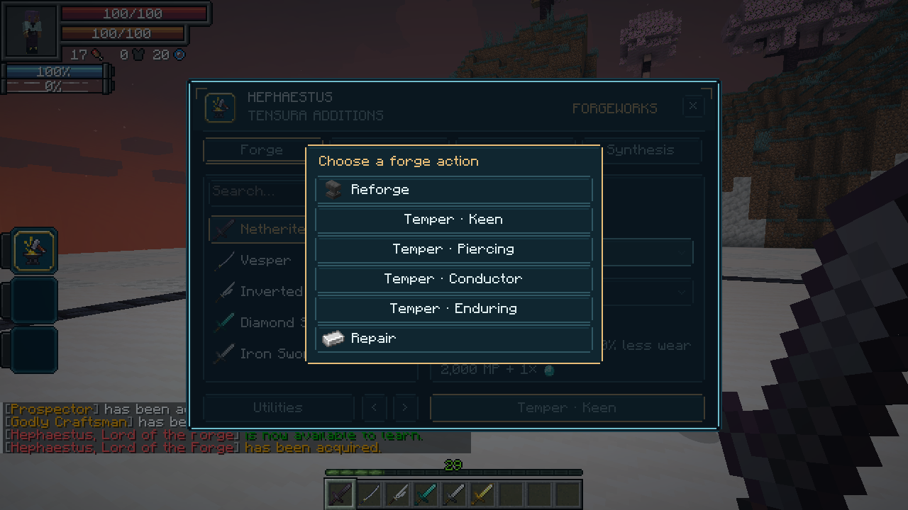

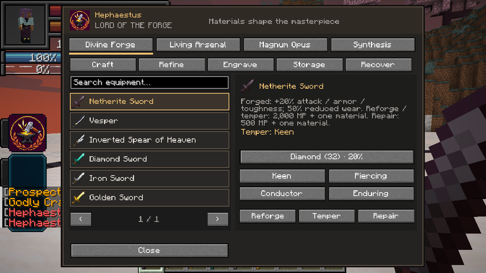

## Living Arsenal · Active, Press

Deploy up to **six actual melee weapons** from your inventory. They hover in a compact formation and take turns making curved slashes with short, tapered wakes, inspired by Terraria’s Terraprisma. The blades turn into each cut. A shared **24-tick round** spaces attacks evenly across the deployed weapons; each weapon attacks once per round.

Weapons prioritize your attack target, then visible hostile mobs or combat opponents within **32 blocks**. They use their own damage, enchantments, engravings and applicable wear reduction. All eligible deployed weapons gain EP from your qualifying kills, using Tensura’s normal equipment-growth rates, engravings, caps and evolutions. Growth remains on the item after recall; normal held equipment still receives its usual reward. Allies are excluded and normal server PvP rules apply.

**Cost:** 1,000 magicules per weapon to deploy, then 10 magicules per weapon each second. Deployed weapons are unavailable for other uses. Activate again to manage the arsenal. Check inventory weapons on the left and choose **Deploy selected**. The six-slot rack on the right shows deployed blades: click a blade to recall it. Add weapons while the arsenal is active. **Shift-activate** or choose **Recall all** to return everything. Death, logout, dimension travel or losing access to the skill recalls the weapons; saved escrow protects them across a restart.

**Damage type:** Physical weapon attacks. Native elemental conversions and engraving follow-ups retain their own types and defenses.

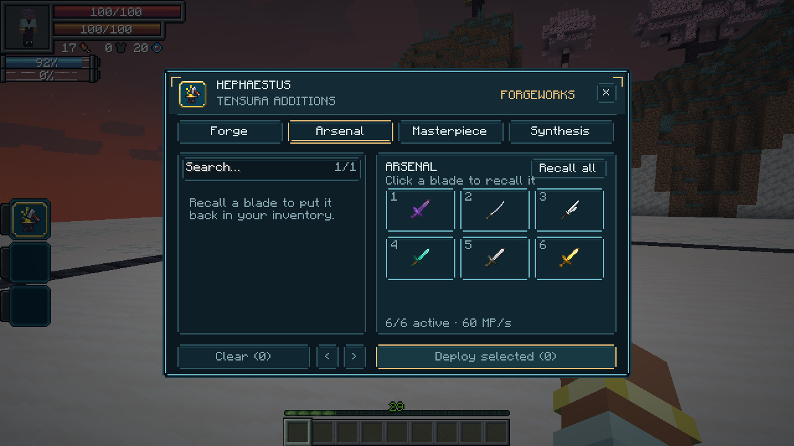

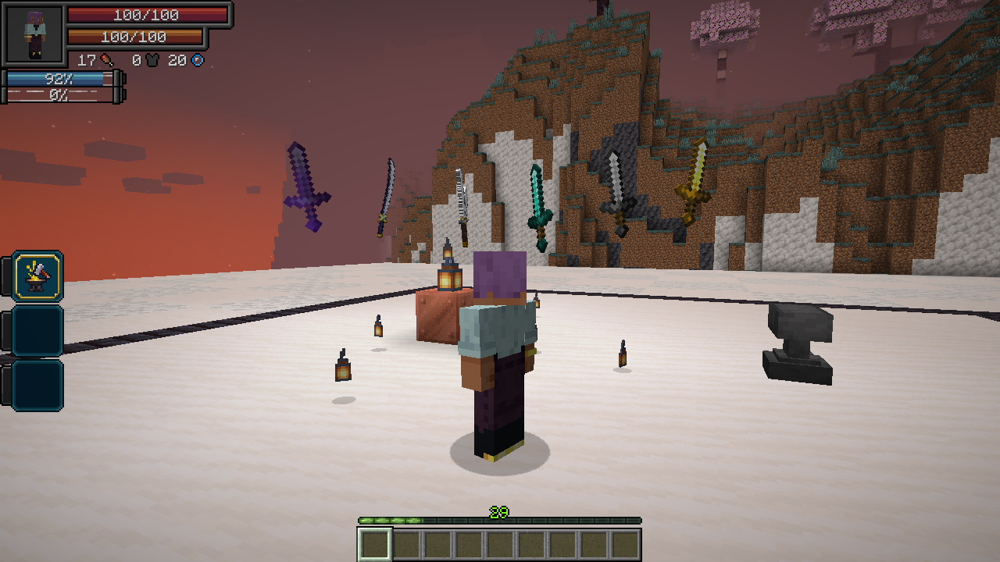

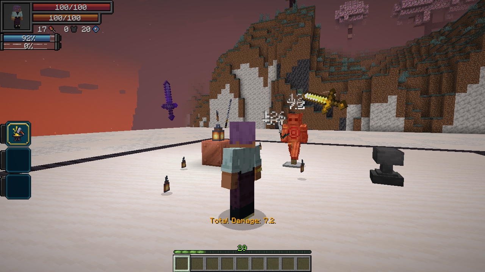

## Magnum Opus · Active, Press

Open **Masterpiece**, select your forged equipment and a material, then **Designate masterpiece** and confirm.

Designate **one personally forged item** as your masterpiece. It receives **+50% equipment stats** and **75% reduced durability damage**, replacing the ordinary +20% / 50% forging benefits. The item gains a glint and gold masterpiece identification; a deployed masterpiece has a golden wake.

**Cost:** 50,000 magicules and two selected materials, Diamond or better. Confirming a new masterpiece removes the old item’s designation, including when that item is stored elsewhere. Its ordinary forging benefits remain.

**Damage type:** none directly. There is no additional transformation or Overforge activation.

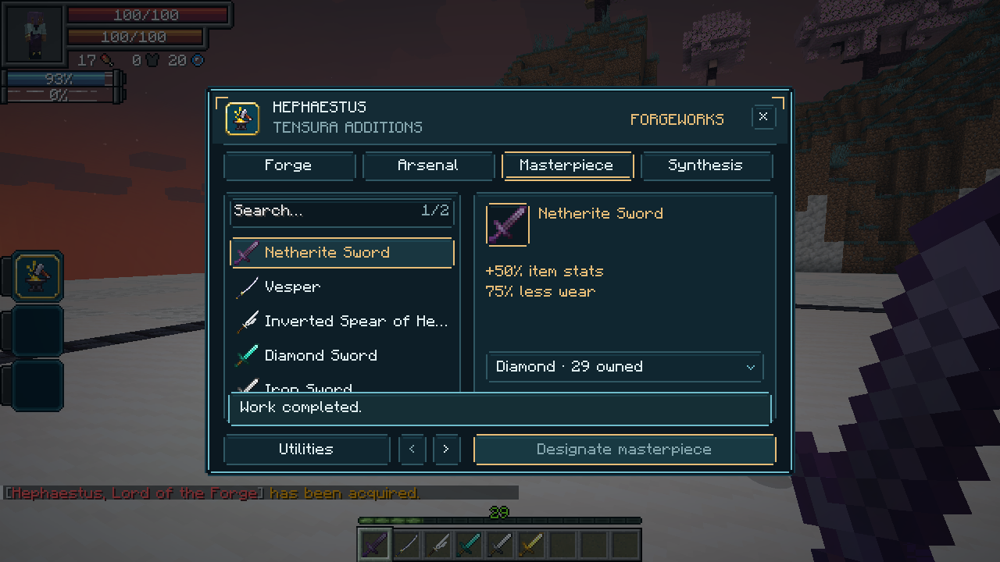

All forge operation and arsenal costs also respect Schema’s resource-cost penalties.
