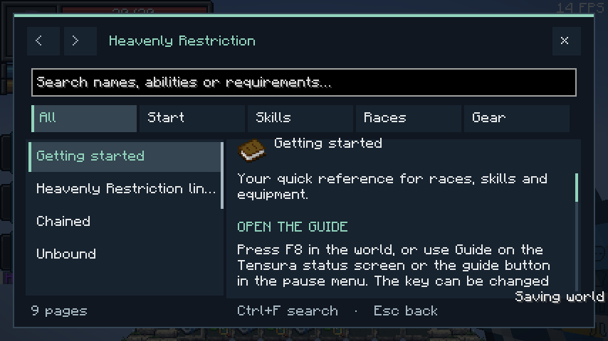

# In-game guide

[All wikis](../README.md) · [TensuraAdditionalAdditions](TensuraAdditionalAdditions.md)

Press **F8**, use the pause-menu **Additions Guide** button, or choose **Guide** below Tensura’s status panel.

- Search names, abilities, damage types or requirements; categories narrow results.
- Scroll the page list and article separately. Use arrows for history and related links for the next topic.
- **Ctrl+F:** search. **Page Up/Down:** scroll. **Esc:** back.

The guide covers this addon only and works offline. Single-player pauses while reading; multiplayer continues. Change its key in Controls.

## Pictures and video

