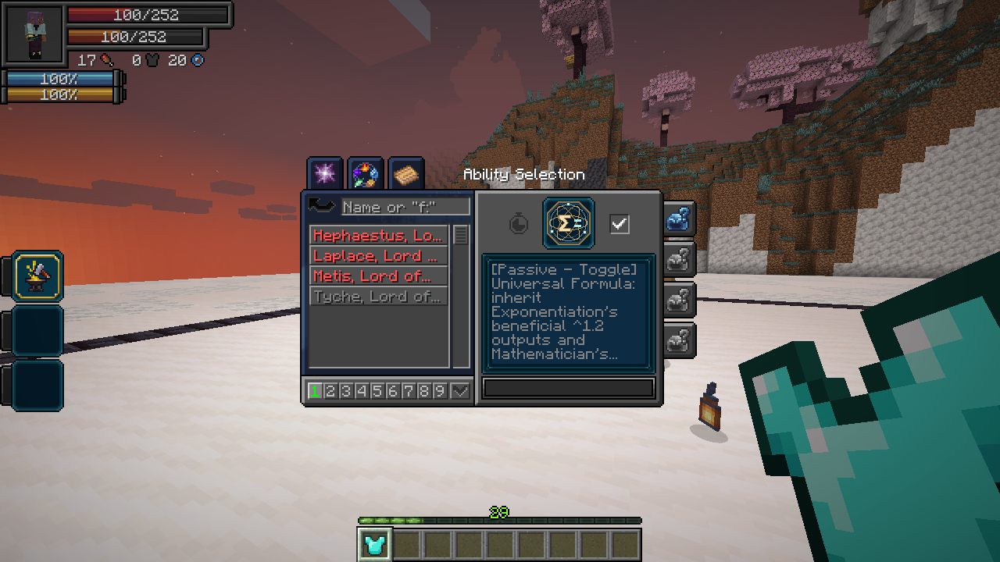
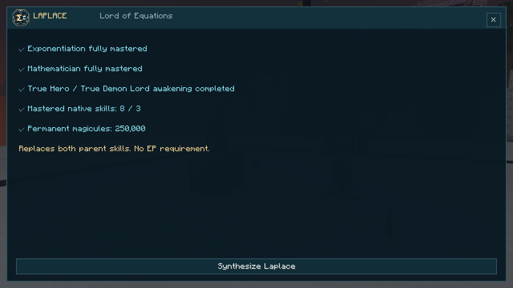
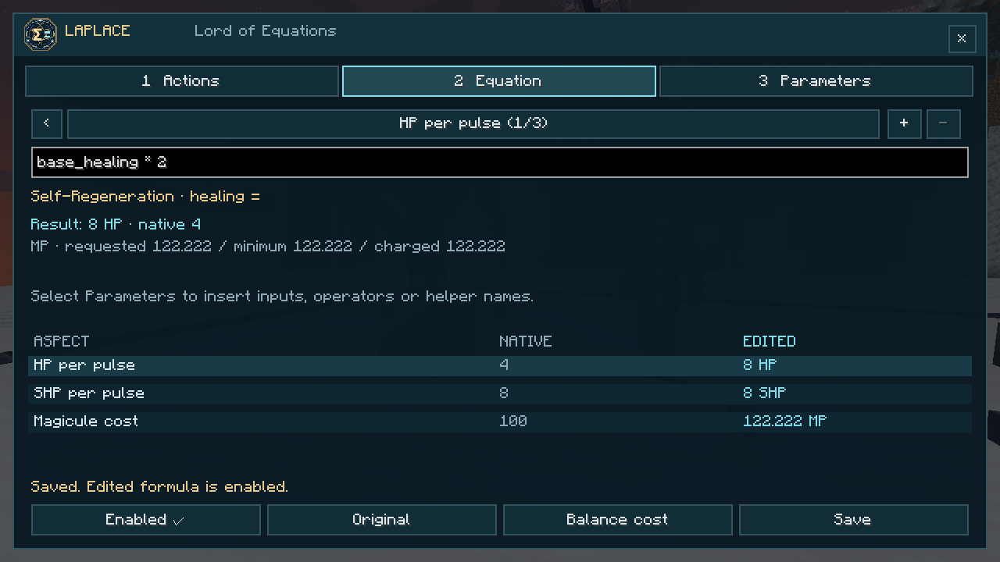
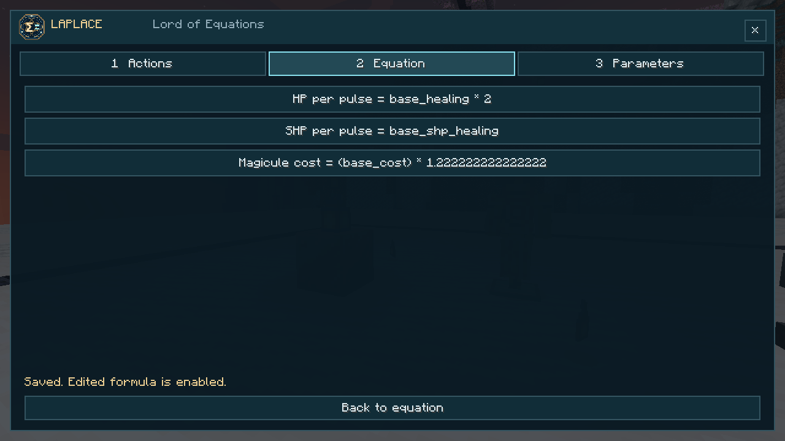
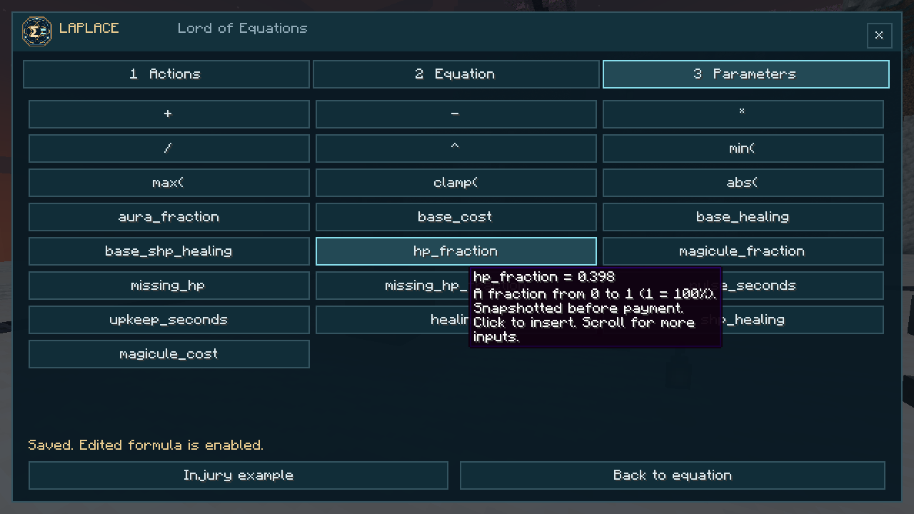

# Laplace, Lord of Equations

[All wikis](../README.md) · [TensuraAdditionalAdditions](TensuraAdditionalAdditions.md) · [Skills](Additions-Skills.md)


| Skill data | Value |
| --- | --- |
| Tier | Ultimate |
| Components | Fully mastered Exponentiation + Mathematician |
| Awakening | Completed True Hero or True Demon Lord awakening |
| Achievement | Master three distinct supported native skills |
| Acquisition | 250,000 permanent magicules by default; configurable and affected by `mpSkillCost` |
| EP requirement | None |
| Abilities | Universal Formula; Equation Editor |



## Obtaining

Owning either component reveals Laplace’s unfinished entry in **Skills → Ultimate**. Activate it, meet the listed requirements and confirm synthesis. Awakening bonuses apply before payment. Both components are replaced by learned, unmastered Laplace; their slots in all presets become Equation Editor. Missing a Unique component? The [Archivist](Additions-Archive-of-Accord.md) offers one paid lesson per player.



<a id="universal-formula"></a>

## Universal Formula · Passive, Toggle

Inherits [Exponentiation’s beneficial **^1.2** outputs](Additions-Exponentiation.md) and Mathematician’s configured passive benefits: calculating defenses, critical chance, learning/mastery gain, chant speed, Thought Acceleration and Analytical Appraisal. Appraisal stays on with the passive and uses your native analysis filter.

Movement, maximum aura/magicules, costs and cooldowns remain excluded from exponentiation. Other native exclusions and caps remain. Co-owning Exponentiation does not exponentiate an output twice. Turning this passive off also suspends edited formulas.

**Damage type:** none directly; enhanced attacks keep their original type.

<a id="equation-editor"></a>

## Equation Editor · Active, Press

Open the editor from a native Tensura ability slot.

1. **Actions:** search your learned, supported actions. A filled diamond marks an enabled edit.
2. **Equation:** choose an aspect, then edit its equation. The preview compares native and edited output, plus requested, minimum and charged magicules.
3. **Parameters:** click to insert native constants, state variables, named equations or operators. Hover for their meaning; scroll for more.
4. Use **Balance cost**, enable the edit and **Save**. **Original** restores the action’s default equations before saving.





### Linked equations

Changing a named output automatically changes equations that reference it. For example, Healing’s native equations are:

```text
healing = base_healing
magicule_cost = max(base_cost, cost_per_hp * healing)
```

You could change its healing limit to:

```text
healing = base_healing * (1 + missing_hp_fraction)
```

This reaches double the healing limit as your HP approaches zero. The target’s missing HP still caps actual recovery, and the bill follows the actual healing. `missing_hp_fraction` describes the **caster**, even when healing another target.

Self-Regeneration instead has separate **one-second recovery pulses** and **native upkeep, normally every five seconds**. Its cost is not a per-HP equation. Each action shows its own verified native equations.

Use **+** to create up to four helper equations, named `helper_1`, `helper_2`, and so on. Refer to a helper from another equation to use its result. Removing a referenced helper requires updating its dependents.

```text
helper_1 = 1 + missing_hp_fraction
healing = base_healing * helper_1
```

Available arithmetic: `+ - * / ^`, parentheses, `min(a,b)`, `max(a,b)`, `clamp(value,low,high)` and `abs(value)`. Powers require a nonnegative base and a constant exponent between 0 and 3. Fractions range from **0 to 1**, where 1 means 100%. Inputs are captured before the action’s payment; a projectile retains its paid-for values in flight.



### Supported actions

This initial catalogue exposes **nine action/mode entries across eight native skills**. Other actions are not editable yet.

| Native skill / mode | Editable aspects | Damage type |
| --- | --- | --- |
| Self-Regeneration | HP per pulse; mastered SHP per pulse; magicule upkeep | None |
| Aspectual Fire | Fire and Magic damage per bolt; cost | Native Fire and Magic |
| Aspectual Wind Cutter | Wind and Magic damage per blade; cost | Native Wind and Magic |
| Aspectual Water Cutter — normal / mastered Repeat | Magic damage per blade; cost per use | Native Water Blade and Magic; primary Water damage is unchanged |
| Aspectual Healing | Healing limit; cost linked to actual healing | None |
| Aspectual Strength | Duration in seconds; cost | None |
| Aspectual Protection | Duration in seconds; cost | None |
| Aspectual Reinforcement | Duration in seconds; cost | None |

Native projectile counts, target selection, effect levels, cast times, cooldowns, defenses, healing suppression and recovery caps remain. Previews show values before Universal Formula and other modifiers. They use your current state when the editor opens or receives a saved update; actions evaluate live state when cast.

### Balance

| Rule | Default |
| --- | --- |
| Enabled action/mode edits | 3; **4 mastered** |
| Maximum combined output per action | 3× native; **4× mastered** |
| Largest cost discount | 25% |
| Stronger-output minimum bill | Native bill × `[1 + 2 × (output ratio − 1)²]` |
| Example minimum bills | 2× combined output → 3× cost; 3× → 9×; 4× → 19× |
| Between saved changes | 5 seconds |
| Helper equations | 4 per action |

For actions with multiple outputs, the output ratio compares their **combined total**. Fixed-cost actions and regeneration upkeep price the strongest possible state of the formula, preventing a cheap activation followed by stronger unpaid pulses. Healing prices the actual missing-HP-clamped recovery; insufficient payment only funds proportional edited healing.

The minimum bill is shown separately and enforced even if the cost equation requests less. **Balance cost** fills a suitable cost equation. Finish casting before saving changes. Circular dependencies, unknown inputs, negative output, unsafe divisors and excessively large values are rejected with an explanation. Formula edits cannot add new effect types or rewrite progression, inventory or resources. Invalid saved formulas fall back entirely to the native action.

**Damage type:** no direct attack; edited attacks keep their native damage type.
