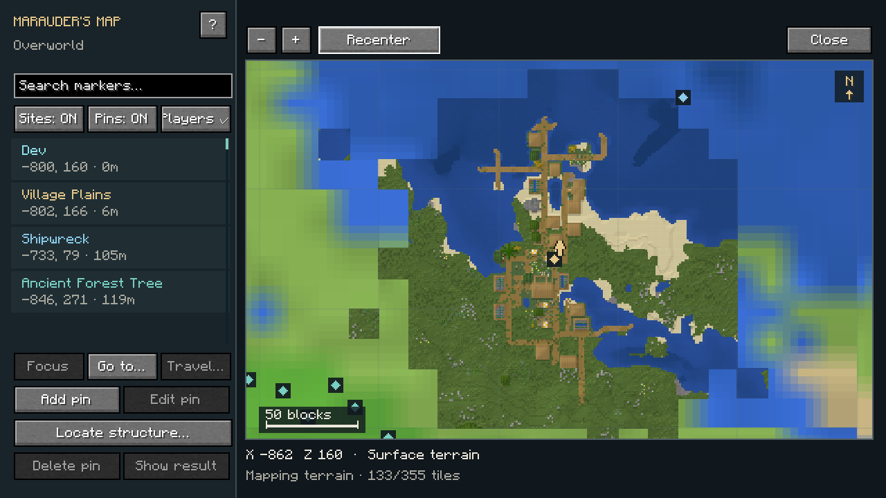
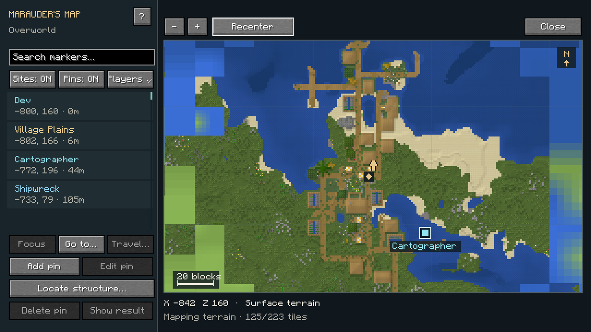
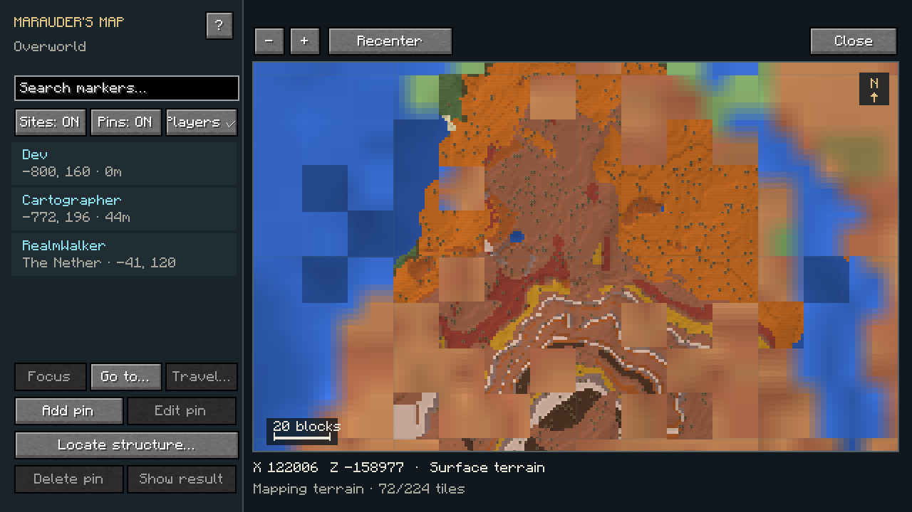
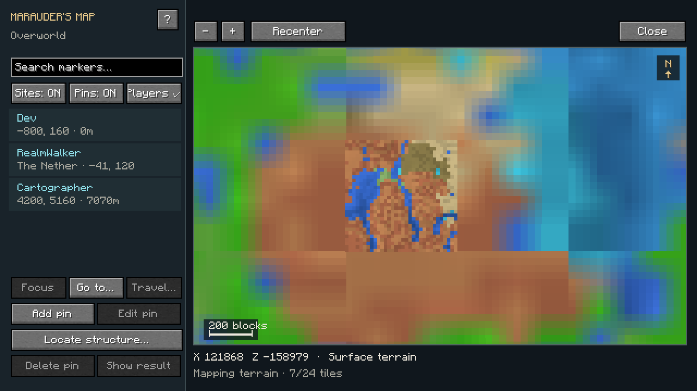
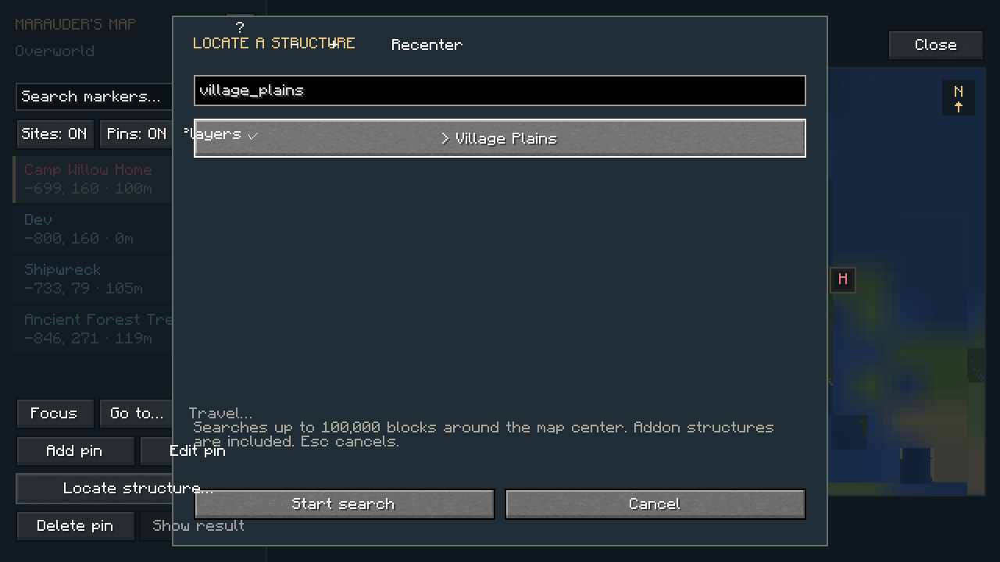
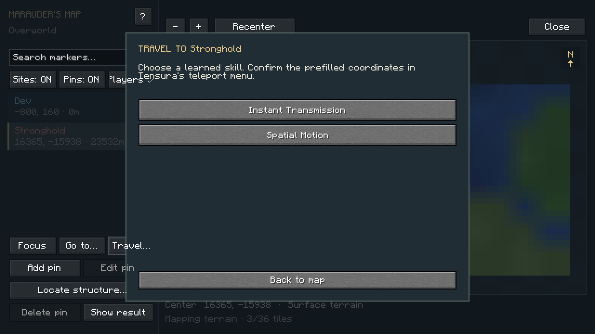
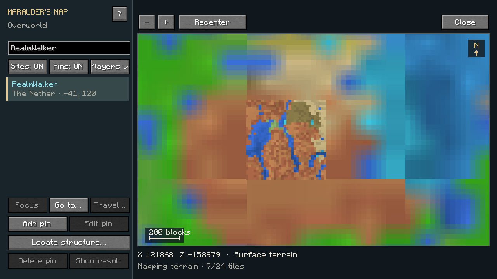
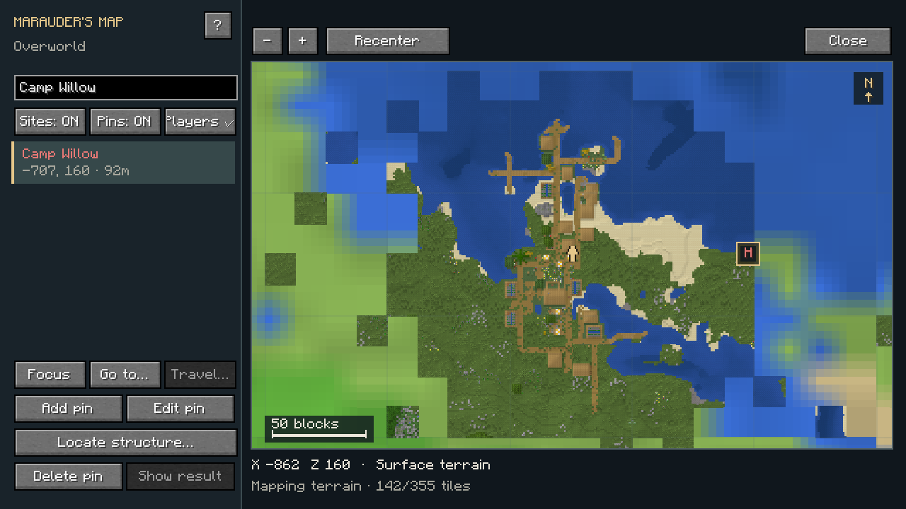

# Marauder's Map

[All wikis](../README.md) · [TensuraAdditionalAdditions](TensuraAdditionalAdditions.md)

| Skill data | Value |
| --- | --- |
| Tier | Unique |
| Obtaining | Normal reincarnation Unique pool; eligible for Fettered Human |
| Role | World terrain, live players, structures and custom pins |
| Cost / cooldown | None |
| Damage type | None |

## Open Map · Active, Press

Slot the learned skill in Tensura’s **Skills → Unique** menu and activate **Open Map**. **Damage type:** None. **Cost / cooldown:** None.

| Control | Action |
| --- | --- |
| Drag | Pan the map |
| Mouse wheel / + / − | Zoom at the cursor |
| Recenter / Home | Return to your position |
| Focus | Center the selected marker |
| Travel… | Choose an owned spatial skill and prefill its teleport menu for a structure |
| Go to… | Center on X/Z coordinates; your character stays in place |
| Sidebar search | Filter player, structure and pin names, types or coordinates |
| Sites / Pins / Players | Show or hide each marker group |
| ? | Controls and color legend |

North stays at the top. The gold arrow shows your position and facing. The bottom bar shows cursor coordinates and a distance scale. Crowded structure markers cluster as you zoom out; zoom in or use the sidebar to choose a marker.

## Terrain and structures

Pan or **Go to…** anywhere in the dimension, including places nobody has visited. A seed-based native terrain preview fills in progressively, followed by finer detail. You do not need to travel there.

Zoom in for native surface detail: block top-face textures, roads, roofs, trees, terrain relief, subtle elevation contours and depth-shaded water. Distant detail is generated in small batches; allow it time to fill in. The initial terrain preview shows landforms and biome colors; surface features and player edits appear when native detail arrives. Newly visited terrain updates from the live client and is cached on this computer, separately for each world and dimension.

Real world-generation structures, including addon types, are marked when their starts are known. Player-built structures are marked with your own pins.

**Locate structure…** opens a searchable list of structure types. Choose one and press **Start search** to search up to **100,000 blocks around the map center**. **Show result** centers the found marker. The search runs in the background; rare types can take longer. **Escape cancels** an active search. If nothing is found, move the map center and search another area; some types do not generate in the current dimension.

| Structure group | Color |
| --- | --- |
| Villages | Gold |
| Temples and pyramids | Orange |
| Fortresses, outposts and strongholds | Coral |
| Ocean structures | Blue |
| Ancient cities, trial chambers and mineshafts | Violet |
| Other and addon structures | Teal |

## Travel to a structure

Select a structure marker, or find one with **Locate structure…** and press **Show result**, then press **Travel…**. Choose one of your **learned, usable coordinate-teleport skills**. **Spatial Motion**, **Spatial Manipulation**, **Instant Transmission** and other skills using Tensura’s spatial-movement interface are supported.

Tensura’s own teleport menu opens with **X, Y, Z and dimension prefilled** for a clear surface arrival near the structure. Check or edit the coordinates, then confirm with the native **Warp** button. Underground structures use a surface approach above them. If that chunk has no clear ground, the map reports that it cannot prepare an arrival.

Opening the map, choosing a skill and preparing coordinates do not teleport you or charge resources. The confirmed teleport uses the chosen skill’s **normal resource cost, charge time, mastery effects, cooldown and restrictions**. The map does not grant a teleport skill. **Travel…** is disabled without a usable compatible skill.

## Player locations

**Players** shows all online players, including those outside your render distance. The server refreshes their locations twice per second. Your own arrow stays gold; other players have labeled cyan markers. Search a player’s name, select them, and press **Show selected** to center on them.

Players in other dimensions appear in the sidebar with their dimension and coordinates. Their markers appear on that dimension’s map; centering is disabled while you are in another dimension. Offline players disappear. Private pins remain private.

## Custom pins

**Right-click the map**, press **Add pin**, or press **N**. Give the pin a name and coordinates, then choose from **8 colors** and **6 icons**: Pin, Home, Danger, Treasure, Portal or Camp. Press **Save pin**.

Select a pin in the sidebar or on the map to center on it, edit it, or delete it. Deletion requires confirmation. Up to **256 pins per player across dimensions** are stored privately on the server. They survive reconnects; other players cannot view or edit them. Only the current dimension’s pins appear.

