# Marauder's Map

[All wikis](../README.md) · [TensuraAdditionalAdditions](TensuraAdditionalAdditions.md)

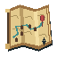

| Skill data | Value |
| --- | --- |
| Tier | Unique |
| Obtaining | Reincarnation Unique pool; eligible for Fettered Human |
| Role | Dimension atlas, shared exploration, structures, players and private pins |
| Cost / cooldown | None |
| Damage type | None |

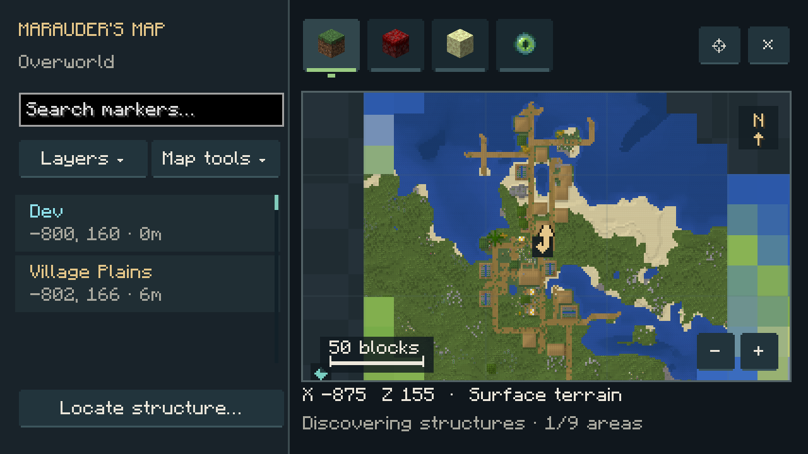

## Open Map · Active, Press

Slot the learned skill in Tensura’s **Skills → Unique** menu and activate **Open Map**. **Damage type:** None. **Cost / cooldown:** None.

| Control | Action |
| --- | --- |
| Drag / mouse wheel | Pan / zoom at the cursor |
| Compass button / Home | Return to your location |
| Click a marker or sidebar entry | Open its relevant actions |
| Right-click empty map space | Open **Add pin here…** |
| Layers | Show or hide structures, pins and players |
| Map tools | Coordinate navigation, located result and map guide |
| Sidebar search / F | Filter marker names, types, players or coordinates |
| N | Create a pin at the map center |

North stays at the top. The scale bar shows distance; the footer shows cursor coordinates and survey progress. Nearby structures cluster with counts when zoomed out. Zoom in to separate them.

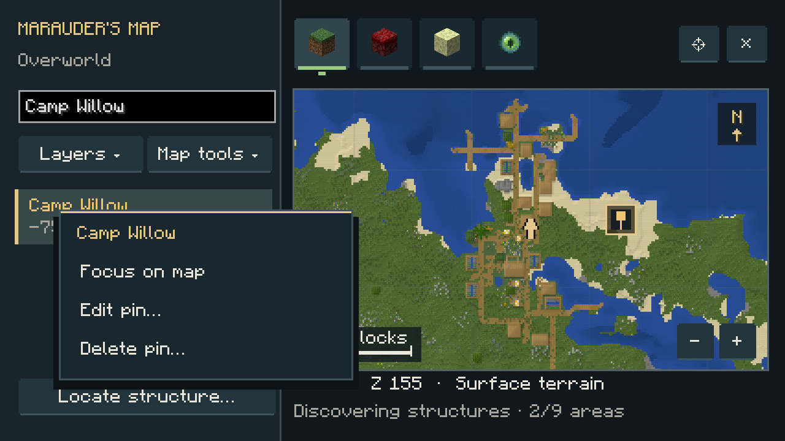

## Dimension tabs

The **grass block**, **crimson nylium** and **end stone** tabs show the **Overworld**, **Nether** and **End**. Hover over a tab to see its name. The selected dimension has a colored underline.

The **eye** tab opens **Other dimensions**, a scrollable dropdown for addon dimensions. Type to filter it, then choose a dimension. Each dimension remembers its map position and zoom. Browsing never teleports your character.

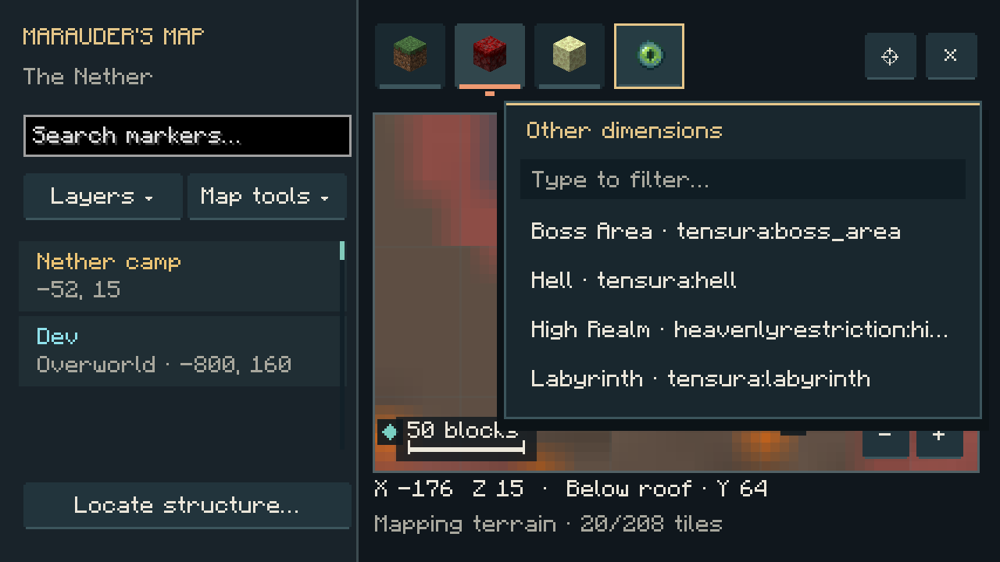

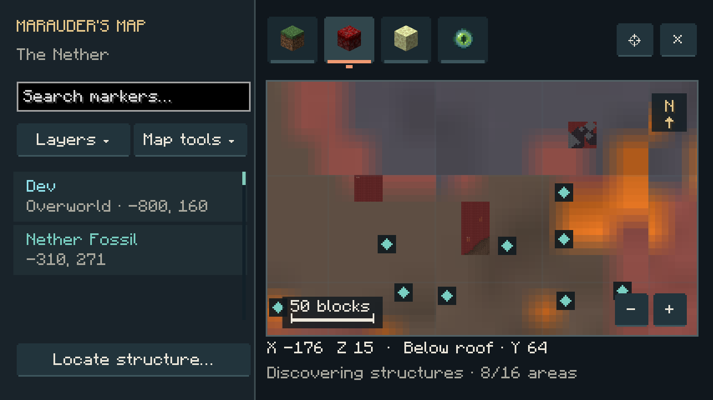

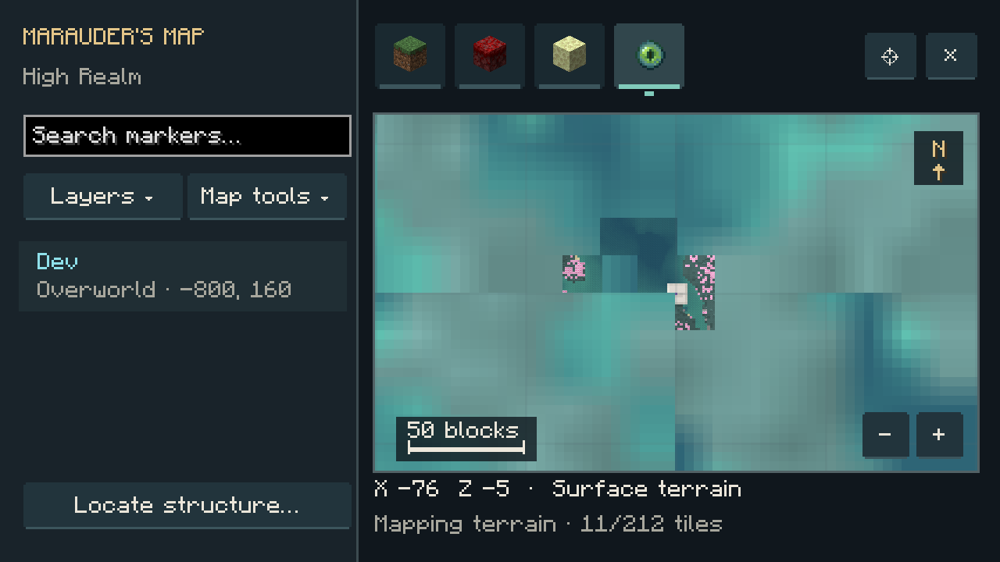

## Terrain and shared exploration

Pan anywhere, including places nobody has visited. A crisp biome overview appears first, followed by terrain relief. Unexplored terrain is a world-generation preview; trees, builds and exact surfaces appear through recorded exploration or native detail when you zoom in. Recorded block pixels remain visible when zoomed out. Nether maps look below the roof. Reopening the map reuses recently viewed terrain.

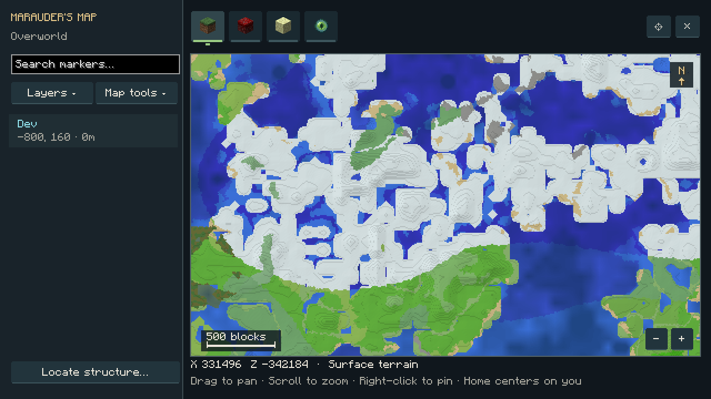

**Exploration is shared between players on the same server.** Actual terrain and builds around all online players are recorded, including players without this skill. Those recorded surfaces can be viewed by other players without visiting or loading the area on their client. Recording starts with this version and refreshes gradually as players explore. Existing local map caches still work. **Custom pins remain private.**

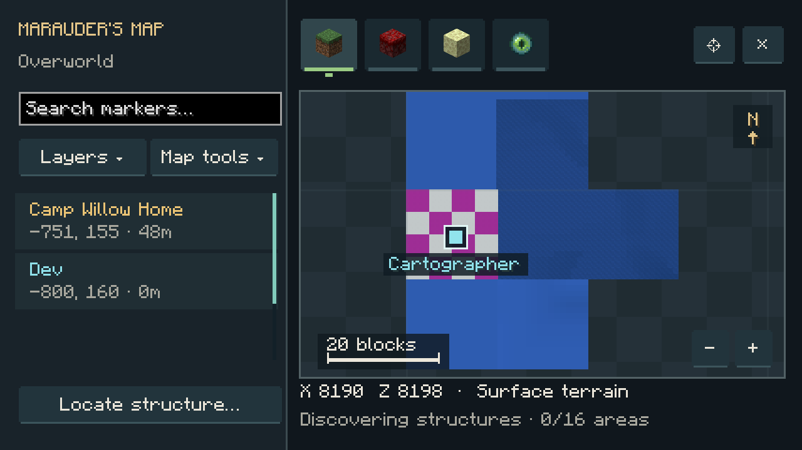

## Structure markers and Locate

Enable **Structures** under **Layers** to show automatic vanilla and addon markers for the viewed area, at every zoom level and in unexplored regions. Panning or zooming starts discovery; **Locate is not required**. Markers appear as they are found, and overlapping views reuse completed discovery. The footer reports progress. Turning Structures off pauses discovery.

Locations follow native generation rules, variants, frequency and biome requirements. Saved structures take precedence. Unvisited sites say **World-generation location** in their tooltip; actual generation confirms the start. Automatic markers do not require generating terrain or spawning mobs. Use custom pins for player-built landmarks.

**Locate structure…** opens the full list of registered vanilla and addon structures. Choose **Name A–Z** for alphabetical order or **Mod A–Z** to group by mod, with alphabetical names inside each group. Each entry shows its mod; hover for the complete structure ID. The search bar narrows entries as you type by name, mod or ID. Scroll or drag the scrollbar to browse the list.

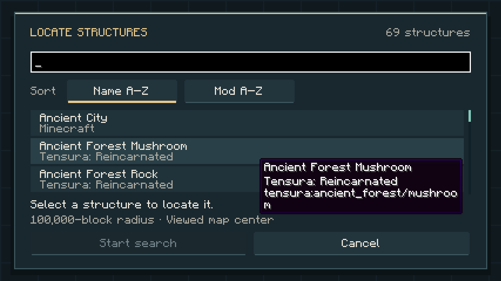

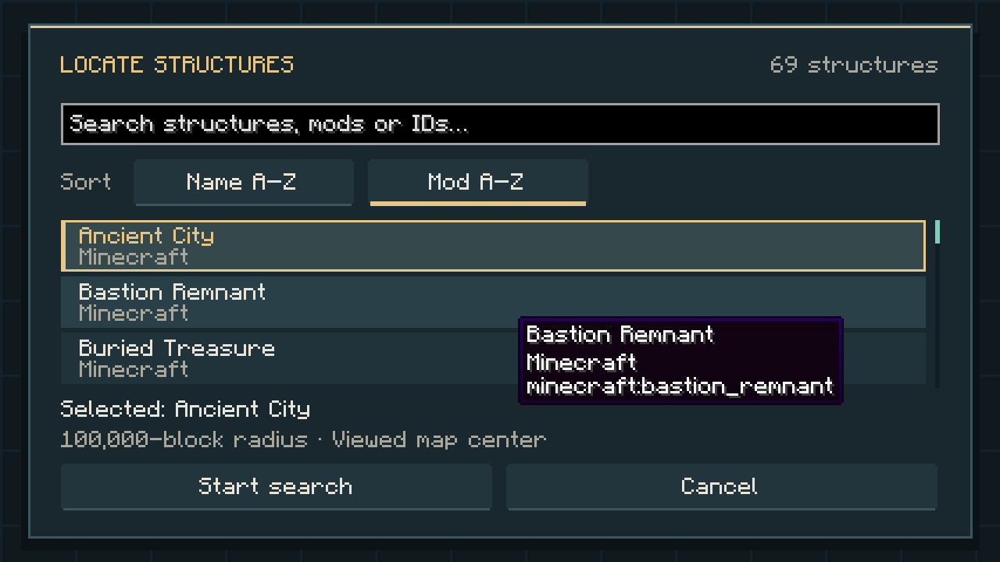

Select an entry and press **Start search** to search up to **100,000 blocks around the viewed map center**. The search runs in the background and centers on a result automatically. **Map tools → Show located structure** returns to it later. **Escape cancels** a search. If nothing is found, pan to another area and try again.

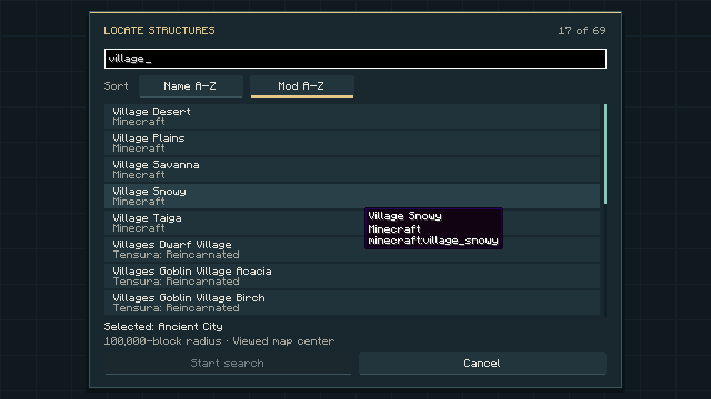

| Structure group | Color |
| --- | --- |
| Villages | Gold |
| Temples and pyramids | Orange |
| Fortresses, outposts and strongholds | Coral |
| Ocean structures | Blue |
| Ancient cities, trials and mineshafts | Violet |
| Other and addon structures | Teal |

## Travel and player locations

Select a structure in your character’s current dimension and choose **Travel…** from its actions. Choose a learned, usable coordinate-teleport skill such as **Spatial Motion**, **Spatial Manipulation** or **Instant Transmission**.

The skill’s native menu opens with **X, Y, Z and dimension prefilled** for a safe surface arrival near the structure. Check the coordinates and confirm **Warp**. Underground structures use a surface approach. If no clear ground is available, choose another structure.

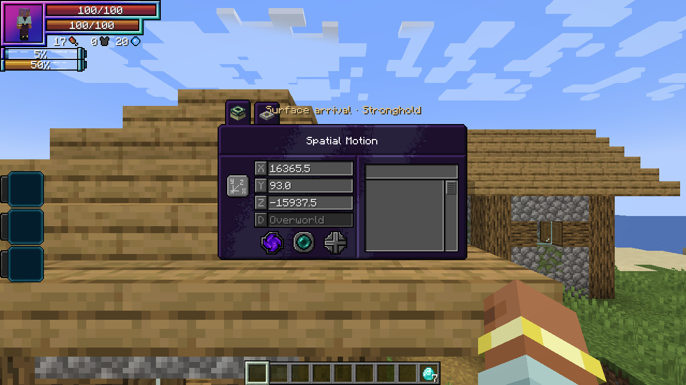

Preparing coordinates is free. Confirming Warp uses the skill’s normal resource cost, charge time, mastery, cooldown and restrictions. The atlas grants no teleport skill or cross-dimension travel; remote tabs are for viewing.

**Players** shows all online players, including those beyond render distance. Locations update twice per second. Your arrow is gold; other players have named cyan markers. Select a player and choose **Focus on map** to center their location and switch to their dimension if needed. Offline players disappear.

## Custom pins

**Right-click empty map space → Add pin here…**, or press **N** for the map center. Give the pin a name and X/Y/Z coordinates, then choose from **8 colors** and **6 icons**: Pin, Home, Danger, Treasure, Portal or Camp.

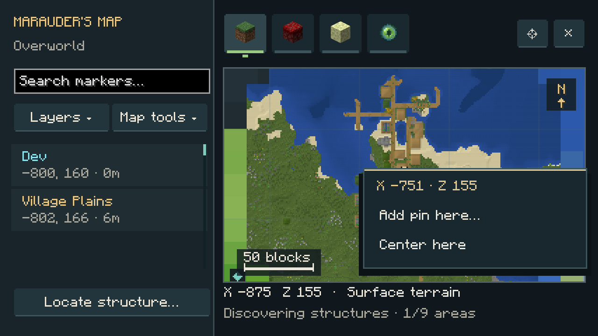

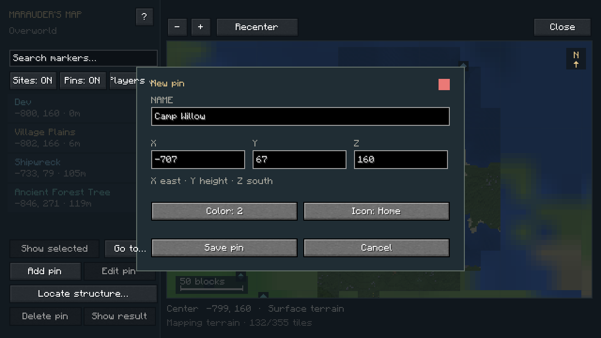

Select a pin to open **Focus on map**, **Edit pin…** or **Delete pin…**. Deletion requires confirmation. Up to **256 pins per player across dimensions** are saved privately on the server and survive reconnects. Only the viewed dimension’s pins appear; other players cannot see or edit them.
