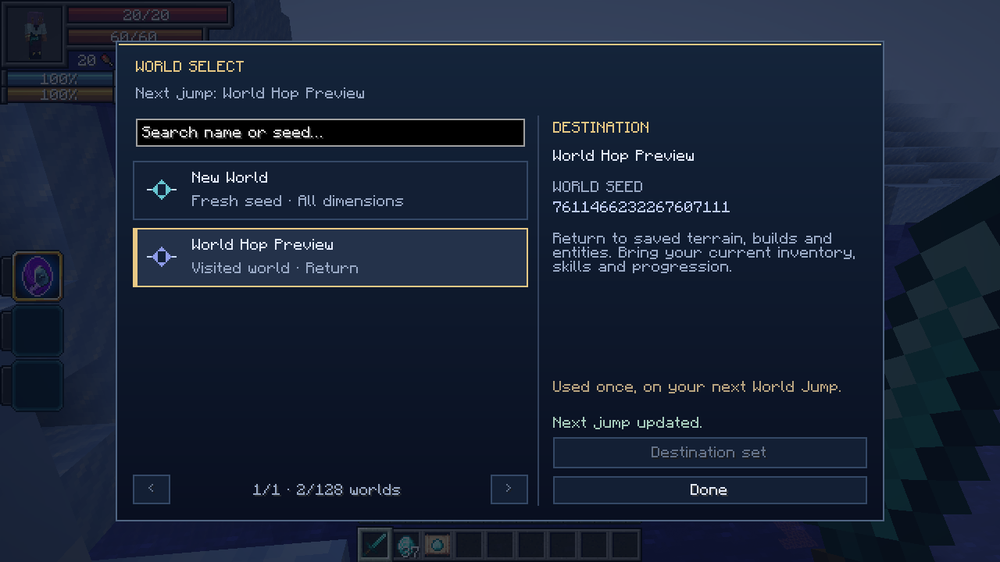

# Parallel World Jumper

[All wikis](../README.md) · [TensuraAdditionalAdditions](TensuraAdditionalAdditions.md)

**Damage type: None** — world travel.

Unique skill · Single-player travel through a hidden library of up to 128 worlds.

| Skill data | Value |
| --- | --- |
| Tier | Unique |

## World Jump · Active, Press

With no destination selected, every dimension regenerates under a new seed. Your character, inventory and progression carry over. The game saves and reloads. No resource cost or damage.

## World Select · Active, Press · Requires Learning

- Browse previously visited worlds. Search by name or seed, choose a world, then press Set next jump. World Jump travels there once, preserving its terrain, builds and entities while bringing your current character, inventory, skills and progression.
- Choose New World and confirm to clear your selection. Selecting a destination does not teleport you. After a jump, the next unselected jump generates a fresh seed again.
- Earlier World Hop saves are imported when their recorded previous saves still exist in this instance. Missing saves cannot be selected.

## Arrival

Fresh jumps find safe ground near your departing coordinates. Returns use your last position in the chosen world. If nearby safe ground is unavailable, search around the Overworld spawn.

## Hidden world library

- Only the active save appears in Singleplayer. All visited worlds are stored inside its hidden library and reached through World Select. The limit is 128 worlds, including the active world. At the limit, revisit existing worlds; new-world creation is blocked.
- Deleting the active save from Singleplayer deletes the entire hidden library, including its visited worlds and internal recovery copies. Renaming or backing up the whole save keeps the library with it.
- Existing recorded travel history is moved into the library on the next jump. Unrelated saves remain separate. Older libraries above 128 retain their worlds but cannot create more.

## Obtaining

Can roll as a reincarnation Unique in a private single-player world. Cannot be acquired, copied, learned or used on dedicated servers or while open to LAN. Chained must receive it through reincarnation to permit it.

## Pictures and video

[World Hop transition (recorded on 1.3.0; current worlds use the hidden library)](../media/world-hop.mp4)
