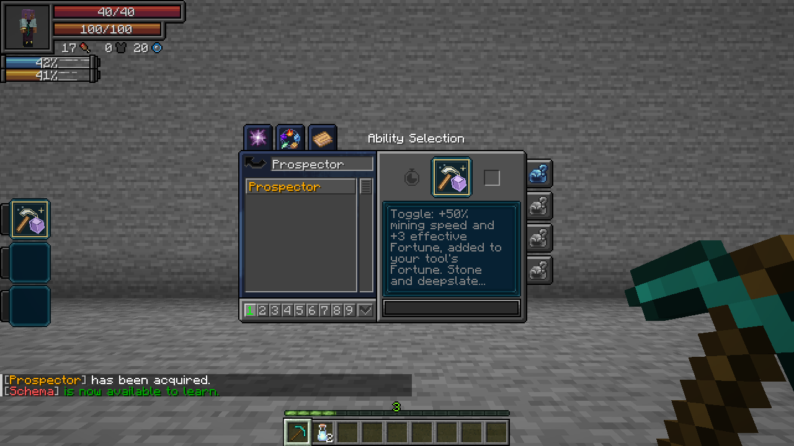
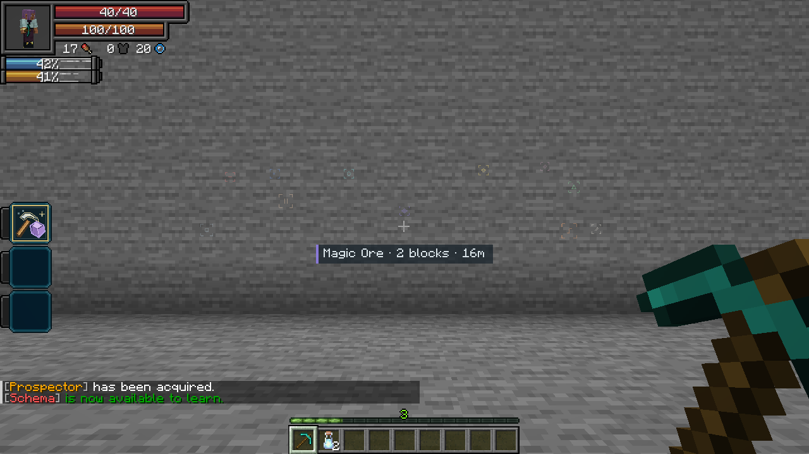
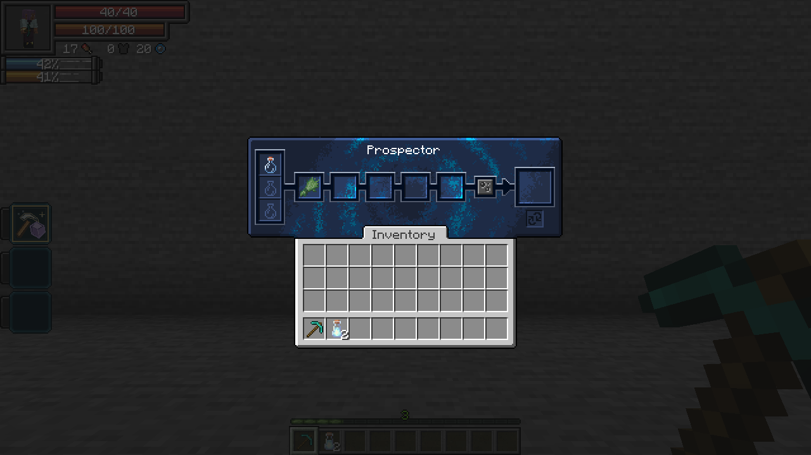

# Prospector

[All wikis](../README.md) · [TensuraAdditionalAdditions](TensuraAdditionalAdditions.md)

| Skill data | Value |
| --- | --- |
| Tier | Unique |
| Obtaining | Normal reincarnation Unique pool; eligible for Fettered Human |
| Role | Mining, ore discovery and refining |
| Resource cost | None |

## Prospector · Passive, Toggle

- **Mining speed +50%.**
- **Fortune +3**, added to your tool's level. Fortune III becomes effective Fortune VI. The tool retains its actual enchantments and durability; Silk Touch behaves normally.
- **Stone/deepslate finds:** each suitable-tool break has a **1% chance** to drop one extra resource. Coal, raw iron and raw copper are most common. Raw gold, redstone, lapis, quartz, diamonds, emeralds and magic ore shards can also appear.
- **Ore vision:** sense deposits through terrain within **32 blocks**. Faint markers use different colors and glyphs; magic ore uses violet double diamonds. Look toward a marker to see the ore name, number of surveyed blocks in that deposit and distance. Only nearby loaded terrain is surveyed.

Enable its checkbox in Tensura's **Skills → Unique** menu. The passive does not require a skill slot.

**Damage type:** None.

## Refine · Active, Press

Open Tensura's normal refining menu. Place base inputs in the **three left slots** and reagents in the **five middle slots**, then use the native Refine or Repeat button. Existing refining recipes apply. Ingredients and output remain stored when you close the menu.

Refine works with the passive disabled. **Damage type:** None. **Cost:** No aura or magicules; recipes consume their ingredients. **Cooldown:** None.

