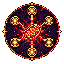
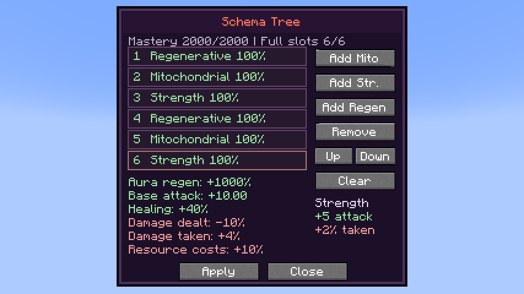

# Schema

[All wikis](../README.md) · [TensuraAdditionalAdditions](TensuraAdditionalAdditions.md)

**Damage type: None** — self-buffs.

A Battlewill with a customizable six-effect tree. Learn: 1,000 points. Master: 2,000 points.

| Skill data | Value |
| --- | --- |
| Tier | Battlewill |

## Obtaining

Use Tensura’s **Battlewill Manual** to roll a Battlewill. Schema is included in its normal random pool. A Schema result opens its learning entry at **−1,000 points**; learn it normally in the Battlewill menu. It no longer appears automatically on login. Existing learned skills, unfinished learning progress and saved builds are retained.

## Use

Press Build to open the tree. Choose Add Mito, Add Str. or Add Regen; select a slot to move or remove it. Apply saves; Close discards unapplied edits. Toggle Schema to activate the saved tree.

## Effects per stack

- Mitochondrial: +500% aura regeneration; −5% outgoing damage.
- Strength: +5 base attack damage; +2% damage taken.
- Regenerative: +20% HP/SHP healing received; +5% aura and magicule costs. Healing bonuses apply once and respect native limits.

## Slot order and mastery

Positive weights start at 100%, 50%, 25%, 12.5%, 6.25%, 3.125%. Every 400 mastery makes another slot full strength, reaching all six at 2,000. All effects share that order; drawbacks always stay full strength.

Chained/Unbound boosts positive Battlewill bonuses once; drawbacks are not boosted.

## Training

Qualifying aura recovery, Strength hits and Regenerative healing share one mastery gain every 30 seconds. Idle full reserves, editing and toggling grant no training. The timer and build persist after saving.

## Related

[Chained](Additions-Chained.md) · [Unbound](Additions-Unbound.md) · [Aura regeneration](Additions-Aura-Regeneration.md)

## Pictures and video

