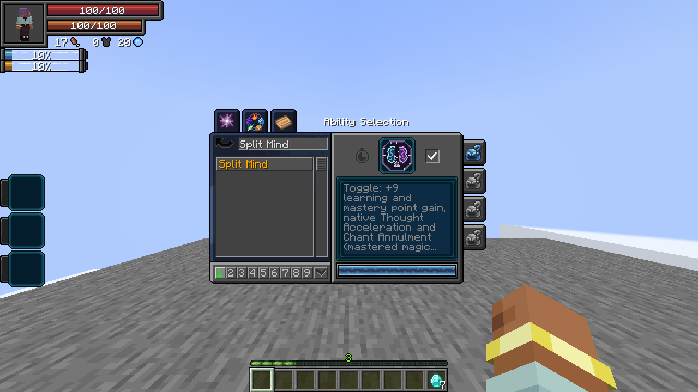
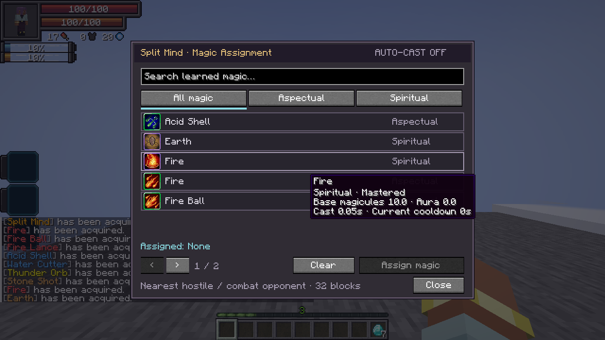
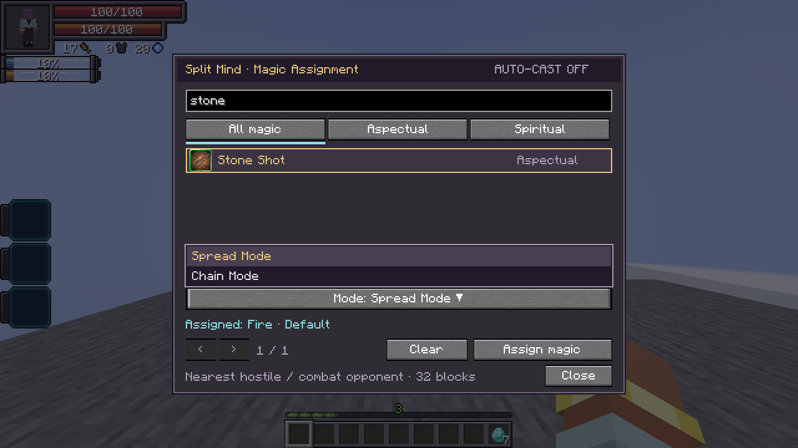
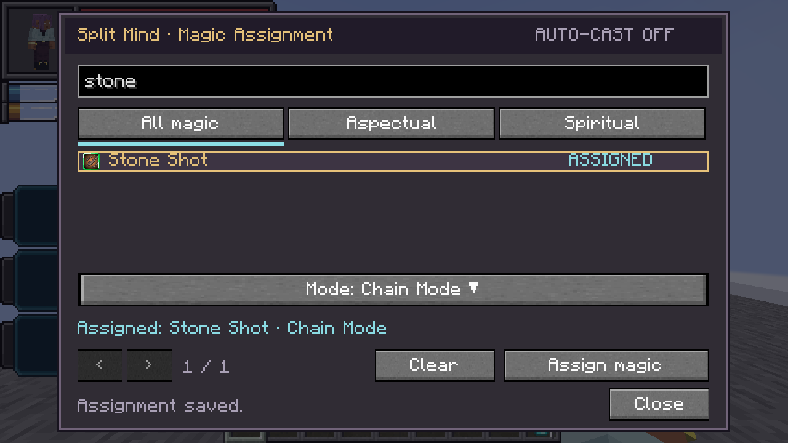

# Split Mind

[All wikis](../README.md) · [TensuraAdditionalAdditions](TensuraAdditionalAdditions.md)

| Skill data | Value |
| --- | --- |
| Tier | Unique |
| Obtaining | Normal reincarnation Unique pool |
| Role | Learning, accelerated thought and automatic magic casting |
| Resource cost | Assigned magic’s normal costs; no additional fee |

## Parallel Thought · Passive, Toggle

- **Learning point gain +9.**
- **Mastery point gain +9.**
- **Chant Annulment:** mastered magic casts instantly, following Tensura’s native rule.
- **Thought Acceleration:** native movement/attack/chant bonuses and its mastered dodge-window bonus.

Enable the passive checkbox in **Skills → Unique**. It does not require a skill slot. **Damage type:** None.

## Magic Assignment · Active, Press

Open the searchable list of **your learned aspectual and spiritual magic**. Filter by type, select a spell, then choose **Assign magic**. For a spell with multiple modes, open the **Mode dropdown** and choose the mode to cast. Locked modes require their normal learning or mastery before they can be assigned. Only one magic and mode can be assigned. **Clear** removes it and stops Auto-Cast. The assignment is saved with the skill.

**Damage type:** None. **Cost / cooldown:** None.

## Auto-Cast · Active, Toggle

Press to enable or disable automatic casting. It targets the **nearest visible hostile mob or combat opponent within 32 blocks**. Allies, owned creatures, passive bystanders and protected players are excluded; player opponents require permitted PvP.

- Uses the assigned magic’s **selected mode**, native damage, resource cost, cooldown and casting requirements.
- Checks for an available cast every **5 ticks**. Unmastered magic finishes its normal accelerated cast time; mastered magic benefits from Chant Annulment while the passive is enabled.
- Repeat/held modes remain active at their native cadence while a target is valid; each pulse pays its normal cost.
- Delayed shots keep the assigned target through their launch delay; no extra homing is added.
- Tracks the target during casting. Cancels if the target leaves range, becomes protected or disappears, or if the magic becomes unavailable.
- Leaves your camera unchanged and gives manual casting priority. Self-targeted and buff magic retain their native behavior.

Successful paid casts train Split Mind; menu clicks and toggle switching do not. This switch is independent of the passive checkbox. **Damage type:** Whatever the assigned magic normally deals. **Cost:** Its normal aura/magicules. **Cooldown:** Its normal cooldown; no additional Split Mind cooldown.

Split Mind is excluded from **Fettered Human** starting rolls because Auto-Cast uses magicule-cost abilities. The usual server allowlist can override that rule.
