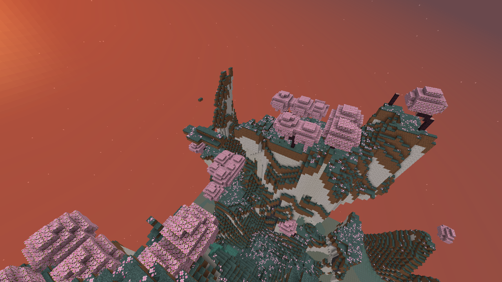
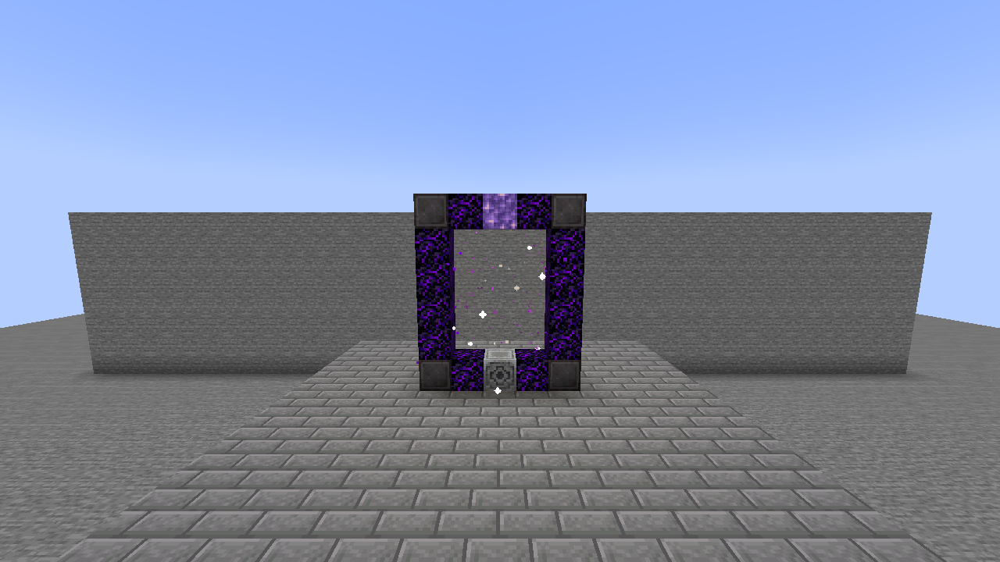
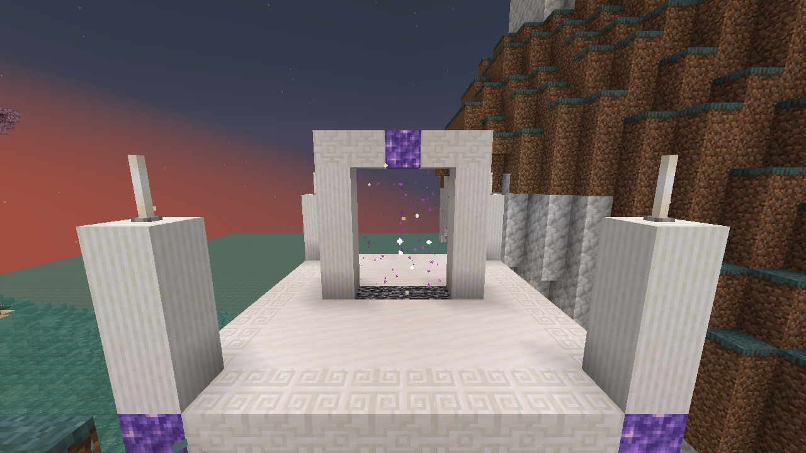
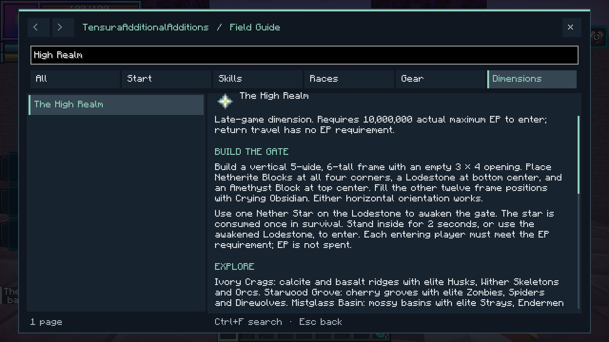

# The High Realm

[All wikis](../README.md) · [TensuraAdditionalAdditions](TensuraAdditionalAdditions.md)

A late-game dimension of pale ridges, cherry groves and misty basins. **10,000,000 actual maximum EP** is required to enter. EP is checked, not spent. Supports single-player and multiplayer.



## Gate

Build a vertical **5 × 6** frame in either direction. Its **3 × 4** opening must be empty, without fluids.

```text
N C A C N
C . . . C
C . . . C
C . . . C
C . . . C
N C L C N
```

| Symbol | Material | Count |
| --- | --- | ---: |
| N | Netherite Block | 4 |
| C | Crying Obsidian | 12 |
| A | Amethyst Block | 1 |
| L | Lodestone | 1 |
| . | Empty opening | — |

Use **one Nether Star** on the Lodestone to awaken the gate. In survival, the star is consumed once. Stand inside the awakened arch for **2 seconds**, or use its Lodestone, to enter. Every player must meet the EP requirement. Breaking the frame disables it.



## Landscape and enemies

The realm stays in twilight. Terrain uses existing Minecraft and Tensura blocks, with native magic ore, emeralds and rare diamonds in the calcite and basalt.

| Biome | Landscape | Elite inhabitants |
| --- | --- | --- |
| Ivory Crags | Calcite mountains with dark basalt bands | Husks, Wither Skeletons, Orcs |
| Starwood Grove | Pale grass and cherry groves | Zombies, Spiders, Direwolves |
| Mistglass Basin | Mossy basins, clay and turquoise water | Strays, Endermen, Lizardmen |

Elites retain their original models and behavior. **Bosses are excluded.** Player-owned mobs, summons and mobs brought from elsewhere are not upgraded.

| Elite | Members | EP | HP | SHP | Native abilities |
| --- | --- | ---: | ---: | ---: | --- |
| High Bulwark | Husk, Wither Skeleton, Orc | 5,000,000 | 1,024 | 5,000 | Physical Attack Resistance; Strengthen Body |
| High Sentinel | Stray, Enderman, Lizardman | 3,500,000 | 850 | 3,200 | Magic Resistance; Water Attack Resistance |
| High Stalker | Zombie, Spider, Direwolf | 2,500,000 | 700 | 2,400 | Poison Resistance; Paralysis Resistance |

These are default stat floors; native effects can alter final attributes. Elites also have stronger attacks, armor and senses. Sentinels' arrows are enhanced. Player or subordinate kills retain normal loot and EP rewards and add **1–3 Amethyst Shards**, with a **20%** chance of native Magic Ore and a **2%** chance of Netherite Scrap. Dropped elite equipment is not an extra guaranteed reward.

## Returning

The **quartz return arch** in the arrival sanctum is the return gate. Walk through it or use its central bedrock base. **Leaving has no EP requirement.** Each player returns near their own entrance; obstructed exits use nearby safe ground or the Overworld spawn.

The small arrival sanctum is protected from normal block edits. Natural hostile spawns are suppressed within **48 blocks** of its center. The rest of the dimension can be mined and built in. **Beds do not work here.**



## Saves and settings

The dimension is added to existing saves. Its terrain, awakened gates and individual return points persist after a restart. [World Hop](Additions-Parallel-World-Jumper.md) generates a fresh realm for a new seed; returning to a previously visited world restores that world's realm.

Server settings are in `serverconfig/tensura-additions-high-realm.toml`: `entryEP`, `gateChargeTicks`, `elitePower`, and `eliteSpawns`. Changing elite strength affects new spawns. Up to **256 awakened gates** can be registered in one world.

Find this page under **Dimensions** in the searchable **F8 guide**.


