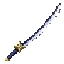
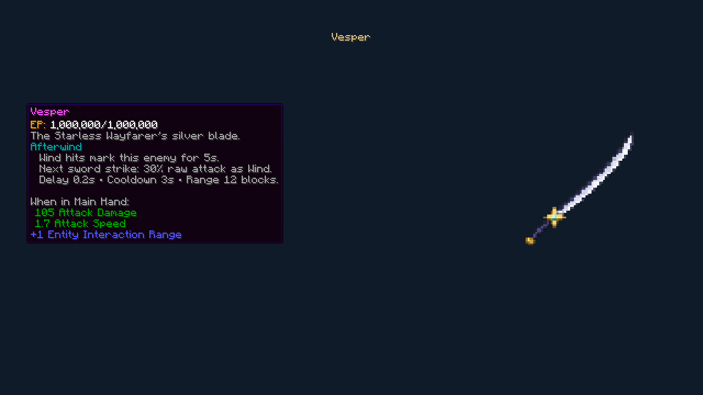
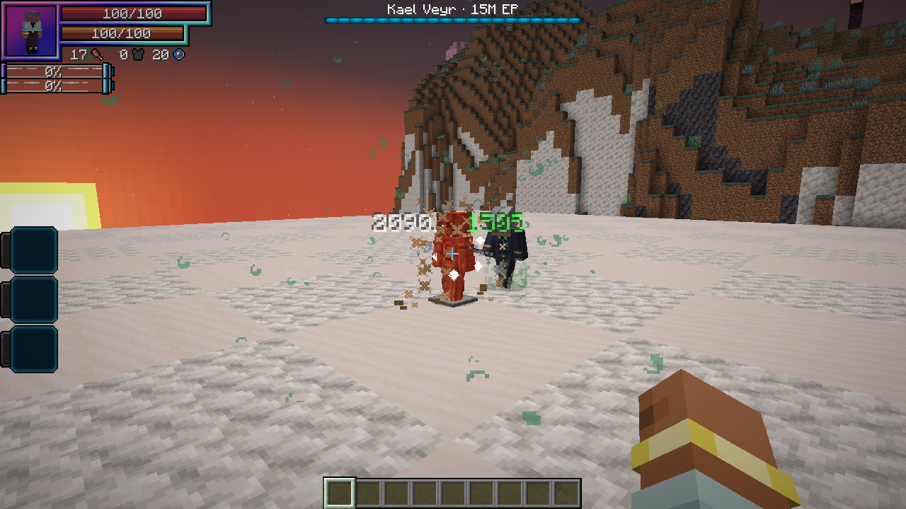
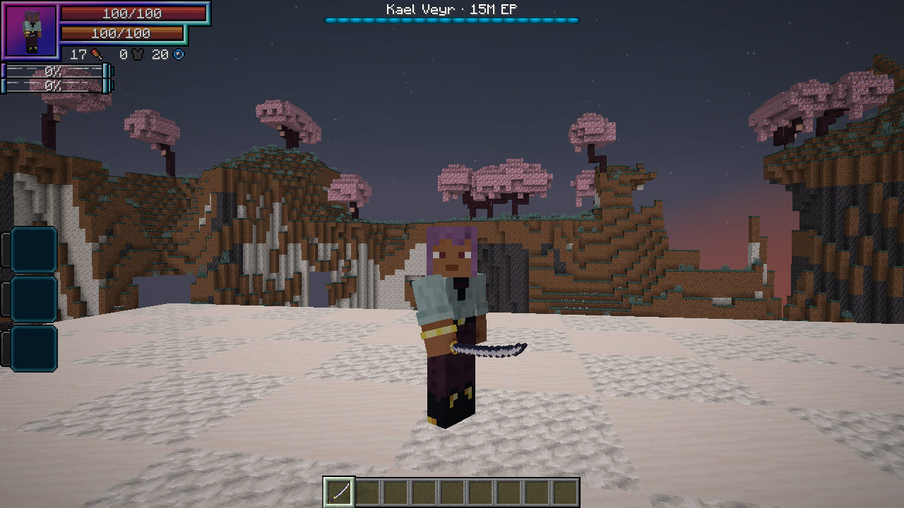
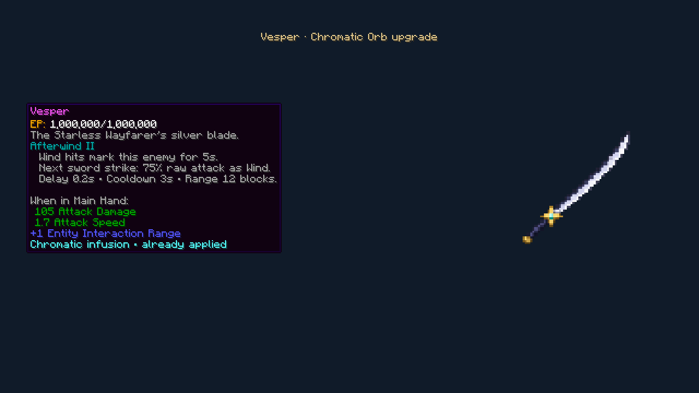

# Vesper

[All wikis](../README.md) · [TensuraAdditionalAdditions](TensuraAdditionalAdditions.md) · [Kael Veyr](Additions-Kael-Veyr.md)

Kael’s silver sword, with a navy spine and a gold star guard. **Defeating Kael drops one Vesper with Afterwind I.**

| Weapon data | Value |
| --- | --- |
| Type | Sword · Epic |
| Baseline attack damage | **105**, with 1 base attack |
| Attack speed | **1.7** |
| Extra reach | **+1 block** |
| Durability | **3,960** |
| Repair material | Hihiirokane Ingot |
| Damage type | Physical for ordinary melee; Wind elemental for Afterwind |

Compared with Valentine’s **Night Rose** from Tensura: Not Enough Bosses, Vesper has **105 vs. 90 damage**, the same attack speed and reach, and **10% more durability**. That addon is not required.

## Afterwind

While holding Vesper, successfully dealing **Wind damage** marks that enemy for **5 seconds**. Your next direct sword strike against that enemy triggers a Wind cut after **0.2 seconds**.

The cut deals **30% of your raw attack attribute**, then uses normal Wind boosts, resistances and defenses. It has a **3-second cooldown per wielder**. Marks do not stack, and it only strikes that enemy. The cut can follow the enemy’s movement within **12 blocks**; switching weapons, death or changing dimension cancels it. There is no extra aura or magicule cost.

Damage recorded by **Tensura’s training dummy** also counts, even though its HP stays full.

## Chromatic Orb

A [Chromatic Orb](Additions-Chromatic-Orb.md) raises Afterwind to **level II**, increasing its raw-attack coefficient from **30% to 75%**. Delay, cooldown and mark duration remain the same.

