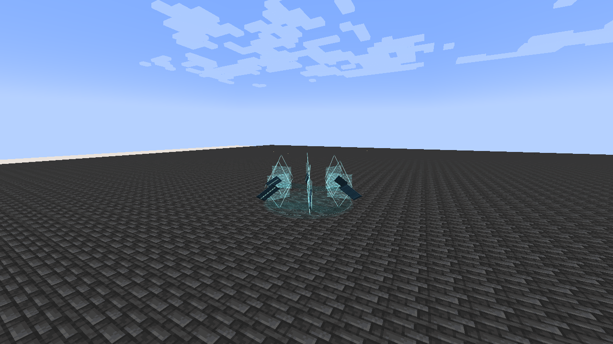

# Aegir, Lord of the Abyss

[All wikis](../README.md) · [Tensura Myths](Tensura-Myths.md)

Aegir, Lord of the Abyss is an Ultimate Skill for water refraction, projectile redirection and an expanding tidal shock front. Mirrorsea changes the origins and reach of its other arts.

| Skill data | Value |
| --- | --- |
| Tier | Ultimate |
| Resource | Aura |
| Passive upkeep | 110 aura / second |
| Obtaining | Mastered Scarlet Deluge + Mirrorbound; 2M total EP |

## Active abilities

| Ability | Damage type / base damage | Cost | Cooldown |
| --- | --- | --- | --- |
| Refracted Harpoon | Water elemental · 1,600; 2,200 with Mirrorsea | 7,000 aura | 5 s |
| Mirrorsea | None — reflected projectiles retain their attack type | 12,000 aura | 16 s |
| Sovereign Breaker | Water elemental · 2,100; 3,000 when empowered | 20,000 aura | 24 s |

## Passive

- Damage type: None
- Upkeep: 110 aura / second
- Gain 100% Water boost, 75% Light boost and 0.5 knockback resistance. Ordinary elemental sources use their strongest contribution; Godly boosts remain separate.

## Refracted Harpoon

- Damage type: Water elemental
- Aim range: 64 blocks
- Target cap: 8 distinct enemies per cast
- Fire a caustic water spear along your aim. Solid blocks stop each ray; fluids do not.

## Mirrorsea

- Damage type: None — projectile redirection / setup
- Placement range: 48 blocks
- Radius: 12 blocks
- Duration: 10 seconds
- Create a stationary caustic basin surrounded by six hovering glass lenses. Incoming hostile and unowned projectiles inside it turn toward their sender, or reverse if unowned.

## Sovereign Breaker

- Damage type: Water elemental
- Normal reach: 18 blocks from the caster
- Empowered reach: 26 blocks from Mirrorsea
- Launch a circular shock front that expands over two seconds, fading out over the following 0.4 seconds. Damage follows its narrow moving rim; the entire inner disk is not continuously damaging.

## Related

[Skill synthesis](Skill-Synthesis.md) · [Godly Skills](Godly.md)

## Pictures and video

