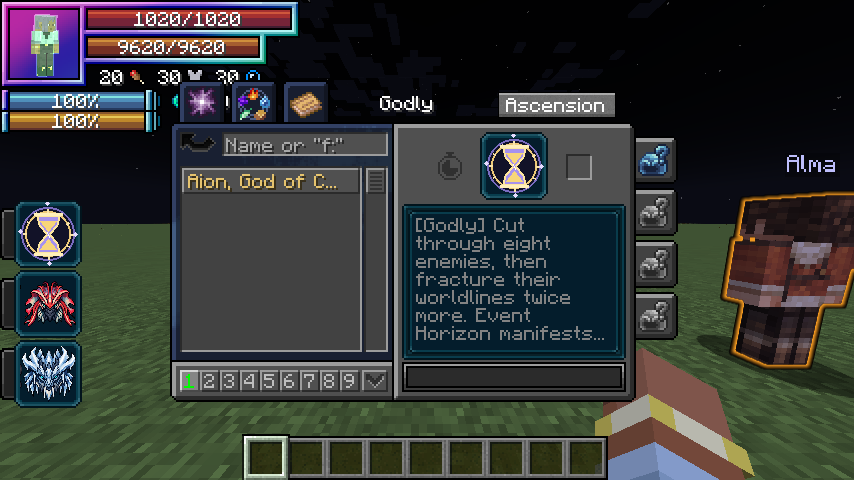
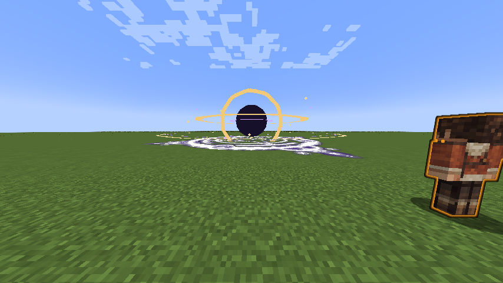

# Aion, God of Causality

[Main Page](../README.md) · [Godly Skills](Godly.md) · [Skills](Skills.md) · [Mechanics](Mechanics.md)

**Aion, God of Causality** is a Godly skill built around spatial precision, battlefield control and a personal HP/SHP rewind with a safe recorded position. Its active arts use aura and space elemental damage. Its power grows with mastery, without EP damage scaling.

| Skill data | Aion, God of Causality |
| --- | --- |
| **Information** | |
| Type | Godly / native Ultimate |
| Damage type | Space elemental |
| Damage ID | `tensura:space_elemental` |
| Active modes | 4 |
| Toggleable passive | Unbroken Continuum |
| Passive upkeep | 180 aura / second |
| Mastery cap | 50,000 |
| Registry ID | `wildhunt:aion` |
| **Evolution** | |
| Previous | Raijin, Varuna, Agni or Ymir |
| Evolution | — |
| **Obtaining** | |
| Method | Mastered Myths Ultimate, True Hero or True Demon Lord, 12M base EP |

## Usage

### Passive

[Passive - Toggle] — **Unbroken Continuum**

Adds **45 physical barrier**, **45 magic barrier**, **0.75 knockback resistance** and **1,200 native Multilayer Barrier** capacity. The latter uses Tensura’s existing barrier HUD. Its owned multilayer contribution rearms after **10 seconds without an incoming hit**, checked on the next upkeep tick. Upkeep does not repair it during combat. Turning the passive off removes its own contributions while preserving other barrier modifiers.

Enabling costs the first 180 aura, then 180 aura each second. It turns off when unfunded or suppressed. It emits no constant passive particle cloud.

### Active

| Mode | Aura per cast | Cooldown | Range / area | Base damage |
| --- | ---: | --- | --- | ---: |
| Worldline Sever | 3,200 | 4 seconds | 80-block cleave, up to 8 targets | 900 + 2 × 300 echoes |
| Event Horizon | 6,000 | 16 seconds | 64-block cursor placement, 10-block radius, 10 seconds | 120 per second |
| Causal Reversal | 2,400 | 1 second to recast; 25 seconds after return or expiry | Personal checkpoint, 20-second window | — |
| Genesis Verdict | 15,000 | 45 seconds | 64-block placement; 12 / 14-block radius | 700 + 700 + 1,400 / 2,100 |

[Active - Mode 1] — **Worldline Sever**

Fire a broad gold-white spatial cleave through up to eight enemies in a line. Each struck enemy suffers two further causal echo cuts, 0.6 and 1.2 seconds later, while still alive, within 96 blocks and in line of sight. The ray stops at blocks. Echoes recheck friendly/PvP protection instead of dealing unavoidable damage after a target becomes protected.

[Active - Mode 2] — **Event Horizon**

Place a gravity domain with a dark core, counter-rotating accretion bands and Tensura’s native **Gravity** magic circle. Enemies within ten blocks are pulled toward the core and take space damage each second. Knockback resistance reduces the pull. Hostile or unowned projectiles lose 35% velocity per tick and curve toward the center; the caster’s own and allied projectiles are preserved.

[Active - Mode 3] — **Causal Reversal**

The first press places a visible clockwork checkpoint and records position, HP and SHP. Press again after the one-second recast delay, within twenty seconds, to return and recover HP/SHP toward their recorded values, limited by current caps. Both casts cost aura. Native **Recovery** circle effects and spatial bursts mark the return.

Reversal does not restore aura, magicules, items, cooldowns, buffs or lost lives. The destination must remain unobstructed, inside the world border and in the same dimension. An unsafe return charges no aura. Returning or expiration applies the full twenty-five-second cooldown. Death, relogging and dimension changes clear the checkpoint.

[Active - Mode 4] — **Genesis Verdict**

Place a warned spatial catastrophe at the cursor within 64 blocks. After one second of warning, three pulses strike at one-second intervals: **700, 700 and 1,400** base damage within twelve blocks.

If your Event Horizon is active, Verdict consumes it, uses its existing center and expands to **fourteen blocks**, with the final strike raised to **2,100**. The old Horizon visual is removed when consumed. A contracting cage, rising spatial beams, native **Space** circle and expanding fracture fronts telegraph the strikes. Enemies can leave the area.

## Damage and interaction

The damage multiplier is **1 + 0.5 × mastery fraction**, capped at **1.5×**. All damaging modes use native `tensura:space_elemental` damage and remain subject to native defensive, authority and PvP rules. Team and owner protection follows the addon’s existing target checks. No mode destroys blocks or scales damage with EP.

## Obtaining

Use **Skills → Godly → Ascension** to replace one mastered Myths Ultimate after reaching the awakening and EP requirements. Equip Aion from the new Godly category in Tensura’s normal ability menu.

## Gallery

