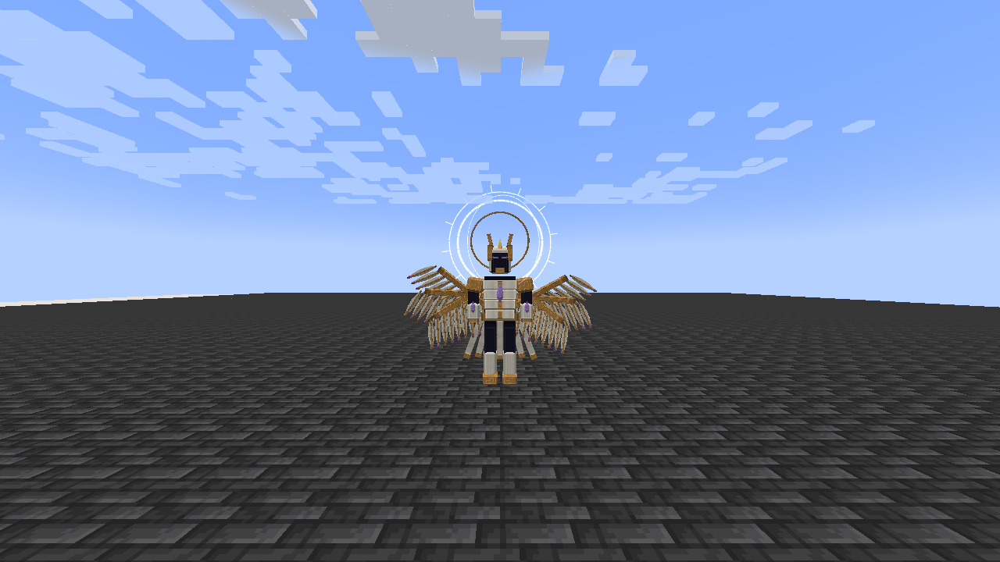
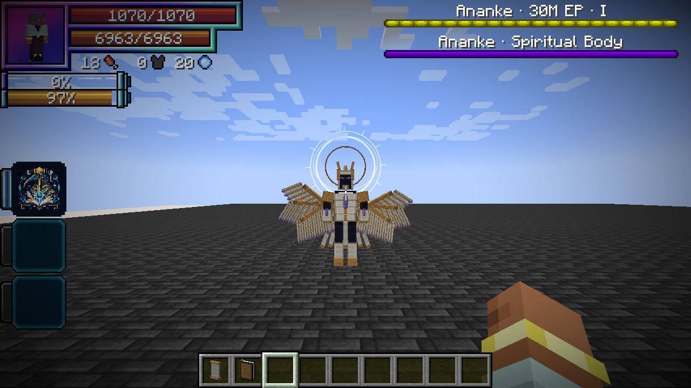
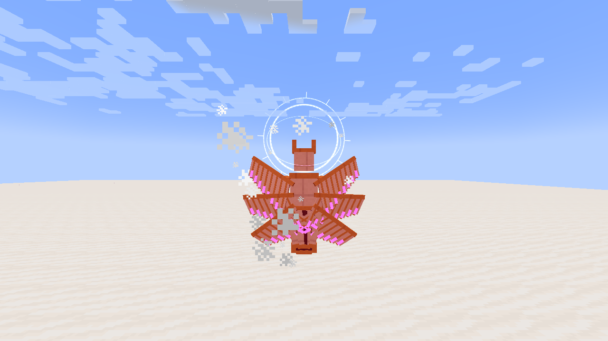
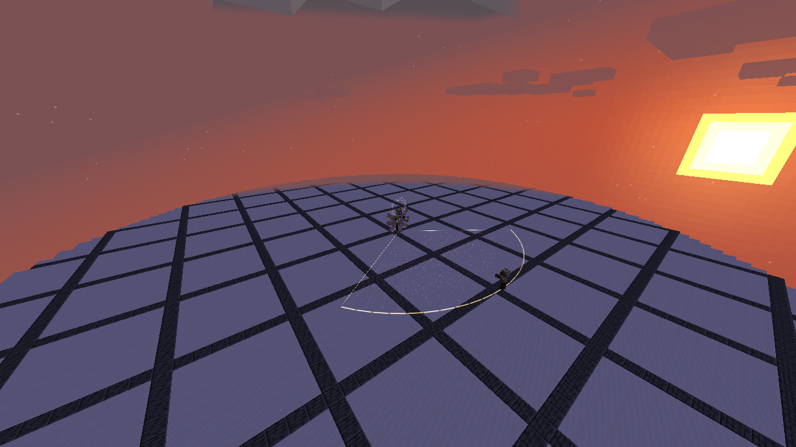
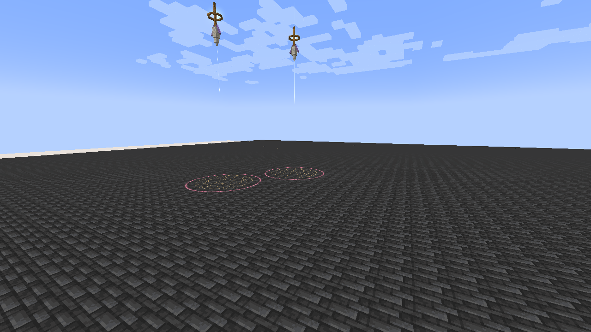
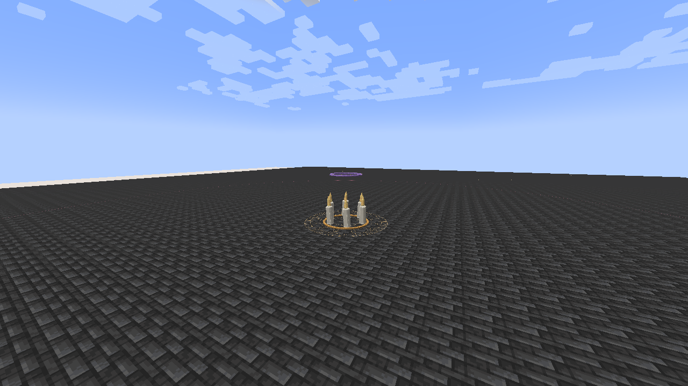
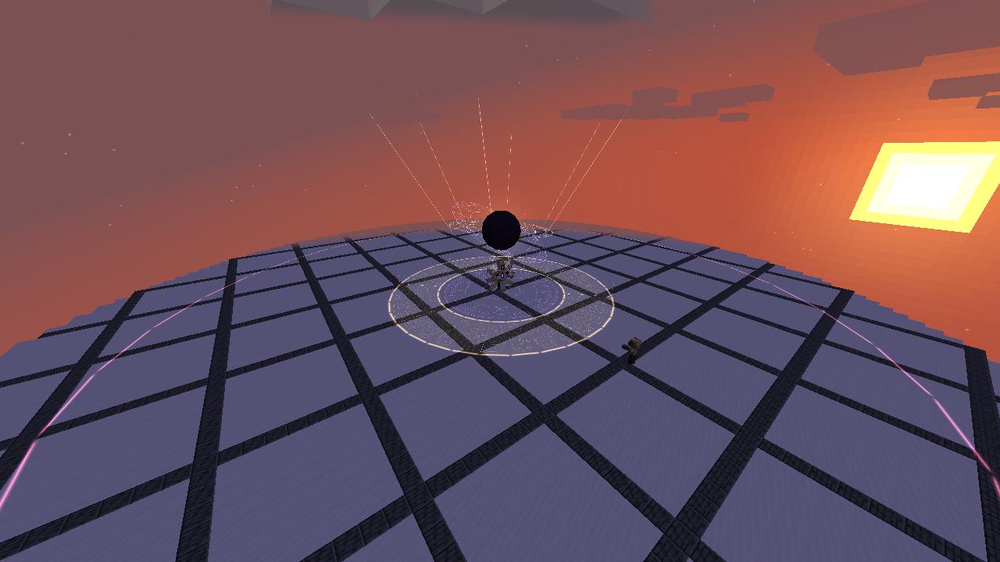
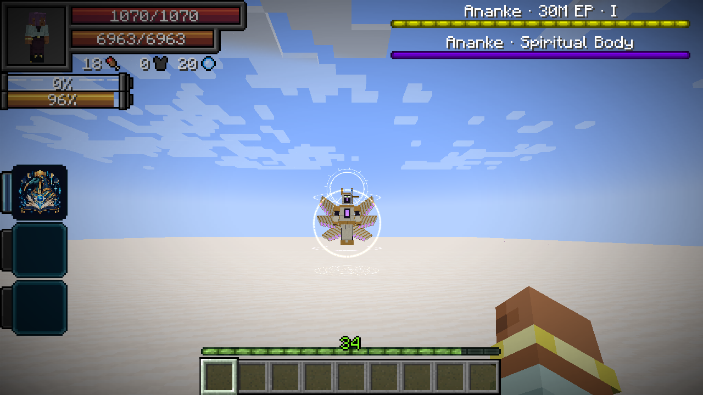

# Ananke, the Unwritten End

[Main Page](../README.md) · [Myth bosses](Bosses.md) · [Moira](Moira.md) · [Damage types](Damage-Types.md)

**Ananke, the Unwritten End** is the first Myth of Tensura Myths: a six-winged arbiter that guards the final page of an unwritten world. It combines fixed, readable attack patterns with native Ultimate and Godly skills.


| Boss data | Ananke, the Unwritten End |
| --- | --- |
| **Information** | |
| Race | [Eclipse Seraph](Eclipse-Seraph.md) |
| Classification | Myth boss; native True Demon Lord |
| Base EP | 30,000,000 |
| Aura / magicules | 15,000,000 / 15,000,000 |
| Maximum HP / SHP | 48,000 / 120,000 |
| Armor / toughness | 40 / 20 |
| Base melee damage | 180; native mob attack |
| Entity ID | `wildhunt:ananke` |
| **Skills** | |
| Signature Ultimate | [Moira, Lord of Finality](Moira.md) |
| Godly Skill | [Thoth, God of Magic](Thoth.md) |
| Learned package | 53 mastered skills |
| **Spawning** | |
| Survival | Writ of Last Dawn on a lodestone |
| Natural spawning | None |
| Operator summon | `/myths boss summon` |

## Summoning

Craft a **Writ of Last Dawn** (`wildhunt:writ_of_last_dawn`) with this shaped recipe:

| | | |
| --- | --- | --- |
| End Crystal | Echo Shard | End Crystal |
| Dragon's Breath | Nether Star | Dragon's Breath |
| End Crystal | Echo Shard | End Crystal |

Use it on a lodestone with room for a 1.6-block-wide, 4.1-block-tall entity above it. Prepare at least 32 blocks of clear fighting space around the spawn and more room to retreat. The ritual requires a hostile difficulty and no Ananke within 128 blocks. Failure leaves the writ intact; creative players keep it on success.

Spawn eggs and `/summon wildhunt:ananke` also work for operators. Ordinary ritual summons use the current world; the encounter does not generate a dimension or build an arena for you.

## Combat

Ananke flies after valid targets, fights nearby players and retaliates when attacked. Its arena anchor limits valid targets to 72 blocks from the spawn. Both **HP and SHP bossbars** appear at the upper right to tracking players within 80 blocks, clear of Tensura’s player HUD. The health bar shows phase I, II or III, and switches to the gold-refuge warning during Last Dawn.

| Phase | Entry condition | Changes |
| --- | --- | --- |
| Sealed Testament | Initial life | Fatebreaker, six-star Starfall Canticle, Eventide Procession and melee |
| Unwritten Crown | First fatal defeat after regeneration fails | Faster decisions, eight-star Starfall, Astral Library and Spellbreak |
| Last Dawn | Second fatal defeat after regeneration fails | Fastest decisions; The Last Dawn joins the rotation |

Infinite Regeneration takes priority: while funded and able to prevent the incoming death, it keeps Ananke in the current phase and restores wounds using magicules. When it can no longer prevent a fatal defeat, Ananke enters the next phase and immediately refills **HP, SHP, magicules and aura to their current maximums**. This can happen twice. A fatal defeat in phase III ends the encounter once regeneration can no longer prevent it. Native bypass and healing rules still apply.

Each revival cancels the previous attack sequence and announces the new phase with the six-point ascension effect. The new phase has a short attack preparation interval, with ordinary native hit immunity. Nonfatal damage and low-health percentages do not change phases.

Successful **HP or SHP damage** makes the model flash Minecraft red, including while Pain Nullification is enabled and while regeneration repairs the hit. Nullified or dodged attacks do not trigger this confirmed-damage flash.

### Moira's rites

See [Moira](Moira.md) for individual costs and full per-ability damage tables.

| Rite | Damage type | Fixed raw damage | Warning and counterplay |
| --- | --- | ---: | --- |
| Fatebreaker | Aura slash — `tensura:aura_slash` | 1,800 | 1.2 s warning; leave the locked 110° fan within 16 blocks |
| Starfall Canticle | Light — `tensura:light_elemental` | 1,000 per star | Each three-block-radius marker gives 1.4 s warning; later markers track new positions, existing markers stay fixed |
| Eventide Procession | Darkness — `tensura:darkness_elemental` | 2,200 once per victim | 1.5 s preparation; dodge the moving hollow wave, stay behind its front or move above its damage band |
| The Last Dawn | Space — `tensura:space_elemental` | 4,800 | 3.75 s warning; stand in the **gold ring 7–12 blocks** from the cast center, or leave the 32-block sphere |

The gold refuge protects against **The Last Dawn only**. It does not protect against melee, Thoth or other simultaneous attacks. All rite origins lock when casting begins. No EP multiplier applies to their damage; Thoth's elemental boosts and native combat handling are separate.

### Godly authority and Thoth

Ananke owns Thoth and therefore has the shared [Godly classification passives](Godly.md#classification-passives): +35% damage against non-Godly owners, resistance/nullification penetration for its own damage, and immunity to non-Godly-origin Magic Interference. Other Godly owners prevent the ownership-based damage bonus against themselves; they do not disable penetration.

Ananke enables **Arcane Sovereignty**, paying its normal 180-magicule-per-second upkeep, for elemental boosts and native chanting/cost attributes. From phase two it uses:

- **Astral Library:** three books take turns firing every 0.25 seconds for ten seconds, cycling Fire, Water, Lightning, Earth, Wind, Light and Space. Each bolt is 800 raw damage before the ordinary 1.5× mastered multiplier and native modifiers. Cost 24,000 magicules; cooldown 35 seconds.
- **Spellbreak:** 900 raw magic damage before 1.5× mastery, plus Thoth's native interference/drain rules. Godly owners take the damage but are exempt from this mode’s drain and disruption. Cost 6,500 magicules; cooldown 15 seconds. See [Spellbreak's full behavior](Thoth.md#spellbreak).

Moira itself is **Ultimate**, so Lugh's Countermand can seal and interrupt its rites. Thoth is Godly and cannot be sealed by Countermand. Native activation restrictions can also stop a cast. Ananke has finite native resources; the AI pays skill costs and does not refill resources during an active fight.

### Native skill package

| Skill | Registry ID | Use |
| --- | --- | --- |
| Moira, Lord of Finality | `wildhunt:moira` | Four autonomous encounter rites; aura slash, Light, Darkness and Space damage |
| Thoth, God of Magic | `wildhunt:thoth` | Godly ownership, paid Arcane Sovereignty, Astral Library and Spellbreak |
| Mathematician | `tensura:mathematician` | Enabled native analysis and support; no invented extra NPC attack |
| Observer | `tensura:observer` | Enabled native perception and dodge support; no invented extra NPC attack |
| Universal Perception | `tensura:universal_perception` | Enabled native perception toggle |
| Thought Acceleration | `tensura:thought_acceleration` | Enabled native support toggle |
| Chant Annulment | `tensura:chant_annulment` | Enabled native support toggle |
| Spatial Domination | `tensura:spatial_domination` | Enabled native elemental support; the encounter has a separate paid repositioning action |
| Infinite Regeneration | `tensura:infinite_regeneration` | Enabled, mastered native HP/SHP recovery |
| All native defenses | See the table below | Every resistance and nullification, learned, mastered and enabled |

The package contains **53 mastered skills**: Moira, Thoth, seven native support/recovery skills and all **44 native defense skills**. The native supports use their actual stored instances. Server configuration controls native effects and nullification availability; native Godly penetration and other valid bypass rules still apply.

### Resistances and nullifications

Both skills in every row are granted, mastered and toggled on. Native resistance/nullification processing determines which applies to a particular damage source; owning both does not multiply the same protection twice.

| Defense family | Resistance ID | Nullification ID |
| --- | --- | --- |
| Abnormal Condition | `tensura:abnormal_condition_resistance` | `tensura:abnormal_condition_nullification` |
| Cold | `tensura:cold_resistance` | `tensura:cold_nullification` |
| Corrosion | `tensura:corrosion_resistance` | `tensura:corrosion_nullification` |
| Darkness Attack | `tensura:darkness_attack_resistance` | `tensura:darkness_attack_nullification` |
| Earth Attack | `tensura:earth_attack_resistance` | `tensura:earth_attack_nullification` |
| Electricity | `tensura:electricity_resistance` | `tensura:electricity_nullification` |
| Flame Attack | `tensura:flame_attack_resistance` | `tensura:flame_attack_nullification` |
| Gravity Attack | `tensura:gravity_attack_resistance` | `tensura:gravity_attack_nullification` |
| Heat | `tensura:heat_resistance` | `tensura:heat_nullification` |
| Holy Attack | `tensura:holy_attack_resistance` | `tensura:holy_attack_nullification` |
| Light Attack | `tensura:light_attack_resistance` | `tensura:light_attack_nullification` |
| Magic | `tensura:magic_resistance` | `tensura:magic_nullification` |
| Physical Attack | `tensura:physical_attack_resistance` | `tensura:physical_attack_nullification` |
| Pain | `tensura:pain_resistance` | `tensura:pain_nullification` |
| Paralysis | `tensura:paralysis_resistance` | `tensura:paralysis_nullification` |
| Pierce | `tensura:pierce_resistance` | `tensura:pierce_nullification` |
| Poison | `tensura:poison_resistance` | `tensura:poison_nullification` |
| Spatial Attack | `tensura:spatial_attack_resistance` | `tensura:spatial_attack_nullification` |
| Spiritual Attack | `tensura:spiritual_attack_resistance` | `tensura:spiritual_attack_nullification` |
| Thermal Fluctuation | `tensura:thermal_fluctuation_resistance` | `tensura:thermal_fluctuation_nullification` |
| Water Attack | `tensura:water_attack_resistance` | `tensura:water_attack_nullification` |
| Wind Attack | `tensura:wind_attack_resistance` | `tensura:wind_attack_nullification` |

### Infinite Regeneration

[Passive - Native recovery] — **Infinite Regeneration**

| Ability information | Value |
| --- | --- |
| Damage type / Damage ID | None — recovery only |
| Native skill | `tensura:infinite_regeneration` |
| Mastery / toggle | Mastered and enabled |
| Recovery cadence | Native Instant Regeneration checks every ten ticks / half second |
| HP recovery | Attempts to restore all missing HP, within native limits and available magicules |
| SHP recovery | Native Infinite Regeneration also attempts to restore missing SHP |
| Default mastered costs | 60 magicules per HP and 80 per SHP; native configuration applies |
| Windup / cooldown | None |

Ananke continuously maintains Tensura's native Infinite Regeneration effect. It restores wounds rapidly while funded and uses the native ordinary-lethal-damage prevention rules. A recent hit does not interrupt it or impose a recovery delay. It consumes Ananke's magicules rather than granting free HP/SHP.

Native severance, confinement, healing rules and qualifying bypass sources remain authoritative. Regeneration has priority over phase revival while it can prevent death, and never relocks an unlocked phase. There is no separate recovery cast or recovery bossbar mode.

### Spatial Reposition

[Active - Boss movement] — **Spatial Reposition**

| Ability information | Value |
| --- | --- |
| Damage type / Damage ID | None — movement only |
| Trigger distance | Target more than 22 and no more than 64 blocks away |
| Destination | Approximately ten blocks from the target, within 60 blocks of the encounter anchor |
| Resource cost / cooldown | 20,000 magicules / ten seconds |
| Follow-through | One second before the next attack decision |

Between casts, Ananke can dissolve into violet and gold seals and reappear nearer a distant opponent. It checks loaded chunks, solid blocks, liquids and the world border before spending magicules. It never moves the origin of an active rite. This is an encounter movement action, not an automatic player mode of Spatial Domination.

Moira selection checks range before payment: the boss prefers a usable distant Starfall over a fan that cannot reach. Movement resumes eight ticks after a rite's final damaging frame while its remaining visual fades at the original position.

### Leaving and reloading

After **10 seconds without a valid target**, Ananke resets to phase one and restores its HP, SHP and resources. It moves back toward its original anchor and does not despawn through ordinary distance rules.

Saving/loading preserves the current phase, HP, resources, race, learned skills and the remaining repositioning cooldown. Loading does not replenish a spent phase. Pending rites are cancelled on reload, preventing an invisible attack from resuming. Death, removal, interruption and encounter reset cancel owned visual/attack plans.

## Rewards

A player-attributed kill drops **one Dawn Testament** (`wildhunt:dawn_testament`) and **1–3 Nether Stars**. The boss grants 1,500 base experience; the **First Myth** challenge advancement grants 2,000 experience. Native loot/experience rules still apply. Ananke is in the native boss tags and counts as one distinct boss type for Hunter progression.

Drink a Dawn Testament for **2.4 seconds** to heal **50% maximum HP**, restore **50% maximum SHP**, and fill aura and magicules to their current native caps. HP healing uses the native heal event; SHP restores directly to its native pool. Both clamp at the current maximum. The consumable starts a **five-minute cooldown**. It does not grant EP, change race or unlock Moira.

## Gallery















[Watch The Last Dawn in the Minecraft client](../media/ananke-last-dawn.mp4).

Captures use an isolated validation arena. Warning stills pause the native encounter at specific moments; the clip shows the running cast. No shader pack or external rendering is used.



## Native boss arena

For a managed encounter, stand at the center of a prepared arena and run:

```mcfunction
/myths boss arena
/bossFight join @s ananke
```

Operator `/kill` removes Ananke directly without playing through its combat lives.

The first command requires operator permission and creates a native profile named `ananke` in the current dimension: radius 48, up to four joined players, five-second start delay, fifteen-minute timer. It sets the boss spawn one block above the center and the entrance 24 blocks along +Z. The native arena system handles the fight lifecycle. Build safe ground and clear space at both locations first.

The profile is saved in the world's native `data/boss_fights/` configuration. Existing `ananke` profiles are not overwritten. Use Tensura's `/bossFight` editor for adjustments; the join command also needs the permissions required by the base mod. Ananke's arena targeting is restricted to joined players. Boss-area-dimension restrictions are not automatically added to an ordinary lodestone ritual.

---

**Categories:** Tensura Myths · Bosses
