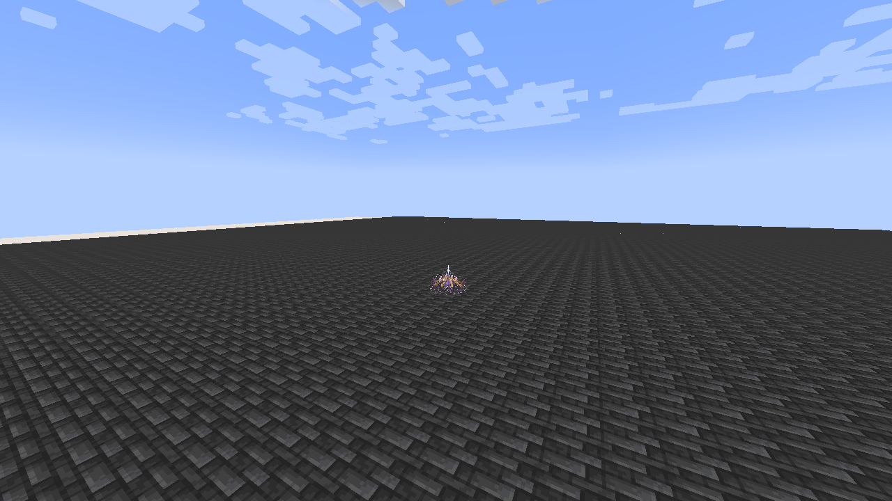

# Anansi, Lord of Schemes

[All wikis](../README.md) · [Tensura Myths](Tensura-Myths.md)

Its damage follows the threads and the shape you construct.

| Skill data | Value |
| --- | --- |
| Tier | Ultimate |
| Resource | Aura |
| Passive upkeep | 100 aura / second |
| Obtaining | Mastered Threadweaver + Rune Smith; 2M total EP |

## Active abilities

| Ability | Damage type / base damage | Cost | Cooldown |
| --- | --- | --- | --- |
| Fate Stitch | Space elemental · 1,300 per thread contact | 5,000 aura per anchor | 2 s |
| Puppet Passage | None | 3,500 aura | 5 s |
| Checkmate Loom | Space elemental, then Earth elemental · 2,800 Space, then 1,900 Earth | 22,000 aura | 24 s |

## Passive

- Damage type: None
- Upkeep: 100 aura / second
- Gain 100% Space boost, 100% Earth boost and 30% movement speed. Only the strongest ordinary source applies per elemental attribute; Godly bonuses remain separate.

## Fate Stitch

- Damage type: Space elemental
- Placement range: 40 blocks
- Anchor lifetime: 20 seconds
- Maximum anchors: 3
- Place a hovering runic spider anchor at the aimed location. Each anchor arms after 0.6 seconds.

## Puppet Passage

- Damage type: None — repositioning
- Selection range: 48 blocks
- Aim along a visible anchor to travel to it. Your current momentum is preserved, and that anchor moves to your previous position, rebuilding its links and rearming after 0.6 seconds.

## Checkmate Loom

- Damage type: Space elemental, then Earth elemental
- Requirement: At least two active anchors
- After 1.2 seconds, enemies inside the triangle or its narrow perimeter suffer 2,800 raw Space damage. With two anchors, the affected region is a 3.5-block corridor around their connecting segment.

## Related

[Skill synthesis](Skill-Synthesis.md) · [Godly Skills](Godly.md)

## Pictures and video

