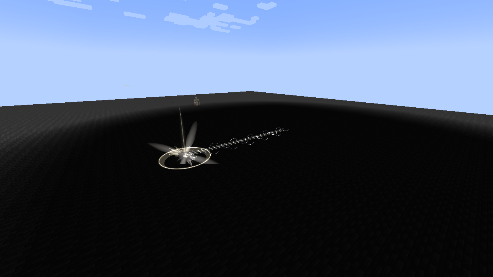

# Chained

[Main Page](../README.md) · [Unique Skills](Unique-Skills.md) · [Fettered Human](Fettered-Human.md)

**Chained** is an original interpretation inspired by Heavenly Restriction in **Jujutsu Kaisen**, implemented as the race-exclusive Unique Skill of the Heavenly Restriction lineage. Its binding pact exchanges magical growth and unrestricted skill acquisition for exceptional aura capacity, Battlewill training and physical combat. The true passive follows ownership; the combat bonuses use Tensura’s normal skill toggle.


| Skill data | Chained |
| --- | --- |
| **Information** | |
| Skill tier | Unique |
| Acquisition | Guaranteed intrinsic skill of Fettered Human only; retained through evolution |
| Normal reincarnation Unique pool | No; other reincarnation skills still roll normally |
| Maximum mastery | 1,000 |
| Active mode | Severance Rush |
| Resource | Aura |
| Damage type | Physical |
| Damage ID | `minecraft:mob_attack` |
| Toggle upkeep | None |

## Usage

### Heavenly Restriction

[Passive - True] — **Heavenly Restriction**

| Ability information | Value |
| --- | --- |
| Damage type | None |
| Damage ID | None |
| Activation | Owning the learned skill; independent of toggle and slots |

Chained trades magical growth and unrestricted skill learning for much greater aura capacity. These effects always apply while you own it:

- **5× aura growth:** later maximum-aura gains are multiplied by five. Your starting aura is not multiplied.
- **No maximum-magicule gains:** keep your existing capacity, but it cannot increase. Current magicules remain usable; costs and losses still apply.
- **Regeneration conversion:** keep normal **1× magicule regeneration** and redirect only the bonus above 1× into aura. Rates below 1× retain their penalties; sleep recovery stays with its normal resource.
- **Restricted learning:** you can gain Battlewills, resistances/nullifications, reincarnation-granted skills and their derived skills, and the lineage’s aura-recovery skills. Skills you already own are retained.
- **Aura-paid resistances:** acquiring resistances or nullifications spends the configured cost in current aura instead of permanent magicule capacity. Free grants stay free.

Blocked acquisition attempts show a red **“Chained blocks [skill]”** message explaining the allowed skill categories. Repeated attempts for the same skill are limited to one notice per second.

For example, reincarnating with **Martial Master** still lets you gain **Heavenly Eye**. Myths synthesis and Godly ascension are also allowed when every ingredient comes from your recorded reincarnation skills.

A fresh Fettered Human starts with **1,500–2,000 aura** and **50–100 magicules**: **1,550–2,100 EP**, before other reincarnation rewards. With no other modifiers, maximum aura is **starting aura + 5 × later gains**. This increases capacity, not your current aura balance.

EP growth splits **90% aura / 10% magicules**; Chained blocks the magicule share without redirecting it. Its bonus aura counts toward **total EP** in Status and evolution requirements. Native limits still apply. Secondary-race growth bonuses preserve this split; Convergent races use their own profiles.

### Martial Supremacy

[Passive - Toggle] — **Martial Supremacy**

| Ability information | Value |
| --- | --- |
| Damage type | None directly; strengthens Physical and Battlewill damage |
| Damage ID | None |
| Resource cost | None |

Enable Chained through Tensura’s normal Ability Selection toggle to gain:

| Effect | Bonus |
| --- | --- |
| Battlewill learning points | +9 |
| Battlewill mastery points | +9 |
| Resistance/Nullification learning points | +19 |
| Damage from Battlewill abilities | **5×**, takes priority over the Physical branch |
| Numeric Battlewill buff effectiveness | **3×**, except Aura Sword |
| Other outgoing Physical damage | **3×** |

Numeric buffs include native attribute bonuses, such as Diamond Path’s armor. **Aura Sword is excluded from the 3× buff-effectiveness bonus:** it adds its normal configured weapon-damage bonus. Each hit then uses its applicable outgoing damage branch. The bonus changes their numeric strength; buff duration, learning costs and resource-conversion rates keep their native values. Repeated refreshes do not multiply an already boosted buff again. Disabling Chained restores each tracked buff’s native amount.

Damage bonuses use **separate branches**: a hit sourced from a Battlewill ability receives **5×** damage, even if it is also Physical. Otherwise, Physical melee, projectiles and skills receive **3×**, including native damage converted to Physical. These multipliers **do not stack** and do not change your attack attribute. Aura Sword or Ogre Guillotine on an ordinary melee hit does not make that hit a Battlewill-ability source. Severance Rush is purely Physical and receives **3×**; non-Physical Battlewills receive **5×**, and unrelated elemental/magical damage gets neither bonus.

With a diamond sword and native default coefficients, Aura Slash deals **35 normally / 70 mastered**, before defenses and other modifiers. An ordinary 7-damage melee hit plus Aura Sword’s native 7-damage increment receives the Physical branch: **(7 + 7) × 3 = 42**, excluding racial attack bonuses and other modifiers.

### Broken Limit

[Passive - True - Mastered] — **Broken Limit**

| Ability information | Value |
| --- | --- |
| Damage type | None directly |
| Damage ID | None |
| Requirement | Chained mastered and owned; independent of toggle and slots |

Your own hits lower defensive skills by **one tier**: **Resistance → no resistance**, **Nullification → Resistance**. Numeric resistance attributes are bypassed for those hits. Attributable status effects use the corresponding lower-tier immunity rules. The target’s learned skills are retained. Native barriers, authority and other defenses continue to apply.

Your damage sources also **ignore dodge**, including projectiles attributed to you. Broken Limit is always active while you own mastered Chained, even with Chained toggled off and unequipped. Forgetting Chained removes it. Martial Supremacy’s damage/training bonuses still require the toggle.

### Unerring Body

[Passive - In-slot] — **Unerring Body**

| Ability information | Value |
| --- | --- |
| Damage type | None |
| Damage ID | None |
| Requirement | Chained equipped in the active ability preset |

Gain **100% dodge chance against projectiles** and **25% against other incoming damage**. The latter includes non-projectile magic and environmental hits. This passive works with Chained’s combat toggle off. Explicit source-level dodge bypass and operator/void-style invulnerability bypass still take priority; another mastered, enabled Chained owner can bypass it.

### Severance Rush

[Active - Press] — **Severance Rush**

| Ability information | Value |
| --- | --- |
| Damage type | Physical |
| Damage ID | `minecraft:mob_attack` |
| Resource cost | **2% of current aura**, paid once |
| Cooldown | **1 second** |
| Movement | Instant teleport with **16-block aim reach**; stops before an aimed enemy |
| Path damage radius | **3 blocks** |
| Arrival damage radius | **4 blocks** |

Use while **on the ground or in water**, like Martial Master’s movement art. An eye-level aim ray ignores fluids. Aiming at a hostile mob or eligible player stops the dash just in front of the nearest target, leaving room for your body. Targets behind blocks, allies and targets off the aim ray do not capture it. Block surfaces use Martial Master’s adjacent-block landing logic; aiming into open air uses the look direction from your feet, including slightly upward aim. If the preferred destination lacks room, the dash finds a closer forward landing and adjusts to actual terrain surfaces, including slabs and raised blocks. Low leaves or ceilings do not force the whole cast to fail when standing room remains. Fallback landings keep a clear eye path through the scene and stay clear of solid geometry. Very short safe stops at nearby enemies or walls are allowed. Your feet are never swept through the ground. The same activation resolves one hit along the route and an additional hit at the destination. A victim caught in both receives both hits, including inside the ordinary hurt cooldown. Each victim receives at most one path hit and one arrival hit.

If no safe forward landing is available, the cast spends no aura. Airborne activation and casts attempted during cooldown also spend no aura. Each successful press pays once and starts a **1-second cooldown**. The teleport is instant, not a timed channel or a movement-over-time attack.

Let **A** be the aura actually paid:

- **A = 0.02 × current aura**.
- **Path damage = 1.5 × √A**.
- **Arrival damage = 3 × √A**.

At **100,000 current aura**, the cast pays **2,000 aura** and has about **67.08 path damage** plus **134.16 arrival damage** before native handling. With Martial Supremacy enabled, those become about **201.25** and **402.49**. The formula uses actual aura spent, with no extra EP multiplier or mastery damage multiplier.

A brief chain separates into broken links along the route, with a pale pressure burst at arrival. The trail remains visible after the instantaneous teleport; it does not move the player over its lifetime.



## Obtaining and evolution

Select **Fettered Human** in the native reincarnation race menu. Only Fettered Human grants Chained. Normal evolution retains the existing skill and its mastery, but later stages do not grant or regrant it. Selecting a later stage directly does not award Chained. The lineage proceeds through four native-menu evolutions to [Heavenbreaker](Heavenbreaker.md). Chained is separate from the ordinary reincarnation Unique roll.

## Existing saves and recorded inheritance

Automatic inheritance tracking starts with version 0.32.0, including reincarnation rolls made before the player chooses this race. Previously owned skills are retained. The addon cannot infer the original source of every historical skill grant in an older save.

An operator can certify a known, already-owned reincarnation root with:

```text
/myths chained inherit <player> <skill_id>
```

For example: `/myths chained inherit PlayerName tensura:martial_master`. This requires permission level 2 and does not grant the named skill. Future native derived grants can then inherit its exemption.

---

**Categories:** Tensura Myths · Skills · Unique
