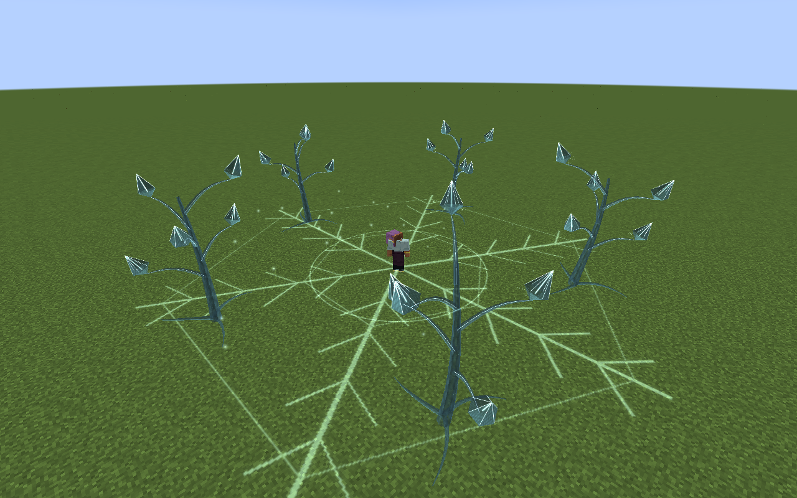

# Demeter, Lady of Sanctuary

[Main Page](../README.md) · [Skills](Skills.md) · [Ability index](Abilities.md) · [Damage types](Damage-Types.md)

**Demeter, Lady of Sanctuary** is an Ultimate Skill focused on **ice orchard, allied barriers and delayed crystal blooms**.

| Skill data | Demeter, Lady of Sanctuary |
| --- | --- |
| **Information** | |
| Type | Ultimate Skill |
| Combat role | Ice orchard, allied barriers and delayed crystal blooms |
| Active modes | 3 |
| Resource | Aura |
| Toggleable passive | Evergreen Sanctuary |
| Passive upkeep | 70 aura / second |
| Registry ID | `wildhunt:demeter` |
| **Obtaining** | |
| Method | Synthesis: master both ingredients; 2M base EP |
| **Evolution** | |
| Evolution | [Aion](Aion.md) or [Thoth](Thoth.md) |

## Usage

### Passive

[Passive - Toggle] — **Evergreen Sanctuary**

| Ability information | Value |
| --- | --- |
| Damage type | None — support / defense |
| Damage ID | — |
| Upkeep | 70 aura / second |

Gain 150% increased natural SHP regeneration and 0.6 knockback resistance. This sustains your position and spiritual recovery. Use Crystal Bulwark when your team needs a temporary barrier.

Enable the native skill toggle in Ability Selection. The first second is paid on enabling; upkeep is paid every twenty game ticks. It turns off when unfunded or blocked by native activation rules. Turning it off removes only its own modifiers. It is separate from active mode cycling.

### Active

| Mode | Aura | Cooldown | Raw damage |
| --- | ---: | ---: | --- |
| 1. Winter Orchard | 2,200 | 18 s | 140 per enemy pulse |
| 2. Crystal Bulwark | 1,800 | 16 s | — |
| 3. Winter Harvest | 4,000 | 20 s | 600; 900 when consuming a live orchard |

Damage listed here is before native combat handling and uses **1 + 0.5 × mastery fraction**, capped at **1.5×**. These new kits do not use the apex skills’ 0.90 multiplier or the former 3× Ultimate multiplier. EP never multiplies their damage. Native elemental boosts, authority, resistances, barriers and hit immunity apply.

#### Winter Orchard

[Active - Press] — **Winter Orchard**

| Ability information | Value |
| --- | --- |
| Damage type | Ice elemental against enemies; allied healing has no damage type |
| Damage ID | `tensura:ice_elemental` |
| Resource cost | 2,200 aura |
| Cooldown | 18 seconds |
| Raw damage | 140 per enemy pulse |

Plant a ten-block-radius crystal orchard within 32 blocks for ten seconds. Each second, heal up to eight allies for 7% maximum HP and 6% maximum SHP, and strike up to eight visible enemies for ice damage with native Chill II for two seconds. Healing respects the same ally/owned-pet rules as Living Grove. Only one orchard per owner.

#### Crystal Bulwark

[Active - Press] — **Crystal Bulwark**

| Ability information | Value |
| --- | --- |
| Damage type | None |
| Damage ID | — |
| Resource cost | 1,800 aura |
| Cooldown | 16 seconds |
| Raw damage | — |

Give yourself and up to seven nearby allies within twelve blocks an eight-second native ward: 50 Physical Barrier, 50 Magic Barrier and 500 Multilayer Barrier capacity. These wards appear in the native shield HUD. They have separate ownership and expire without removing other skills’ barriers. A broken ward is not repaired during its eight-second duration.

#### Winter Harvest

[Active - Press] — **Winter Harvest**

| Ability information | Value |
| --- | --- |
| Damage type | Ice elemental |
| Damage ID | `tensura:ice_elemental` |
| Resource cost | 4,000 aura |
| Cooldown | 20 seconds |
| Raw damage | 600; 900 when consuming a live orchard |

Select up to six enemy positions within twelve blocks of your orchard, or an aimed location within 32 blocks if no orchard is active. Consume the live orchard to empower the blooms. Each marked position erupts after 1.2 seconds in a three-block radius. Empty target areas create one central warning. Blooms remain fixed, so enemies can leave before impact.

## Obtaining

Open **Skills → Ultimate → Synthesis**. Choose Demeter and combine **[Verdant Keeper](Verdant-Keeper.md) + [Frostbound Colossus](Frostbound-Colossus.md)**, with both mastered and at least **2,000,000 base EP**. Any race can synthesize. Both ingredients are replaced only after native storage accepts the result. Other skills remain learned. All nine presets and the longest remaining ingredient cooldown carry over; the new Ultimate starts with its own mastery.

## Suggested combo

Set Winter Orchard beneath your team → lend Crystal Bulwark before a dangerous attack → consume the orchard with Winter Harvest when enemies commit to its area.

## Strengths and limitations

Harvest ends the orchard’s healing and pulse damage. Crystal Bulwark is your dedicated barrier art. Native barriers still need magicules to absorb attacks.

Attacks respect teams, owned pets, creative/spectator immunity and server PvP settings. Native status resistances apply. World effects are bounded, expire automatically and do not damage terrain. Anchored effects do not persist across death, relog or dimension changes.

## Related pages

[Skills](Skills.md) · [Skill synthesis](Skill-Synthesis.md) · [Damage types](Damage-Types.md) · [Mechanics](Mechanics.md)

## Visual effects

Winter Orchard grows an ice-veined grove with curved crystal branches, snowflake tips, roots and flowing restorative ripples. Crystal Bulwark uses six engraved faceted panels around its actual recipient. Winter Harvest first shows its frost warning, then opens into a large eight-petalled crystalline bloom at the strike.

[Visual effects gallery and display settings](Visual-Effects.md).

---

**Categories:** Tensura Myths · Skills
