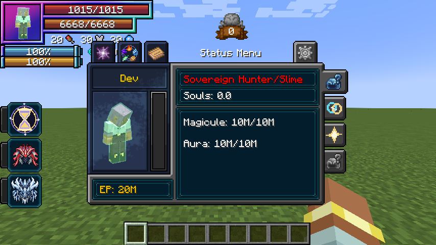
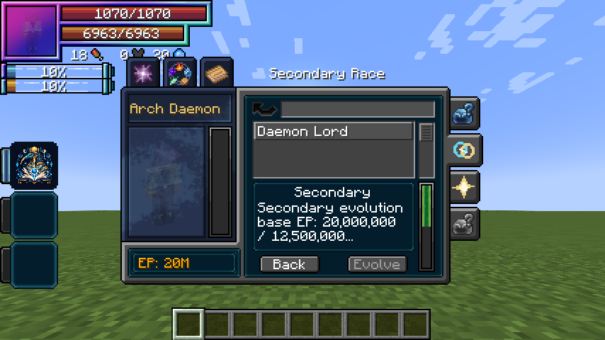

# Duo Races

[Main Page](../README.md) · [Races](Races.md) · [Ability index](Abilities.md) · [Damage types](Damage-Types.md)

**Duo Races** let an awakened player develop a second ancestral race alongside their primary race. The primary race retains the body, size and normal racial key. The secondary supplies half-strength shared attributes, its native intrinsic skills, racial reactions and a separate racial action.

## Obtaining

Open Tensura’s menu and select the **Secondary Race tab on the right**, directly below Status. `/myths` is an optional shortcut to that native page. All of these conditions are required:

| Requirement | Default |
| --- | --- |
| Primary evolution | Final stage: no next native evolution |
| Awakening | True Hero **or** True Demon Lord |
| Base EP | At least 5,000,000 |
| Secondary slot | Empty |
| Ancestry | Different from the primary family |

A Hero Egg or Demon Lord Seed alone does not qualify. Selection is permanent for the current life; the menu asks for a second click to confirm. Reincarnation or an external change of the primary race resets the Duo state. Ordinary death preserves it.

The supported native families are **Beastfolk, Harpy, Ogre, Goblin, Giant, Orc, Lizardman, Merfolk, Elf, Human, Dwarf, Slime, Vampire and Daemon**, plus **Wight**. Vampire starts as Ghoul, and Daemon starts as Lesser Daemon. The hunter branch belongs to Human. Other addons’ races are not automatically added to the catalog.

## Secondary evolution

The secondary starts at its native base race. Select its next stage from the **Secondary Race right-side tab**, inspect the native requirements in the tooltip, and choose **Evolve**. Native EP, awakening, mastery and other conditions are evaluated by the server. Scroll or hover the native requirements box for longer details.

Each secondary evolution has a **fixed stage threshold**, independent of the player’s current EP, EP at selection or EP when evolving:

**Required base EP = secondaryRaceEP + secondaryEvolutionEPStep × (completed secondary evolutions + 1)**

With defaults, the first evolution requires **7.5M**, the second **10M**, the third **12.5M**, and the fourth **15M** base EP. Choosing the secondary at 5M or 100M gives the same requirements. Native weighted evolution requirements must also be met. The menu and server share these fixed gates. Server owners can configure `secondaryRaceEP` and `secondaryEvolutionEPStep`.

Native branching remains available. If a chosen Goblin branch becomes an Oni, its recorded secondary ancestry remains Goblin for the eventual fusion. Secondary Human can also follow the hunter branch and earn its distinct boss credits.

Evolution replaces the secondary’s half-strength attribute contributions. It does not award a fresh starting energy pool. Shared attributes are HP, SHP, attack damage, armor, toughness, movement and knockback resistance. Energy caps, body size and appearance continue to belong to the primary until Convergent Awakening. Learned intrinsic skills use native skill storage; native learning rules can reject incompatible skills.

Assign **Secondary racial ability** under **Controls → Key Binds → Tensura Myths**. It starts unbound to avoid conflicts. Pressing, holding and releasing invoke the secondary’s native racial action with server-measured duration, native cooldowns and energy costs. The normal Tensura racial key continues to use the primary race.

## Evolution requirement checklist

The Secondary Race tab shows each candidate’s **live native requirement contribution**, whether it is met, and the additional base EP gate. The list updates while open without resetting the search, scroll position or a pending ancestry confirmation. The server checks the same native weighted progress when you choose Evolve.

Native requirements are **weighted**, with **100 points required**. They are not always an all-of checklist. In particular, Tensura 2.0.1.3 assigns Daemon Lord three contributions of 50 points each, so any two supply the required 100. This preserves the base mod’s alternatives.

### Daemon naming requirements

**Be named** means **you have received a name through Tensura’s naming system**. Naming other mobs, including mass-naming, does not satisfy it. A vanilla name tag or a display nickname also does not set the native name checked by this requirement. Receiving a native name counts for the secondary lineage without replacing the primary race.

| Secondary evolution | Native contributions | Required native total |
| --- | --- | --- |
| Arch Daemon → Daemon Lord | True Hero / True Demon Lord: 50; be named yourself: 50; physical body: 50 | 100 — any two |
| Daemon Lord → Devil Lord | True Hero / True Demon Lord: 50; be named yourself: 25; physical body: 25 | 100 — all three |

The physical-body check uses your actual body state; a spiritual form does not meet it. The added secondary EP gate is required separately. The fixed default thresholds are **7.5M** for Greater Daemon, **10M** for Arch Daemon, **12.5M** for Daemon Lord, and **15M** for Devil Lord, together with the applicable native conditions.

## EP gains

A secondary lineage grants **10% extra native kill EP gain**, preserving the current primary race’s aura/magicule proportions. Native gain attributes, caps and penalties still apply. The bonus and primary split remain the same as the secondary evolves. Saved energy is unchanged.

| Example | Before secondary | With secondary |
| --- | --- | --- |
| Default Human / Hunter | 6 aura / 3 magicules | **6.6 aura / 3.3 magicules** |
| Holy Divine Human | 3 aura / 6 magicules | **3.3 aura / 6.6 magicules** |

Convergent Awakening **inherits the 10% bonus**, applied to the fused race’s own growth profile.

## Status display

The native Status menu shows the current independent lineages as **Primary Race/Secondary Race**, for example **Sovereign Hunter/Slime**. Long labels scroll within the original race-name area and show their complete text on hover. After convergence, Status displays the unified race’s own name.

## Gallery

## Awakening

Once **both** races finish evolving, follow [Convergent Awakening](Convergent-Awakening.md). The [awakening EP requirement](Convergent-Awakening.md#ep-requirement) scales with the preceding native and secondary evolution gates. The new fused race uses its own EP profile and retains the 10% growth bonus.

---

**Categories:** Tensura Myths · Races
