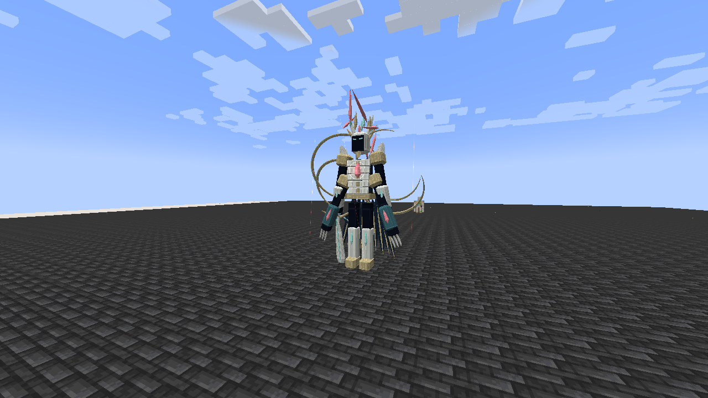
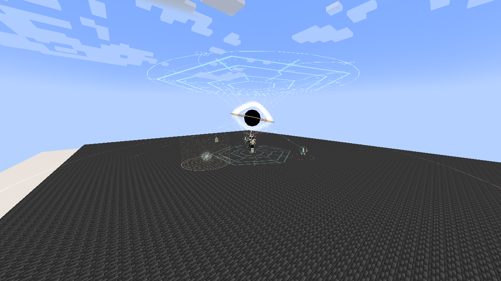

# Eschaton, the Last Myth

[Main Page](../README.md) · [Myth bosses](Bosses.md) · [Demiurge](Demiurge.md) · [Damage types](Damage-Types.md)

**Eschaton, the Last Myth** is the final boss of Tensura Myths. An Origin Sovereign with **one billion EP**, he commands the birth and destruction of worlds through Demiurge, Aion and Thoth. His creation seals turn overwhelming regeneration into a fight over finite resources.

| Boss data | Eschaton, the Last Myth |
| --- | --- |
| **Information** | |
| Race | [Origin Sovereign](Origin-Sovereign.md) |
| Classification | Final Myth; native True Demon Lord |
| Base / maximum EP | **1,000,000,000** |
| Aura / magicules | **500,000,000 / 500,000,000** |
| Maximum HP / SHP | **1,000,000 / 4,000,000** |
| Armor / toughness | 100 / 60 |
| Base melee damage | 2,600; native mob attack |
| Entity size | 2.6 blocks wide; 6.2 blocks tall |
| Entity ID | `wildhunt:eschaton` |
| **Skills** | |
| Signature Godly | [Demiurge, God of Genesis](Demiurge.md) |
| Auxiliary Godlies | [Aion](Aion.md), [Thoth](Thoth.md) |
| Learned package | 54 mastered skills |
| **Spawning** | |
| Survival | Last Convergence on a beacon |
| Natural spawning | None |
| Operator summon | `/myths boss eschaton summon` |

## Summoning

Craft **Last Convergence** (`wildhunt:last_convergence`):

| | | |
| --- | --- | --- |
| Beacon | Nether Star | Beacon |
| Dragon's Breath | Dawn Testament | Dragon's Breath |
| Beacon | Nether Star | Beacon |

The Dawn Testament is obtained from [Ananke](Ananke.md). Use the invitation on a beacon on Easy, Normal or Hard, with seven clear blocks above it and sufficient width. The invitation is consumed only after a successful summon; creative players retain it. The ritual fails if another living Eschaton is within 256 blocks. There is no player EP gate.

Prepare a broad, open arena, preferably more than 120 blocks across. The ritual uses the existing world and does not construct terrain. Spawn eggs and `/summon wildhunt:eschaton` also work for operators.

## Forms

| Form | Entry | Combat changes |
| --- | --- | --- |
| I — Origin Sovereign | Initial summon | Crownless Edge, Astral Loom, Sevenfold Genesis, Thronefall, exchange and apocalypse |
| II — Crown of Ruin | First fatal defeat that regeneration cannot prevent | Two additional arms and crescent mantle unfold; Null Testament and World-Eater's Wake join the rotation; Thoth auxiliary casts |
| III — The Last Myth | Second fatal defeat that regeneration cannot prevent | Seven crown blades awaken; fastest decisions; Aion auxiliary casts join Thoth |

**Infinite Regeneration takes priority.** Funded native regeneration can prevent death without spending a form. Once it fails to prevent a fatal HP or spiritual defeat, Eschaton advances and refills **HP, SHP, aura and magicules to their current maximums**. There are exactly two such revivals. A final fatal defeat after regeneration fails in form III ends the encounter.

The form change clears outstanding owned attacks and seals. It is triggered by fatal defeat, rather than a health percentage or elapsed time. Existing wounds, spent forms and resources survive saving and loading; interrupted warning sequences are cancelled on reload. Losing all valid targets for 20 seconds resets the encounter.

## Combat

Four bossbars at the upper right show **HP, SHP, magicules and aura**. Confirmed HP or SHP loss gives the model a red damage flash even with Pain Nullification. A nullified hit does not falsely flash.

Eschaton flies, pursues valid targets, uses paid collision-safe spatial movement and attacks at close range. Targets must remain within 112 blocks of his anchor. Repositioning stays within 96 blocks and costs 300,000 aura. In native arenas, unjoined players cannot damage him or be damaged by his arts.

### Demiurge

| Ability | Damage type | Pattern / counterplay |
| --- | --- | --- |
| [Crownless Edge](Demiurge.md#crownless-edge) | Physical Aura Slash | Three timed fans; the middle reverses direction |
| [Astral Loom](Demiurge.md#astral-loom) | Light elemental | Rotating rays with gaps between them |
| [Sevenfold Genesis](Demiurge.md#sevenfold-genesis) | Fire, Water, Lightning, Earth, Wind, Light, Space | Seven individually warned and locked impact locations |
| [Null Testament](Demiurge.md#null-testament) | Space elemental | Three parallel spatial corridors; successful hits can apply Godly Magic Interference |
| [World-Eater's Wake](Demiurge.md#world-eaters-wake) | Darkness elemental | Three expanding hollow fronts; two opposing golden gaps in each |
| [Primordial Exchange](Demiurge.md#primordial-exchange) | None | Paid aura-to-magicule conversion; interrupted channels lose their payment |
| [Thronefall](Demiurge.md#thronefall) | Earth elemental | Short ascent and a locked, warned landing zone |
| [The End of All Myths](Demiurge.md#the-end-of-all-myths) | Space elemental | Ten-second apocalypse; break seals to open refuges or interrupt it |

Exact damage, costs, warning times, hit geometry and cooldowns are listed in [Demiurge](Demiurge.md). Demiurge uses fixed encounter damage with native combat modifiers, rather than an EP damage multiplier.

### Creation seals

During **The End of All Myths**, up to three destructible **Genesis Seals** appear around Eschaton. Each has **120,000 HP**, its own hit feedback and a visible health percentage. They cannot be harvested for ordinary boss progression or loot.

Breaking one seal:

- Removes **50,000,000 current magicules** and **25,000,000 current aura** from Eschaton, down to zero.
- Opens a **golden refuge** at its location: seven blocks horizontally and ten blocks vertically from its center.
- Counts only once for that cast.

Break all three to **cancel the apocalypse** and stagger Eschaton for eight seconds. During that stagger, incoming damage is multiplied by **1.25**. Breaking fewer seals still drains his resources and provides refuges. If the warning completes, players can use a broken seal's refuge or leave the 56-block damage sphere. Attack light beyond that boundary is decorative.

Seals require collision-free, loaded space. In cramped terrain, unavailable positions are omitted and counted toward interruption, without creating a usable refuge at a missing location. Seals disappear when their cast ends, is cancelled, or their owner is removed.

### Auxiliary skills

From form II, Eschaton can weave Thoth's **Astral Library**, or **Spellbreak** when the library is unavailable, into some Demiurge casts. Form III adds Aion's **Genesis Verdict**, or **Event Horizon**. These are actual stored native skill activations with their own ordinary costs, cooldowns and targeting rules. They retain the damage types and mastered multipliers documented in [Thoth](Thoth.md) and [Aion](Aion.md).

### Native skill package

| Package | Skills / behavior |
| --- | --- |
| Godly | Demiurge, Aion, Thoth; all three mastered |
| Analysis and casting | Mathematician, Observer, Universal Perception, Thought Acceleration, Chant Annulment, Spatial Domination |
| Recovery | Native Infinite Regeneration, mastered and enabled |
| Defense | All 44 native Resistance and Nullification skills, mastered and enabled |

Thoth's passive is active. Aion's individual passive toggle is not active; its owned Godly classification and selected active arts still work. Godly classification grants the shared bonus against non-Godly owners, penetration for Eschaton's own damage and source-aware interference immunity. These traits do not stack for owning three Godlies.

His defenses can reject ordinary damage; a [Godly owner's own attacks](Godly.md) penetrate native resistance and nullification through the same rules as player skills. Armor, barriers, dodging and other native rules still apply. No artificial incoming damage cap or additional custom barrier protects him.

### Infinite Regeneration

Native Infinite Regeneration restores HP and SHP using magicules and can prevent eligible deaths while funded. Eschaton has **no passive aura or magicule regeneration**. Primordial Exchange converts a finite aura payment into magicules; breaking seals drains both reserves. Each fatal form transition refills them, so expect to exhaust the resource economy three times.

## Native boss arena

An operator can use `/myths boss eschaton arena` to prepare a native Tensura arena at their position. It supports eight joined players, a 96-block radius, a ten-second start delay and a 50-minute encounter timer. Join with `/bossFight join @s eschaton`. An existing arena of that name is not overwritten.

Ordinary ritual summons do not require this managed arena. Both approaches preserve native PvP, allied-target and participant checks.

## Rewards

A player-credited final kill drops:

| Reward | Amount / use |
| --- | --- |
| **Crown of the Last Myth** | One guaranteed; use once per player for **25,000,000 base EP** and permanent **+20% maximum HP and SHP** modifiers |
| **Origin Fragment** | 6–12; four plus a Nether Star craft Last Convergence; four plus a Ghast Tear and Dragon's Breath craft a Dawn Testament |
| Nether Star | 12–24 |
| The Last Myth advancement | Challenge advancement; 5,000 XP |

The crown preserves the player's native primary or convergent aura/magicule allocation ratio. Its permanent HP/SHP modifiers obey the player's normal native attribute limits. The benefit survives death and cannot stack; an already blessed player keeps an unused second crown. It does not grant Demiurge or the boss race.

Intermediate forms award no victory loot or boss-kill credit. Operator removal bypasses the form cycle and is not the intended victory route.

---

**Categories:** Tensura Myths · Bosses
