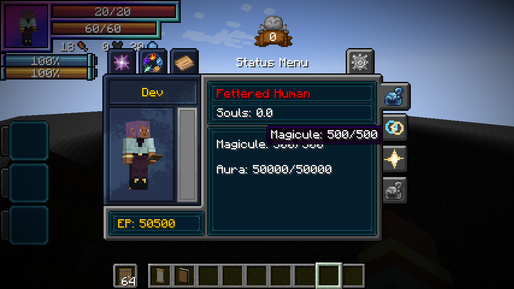

# Fettered Human

[Main Page](../README.md) · [Race directory](Races.md) · [Chained](Chained.md)

**Fettered Human** is the starting race of the **Heavenly Restriction** lineage. A human-looking martial body exchanges magical growth for exceptional physical and aura potential through its intrinsic Unique Skill, **Chained**.

| Race data | Fettered Human |
| --- | --- |
| **Information** | |
| Registry ID | `wildhunt:fettered_human` |
| Ancestry | Human |
| Stage | Starting race |
| Starting base aura | 1,500–2,000; unaffected by Chained |
| Starting base magicules | 50–100 |
| Starting EP | 1,550–2,100 before separate reincarnation rewards |
| Intrinsic Unique | [Chained](Chained.md) |
| HP racial bonus | +0 |
| SHP racial bonus | +0 |
| Attack bonus | +0 before Chained’s toggle multiplier |
| Movement bonus | +0% of base movement |
| Knockback resistance bonus | +0 |
| Previous evolution | None; selected at reincarnation |
| Next evolution | [Tempered Vessel](Tempered-Vessel.md) |

## Traits

You keep a human appearance and normal equipment. Each evolution replaces the previous stage’s bonuses.

EP growth splits **90% aura / 10% magicules**. [Chained](Chained.md#heavenly-restriction) multiplies later aura-capacity gains by **5×** and blocks magicule-capacity gains; the blocked share is not redirected. A fresh Fettered Human starts with **1,500–2,000 aura** and **50–100 magicules** (**1,550–2,100 EP** before other rewards). Starting aura is not multiplied.

[Chained](Chained.md) governs true resource/learning restrictions, the martial toggle, mastered resistance degradation, in-slot dodge and Severance Rush. The same skill and mastery persist through the lineage.

The native-client photograph uses staged resource values for visual review.

## Intrinsic skill

The intrinsic Unique [Chained](Chained.md) supplies the lineage’s true restriction and martial abilities. Its active [Severance Rush](Chained.md#severance-rush) is an instant teleport that deals native **Aura slash / Battlewill** damage (`tensura:aura_slash`). The race’s attribute bonuses are passive traits with no direct damage.

## Evolution

Select Fettered Human from Tensura’s native reincarnation race menu. It guarantees Chained and still permits the normal reincarnation skill roll. Progression is available in the normal native evolution menu.

Evolution checks **total EP**: effective maximum aura plus effective maximum magicules, as shown in Status. Chained’s bonus aura capacity counts. The milestones remain fixed constants, independent of the player’s EP when the lineage is selected.

| Stage | Fixed total EP | Mastered Battlewills | Chained mastery |
| --- | ---: | ---: | ---: |
| [Fettered Human](Fettered-Human.md) | Starting selection | — | — |
| [Tempered Vessel](Tempered-Vessel.md) | 100,000 | 1 | 20% |
| [Unshackled](Unshackled.md) | 500,000 | 2 | 40% |
| [Heavenly Restricted](Heavenly-Restricted.md) | 2,000,000 | 3 | 60% |
| [Heavenbreaker](Heavenbreaker.md) | 8,000,000 | 4 | 100% |

---

**Categories:** Tensura Myths · Races
