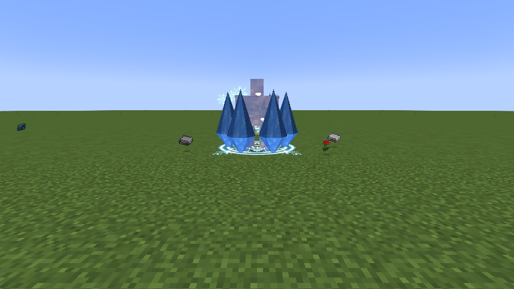

# Frostbound Colossus

> **Discontinued archive:** Tensura Myths ended at 0.36.1. No further updates are planned.

[All wikis](../README.md) · [Tensura Myths](Tensura-Myths.md)

Frostbound Colossus is a Unique Skill inspired by Jin Dahaad. It combines avalanche impacts, ice capture, and a defensive carapace.

| Skill data | Value |
| --- | --- |
| Tier | Unique |
| Damage type | Ice elemental |
| Passive upkeep | 40 aura / second |
| Obtaining | Reincarnation / starting skill roll |

## Active abilities

| Ability | Damage type / base damage | Cost | Cooldown |
| --- | --- | --- | --- |
| Avalanche Crash | Ice elemental · 320 | 700 aura | 3 s |
| Glacial Prison | Ice elemental · 180 | 1,100 aura | 7 s |

## Passive

Damage type: None — support / defense

While toggled on, gain 20 armor, 36 physical barrier, 13.5 magic barrier, one knockback resistance and 50% water-element boost. Tensura classifies ice under water for this boost.

## Avalanche Crash

Damage type: Ice elemental

Aim at a visible enemy up to 16 blocks away, or at the endpoint if no enemy is selected. Damage enemies in a 4-block radius and launch them upward and outward, respecting knockback resistance.

## Glacial Prison

Damage type: Ice elemental

Aim at one visible hostile within 20 blocks. Deal the listed hit damage, then apply Tensura’s native Frost effect for up to 4 seconds, subject to its rank and resistance checks.

## Related

[Skill synthesis](Skill-Synthesis.md) · [Godly Skills](Godly.md)

## Pictures and video

