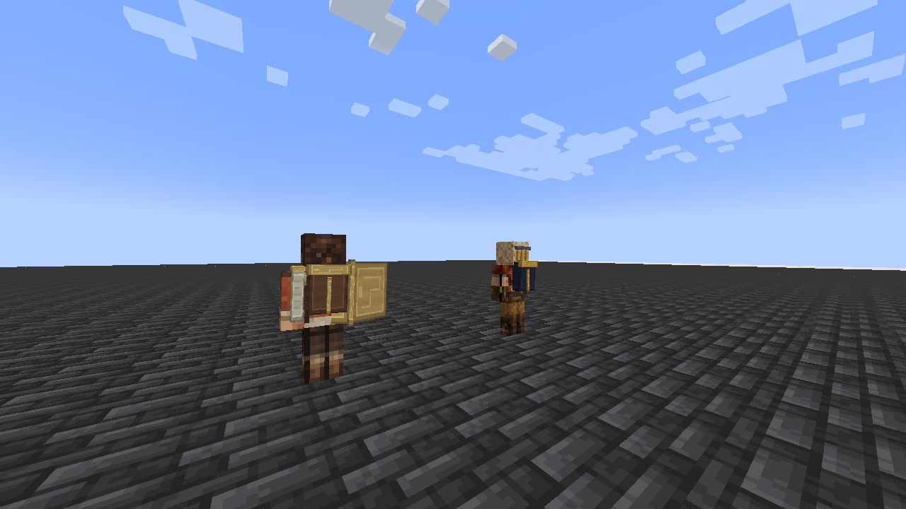

# Gemma

[All wikis](../README.md) · [Tensura Myths](Tensura-Myths.md)

Gemma is the expedition smith. Her skin follows the blonde hair, goggles, cropped brown jacket, cream top, utility belt and ochre work trousers of her base appearance.

| NPC data | Value |
| --- | --- |
| Origin | Monster Hunter Wilds |
| Race | Awakened Hunter |

## Spawning

Appears through Tensura’s normal **Otherworlder** spawning and summoning system. Gemma is an **Awakened Hunter** with **160,000 aura and 80,000 magicules** before other modifiers.

[Otherworlders](Otherworlders.md) · [Operator summon commands](Commands.md).

## Abilities

| Skill | Damage / role |
| --- | --- |
| Godly Craftsman | None — crafting (native Unique Skill) |
| Analytical Appraisal | None — analysis / perception |
| All Seeing Eye | None — analysis / perception |
| Strengthen Body | None directly — physical attribute enhancement |
| Steel Strength | None directly — physical attribute enhancement |
| Flame Manipulation | Fire — native `tensura:flame_breath`; conditional black-flame breath / burning |
| Ultraspeed Regeneration | None — healing |

## Related

[In-game guide](In-Game-Guide.md)

## Pictures and video

