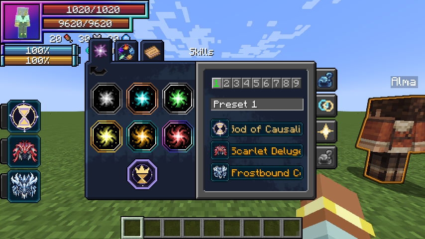
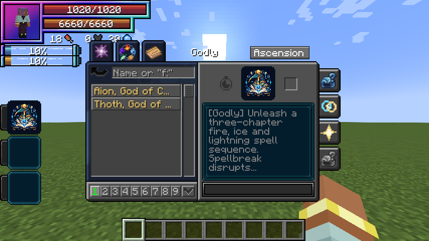

# Godly Skills

[Main Page](../README.md) · [Skills](Skills.md) · [Ability index](Abilities.md) · [Damage types](Damage-Types.md)

**Godly** is Tensura Myths’ skill tier above Ultimate. It appears as **Godly** in Tensura’s skill menu, alongside the six original categories. Its native classification remains **Ultimate** so native skill storage, combat authority, presets, toggles and commands continue to recognize it.

## Classification

| Classification | Value |
| --- | --- |
| Displayed addon tier | Godly |
| Native skill type | Ultimate |
| Native tag | `tensura:ultimate_skills` |
| Additional tag | `wildhunt:godly_skills` |
| Current skills | [Aion, God of Causality](Aion.md); [Thoth, God of Magic](Thoth.md) |

Godly skills appear in their own category instead of being duplicated in the ordinary Ultimate list. Other mods that only inspect the native type see an Ultimate. They do not automatically recognize the addon’s extra tier or grant it additional authority. The addon does not give Godly skills blanket immunity to other skills.

## Obtaining

Master one of the addon’s [three combination Ultimates](Ultimate-Skills.md), become a True Hero or True Demon Lord and reach **12,000,000 base EP**. Open **Skills → Godly → Ascension**, select your mastered Ultimate and choose **Aion** or **Thoth** with the destination button. Thoth additionally requires a mastered [Rune Smith](Rune-Smith.md), which is combined into the result.

The chosen Ultimate is replaced; Thoth also replaces Rune Smith. All nine presets retain references to the evolved skill; its longest remaining cooldown carries to all four new modes. Godly ascension is separate from Duo Races and does not require a fusion. It is not a reincarnation roll, does not consume EP and grants no free magicule or aura pool.

## Controls

Open Tensura’s **Skills** categories and select **Godly**. Equip modes and toggle the passive using the native Ability Selection interface. The four active modes cycle with the normal Tensura controls.

The server’s `godlyEP` setting controls the default EP gate. Registry IDs are `wildhunt:aion` and `wildhunt:thoth`. Owning either does not prevent earning the other with another valid source.

## Gallery

---

**Categories:** Tensura Myths · Skills
