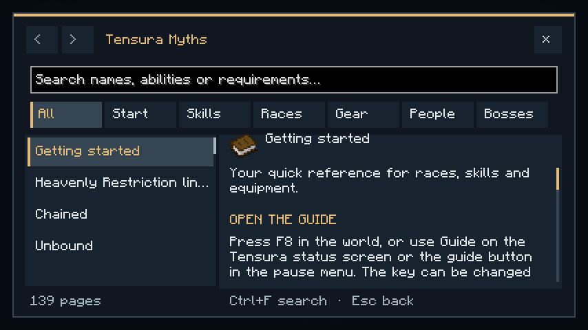
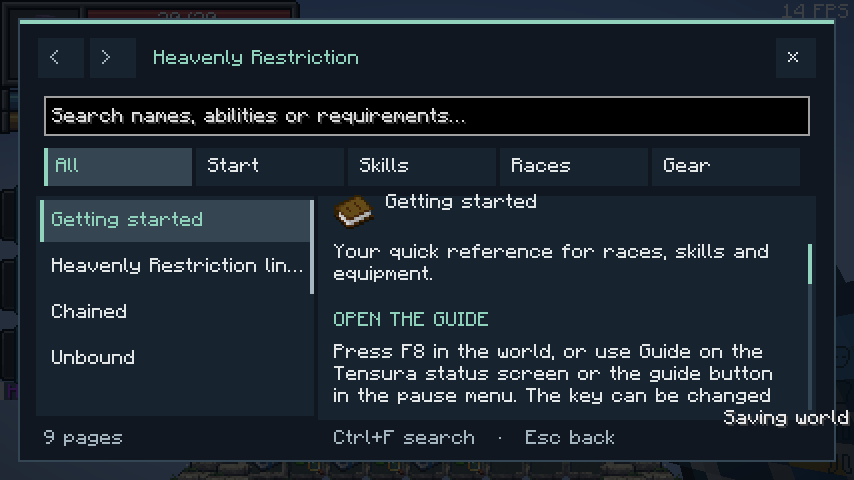

# In-game guide

[Main Page](../README.md) · [Getting Started](Getting-Started.md)

Open the offline guide with **F8** while playing. You can change this key under **Controls → Key Binds**. The pause menu also has **Myths Guide** or **Additions Guide**, and Tensura’s status page has a **Guide** button below the panel.

The Myths guide covers skills, hunter and Heavenly Restriction progression, secondary races, the individual Convergent races, equipment, otherworlders and bosses. The standalone guide contains its lineage, Chained/Unbound, Schema, movement Battlewills, recovery and the spear.

## Search and navigation

- Search names, abilities, damage types or requirements. Multiple words narrow the results.
- Use categories to browse. Core topics appear before advanced race combinations.
- Scroll the page list and article independently; both scrollbars can be dragged.
- Use the arrows for page history and the links at the end of an article for related topics.
- **Ctrl+F** focuses search. **Page Up/Down** scroll the article. **Esc** returns to the previous screen.

Command shortcuts: **`/mythsguide`** in Myths, **`/restrictionguide`** in the standalone. The guide works without a web connection or an additional guidebook mod. It pauses a local single-player game; multiplayer continues normally.

Pages show default gameplay values. Server settings and bonuses can change them. The guide reads no private player data and does not grant items, skills or stats.

