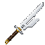

# Inverted Spear of Heaven

> **Discontinued archive:** Tensura Myths ended at 0.36.1. No further updates are planned.

[All wikis](../README.md) · [Tensura Myths](Tensura-Myths.md)

A rare weapon from ominous trial vault loot, with the same attack stats as a Hihiirokane Sword.

## Stats and obtaining

80 total ordinary player attack damage; 1.6 attack speed. Rare 2% additional ominous-vault reward. Regular vaults do not drop it.

## Nullification engraving

Weapon hits instantly shatter barriers, remove skill status effects, and prevent skill activation for 2 seconds. The weapon can attack Spiritual Entities.

Held main-hand attacks, Severance Rush and Counter carry the engraving. Spiritual contact bypasses the spiritual-body Physical reduction, while armor, resistance, dodge and PvP rules still apply.

## Related

[Chained](Chained.md) · [Unbound](Unbound.md)
